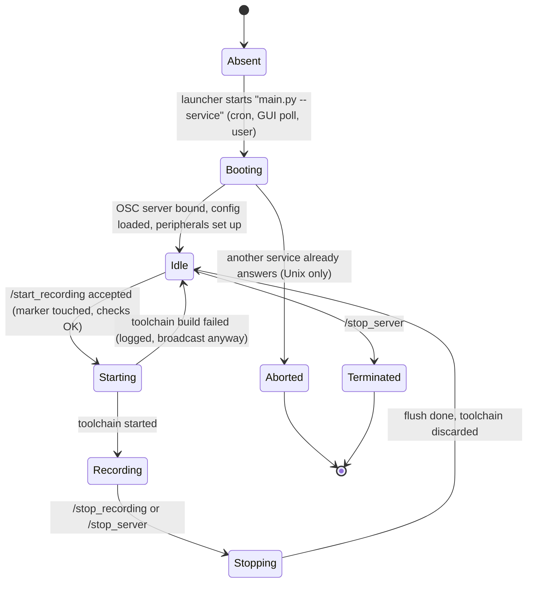
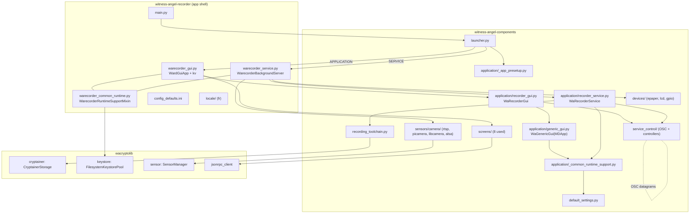

# 01 - Architecture and platform specification

Witness Angel Recorder, version 1.0 (`REC/pyproject.toml:9`; the `CHANGELOG` still says "Version 0.1", see [OI-97](05-open-issues.md#oi-97)), a Kivy/KivyMD application plus a background recording service, in the repository `witness-angel-recorder` (main @ `bbf5d17`).

Sibling files: [02](02-ux-and-screens.md) (screens, labels, dialogs, journeys), [03](03-business-logic.md) (domain, recording toolchain, sensors, cryptainer lifecycle, purge, decryption flows, state machines), [04](04-data-and-protocols.md) (cryptoconf, cryptainer format, on-disk layout of keystores and cryptainers, gateway JSON-RPC, ffmpeg/RTSP command lines, OSC message payloads), [05](05-open-issues.md) (consolidated open issues).

Normative tags (**MUST / SHOULD / MAY / INFO**) and citation prefixes (`REC/`, `COMP/`, `CRYPTO/`, `SERVER/`, `AUTHSPEC/`) are defined once in the [README](README.md#normative-language) ([source baseline](README.md#source-baseline-and-citation-prefixes)). Untagged text describes the 1.0 behaviour; bugs are never requirements.

This file owns: the process model (GUI plus service), the local control channel, the app lifecycle, logging, the **configuration file and every setting**, storage roots per OS, platform specifics (Raspberry Pi, Android, safe-area insets), i18n mechanics, packaging, Raspberry Pi provisioning, and the mapping to `waflet_components`. Message payloads on the control channel are in [04](04-data-and-protocols.md); the recording state machine is in [03](03-business-logic.md); screens are in [02](02-ux-and-screens.md).

Structure:

- Part A (sections 1-13): requirements, written framework-neutrally. A reimplementation must keep them.
- Part B (sections 14-19): incidental Kivy/KivyMD/PyInstaller/ansible details, for traceability.
- Open issues are in [05](05-open-issues.md); this file links to them as `OI-nn`.

---

# PART A - Requirements a reimplementation must keep

## 1. Purpose, scope, actors

### 1.1 Purpose
A cross-platform "write-only" recorder (`REC/Readme.rst:4-8`). It continuously records media (RTSP/IP camera streams everywhere; Raspberry Pi camera and microphone on a Pi) and encrypts each recorded chunk into a **cryptainer** with the "Flightbox" cryptosystem. Only the agreement of a sufficient number of trusted third parties, the **key guardians** (cryptolib "trustees" of type authenticator), allows decryption later. The app also lets its operator:

- import and select the key guardians to use (fetched from the Witness Angel gateway, or read from an authdevice);
- manage the stored cryptainers;
- attempt a decryption of cryptainers, locally or through "revelation requests" sent to the guardians via the gateway.

Screens and flows: [02](02-ux-and-screens.md). Domain rules: [03](03-business-logic.md).

### 1.2 Actors

| Actor | Role | Evidence |
|---|---|---|
| Recorder operator | Owns the device or PC, configures sensors, picks key guardians, starts and stops recording, manages cryptainers. The only user of the GUI. | `REC/Readme.rst:6-10` |
| Key guardian (trustee) | Holds a private key (in an Authenticator app folder). Never uses the Recorder. The Recorder only holds their **public** keys, imported into the keystore pool, and encrypts shards to them. | `REC/warecorder/warecorder_service.py:224-251` |
| Claimant / requestor | Role the operator plays when decrypting: the Recorder creates a revelation request, the gateway relays it to guardians, the guardians answer. Same screens, same app. | `REC/warecorder/warecorder_gui.kv:40-50` |
| Witness Angel gateway | Remote JSON-RPC registry of published authenticators and mailbox of revelation requests. Default `https://api.witnessangel.com/gateway/jsonrpc/` (setting `network.wagateway_url`). Used only by the GUI process. | `REC/warecorder/config_defaults.ini:52`, `COMP/application/_common_runtime_support.py:192-195` |
| Recorded IP camera | RTSP source, `sensor.ip_camera_url`. The device also acts as NTP server for it on the Pi image (section 10). | `REC/warecorder/config_defaults.ini:12` |
| Crash-report endpoint | `https://api.witnessangel.com/support/crashdumps/`, hardcoded, mobile only (section 5.3). | `COMP/launcher.py:69-71` |
| System integrator | Prepares Raspberry Pi images with the ansible playbooks (section 10). | `REC/ansible/README.md` |

### 1.3 Position in the ecosystem and scope boundaries

- The Recorder is the data-producing side. Its counterpart is the Authenticator app ([AUTHSPEC](../../witness-angel-authenticator/specifications/README.md)), which holds the private keys.
- The Recorder app shell (`REC/warecorder/`) is about 1100 lines. Almost everything else lives in `COMP` (screens, sensors, devices, service base class, service control) and `CRYPTO` (cryptainer storage, keystores, sensors manager, gateway client). The reimplementation MUST include equivalents of the `COMP` parts it needs (section 13).
- `COMP` also contains the five Authenticator screens (`COMP/screens/base.py:22-27`). They are not used by the Recorder, whose root layout instantiates eight screens only (`REC/warecorder/warecorder_gui.kv:20-52`). Exception: the Recorder reuses `LanguageSwitcherScreenMixin` and widgets.
- Out of scope of this file: sensor internals, ffmpeg command lines ([03](03-business-logic.md), [04](04-data-and-protocols.md)).

### 1.4 Deployment targets

| Target | Status in this repository | Requirement for a reimplementation |
|---|---|---|
| Linux, Windows, macOS desktop | Run from source (`python main.py`) or PyInstaller one-file executable (`REC/pyinstaller.spec`). Only IP-camera (RTSP, via an external `ffmpeg`) recording is available. | **MUST** support. |
| Raspberry Pi OS (headless or with display) | Primary product ("Witness Angel handbag", `REC/Readme.rst:11-14`). Adds local camera, local microphone, e-paper and LCD displays, GPIO and Pimoroni buttons, boot-time service start. Provisioned with ansible (section 10). | **MUST** support (service without GUI is the normal mode). Which Pi models and OS stay supported, and how the operator GUI reaches them, is the pending decision [OI-102](05-open-issues.md#oi-102): the planned Flet desktop client runs on x64/arm64 Linux only. |
| Android | `COMP` contains Android code paths (Java service start, foreground notification, insets), but this repository has **no** `buildozer.spec`, no service definition, and the Android service controller imports a constant that does not exist ([OI-01](05-open-issues.md#oi-01)). The last commit nevertheless adds Android insets handling (`REC/warecorder/warecorder_gui.py:130-137`). | **MAY** be dropped. Decide before starting ([05](05-open-issues.md)). If kept, section 8.3 lists what exists. |
| iOS | No iOS code in the Recorder (`IS_IOS` appears only in the shared path logic). | **MAY** be ignored. |

Python support: `>=3.9, <3.14` (`REC/pyproject.toml:33`). Resolved GUI stack in the lockfile: Kivy 2.3.0, KivyMD 1.2.0.dev0 (commit zip `1152d3c312`), oscpy 0.6.0, pycryptodome 3.20.0, psutil 5.9.8, Pillow 10.2.0, PyInstaller 6.16.0 (`REC/poetry.lock`).

## 2. Process model

### 2.1 Two processes
The product is two cooperating OS processes started from the same entry point `REC/main.py`:

| Process | Entry | Role | Runs a GUI |
|---|---|---|---|
| **GUI process** ("foreground app") | `python main.py` | Settings, key-guardian and cryptainer management, decryption screens, start/stop button, status and preview image. Class `WardGuiApp` (`REC/warecorder/warecorder_gui.py:40`). | Yes |
| **Service process** ("background service", "recorder service") | `python main.py --service` | Builds and runs the recording toolchain (sensors, encryption, storage, purge), drives e-paper/LCD displays and buttons on a Pi. Class `WarecorderBackgroundServer` (`REC/warecorder/warecorder_service.py:42`). | No (it deliberately poisons `kivymd.uix` at start so that loading a GUI fails early, `COMP/launcher.py:55`) |

Design rules:

- **MUST**: recording continues when the GUI is closed or crashes. The GUI returns `True` from `should_daemonize_service()` (`REC/warecorder/warecorder_gui.py:123-125`), so closing it does not stop the service (`COMP/application/recorder_gui.py:88-95`).
- **MUST**: the service runs without any display, graphical session or GUI library, for example from cron on a headless Pi (section 10).
- **MUST**: at most one service instance per user data root is intended to be effective ([OI-04](05-open-issues.md#oi-04) lists the current races).
- The GUI is a controller and viewer. It never records. The service never presents UI.

### 2.2 Starting and stopping the service

**Desktop and Raspberry Pi (subprocess controller)**, `COMP/service_control/_subprocess_service_controller.py`:

1. The launcher (`COMP/launcher.py:79-93`) sets the env var `WA_SERVICE_SCRIPT` unless it already exists. Frozen build (`sys.frozen`): value `--service` (the executable itself is relaunched). Source run: `<abs path of main.py>|--service`.
2. `start_service()` splits `WA_SERVICE_SCRIPT` on `|`, builds `[sys.executable] + params`, uses `cwd = dirname(params[0])` (or none) and calls `subprocess.Popen(command, shell=False, cwd=cwd)` (`:24-31`). No detaching flags: the child stays in the GUI's process group and console ([OI-03](05-open-issues.md#oi-03)).
3. `stop_service()` sends the control message `/stop_server`, then, only if this GUI spawned the service, waits `10 * WAIT_TIME_MULTIPLIER` seconds (10 on a PC, 40 on a Pi) and kills it on timeout (`:33-40`). If the service was started elsewhere (cron, earlier GUI), `_subprocess` is `None` and the GUI just sends the message.
4. The service also starts without the GUI (`python main.py --service`); the launcher aborts with a console message if another service already answers (section 4.1).

**Android controller** (`COMP/service_control/_android_service_controller.py`): `start_service()` calls the Java `start(activity, "")` method of a service class named by `SERVICE_CLASS`; `stop_service()` only sends `/stop_server`. `SERVICE_CLASS` is not defined in `COMP/default_settings.py`, so this module fails at import ([OI-01](05-open-issues.md#oi-01)). `default_settings.ANDROID_ACTIVITY_CLASS = "org.kivy.android.PythonActivity"`, `SERVICE_START_ARGUMENT = ""` (`COMP/default_settings.py:16-17`).

**Requirement (MUST)**: a controller abstraction with `start_service()`, `stop_service()` (graceful, bounded wait, then kill) and the control commands of 2.3.
**SHOULD**: spawn the service detached from the GUI (new session / `DETACHED_PROCESS`), so that closing a terminal or pressing Ctrl-C in the GUI's console does not kill it.

The GUI exposes a "Reset background service" toolbar button on the home screen. It calls `force_stop_service()`: `stop_service()` on the UI thread, then disables the record button (`COMP/screens/recorder_homepage.kv:16`, `COMP/application/recorder_gui.py:97-100`). The periodic poll (2.3) restarts the service afterwards (4.4). While the service shuts down it stops any recording and **removes the recording marker** (2.4).

### 2.3 Local control channel (OSC)

Mechanism owned here, exact message payloads in [04](04-data-and-protocols.md).

- Library: `oscpy` 0.6.0 (`REC/pyproject.toml:45`). Messages are OSC datagrams with UTF-8 strings, fire-and-forget, no acknowledgement and no authentication. `safer=True` only adds a 10 ns sleep after sending.
- Two **listeners**, one per process, each bound to its own socket. Index 0 is the GUI ("application"), index 1 is the service (`COMP/service_control/_osc_transport.py:32-38, 41-63`):

| Socket index | Owner | Windows | Linux, macOS, Pi |
|---|---|---|---|
| 0 | GUI | UDP `127.0.0.1:6420` | Unix datagram socket `<INTERNAL_APP_ROOT>/.witnessangel0.sock` |
| 1 | Service | UDP `127.0.0.1:6421` | Unix datagram socket `<INTERNAL_APP_ROOT>/.witnessangel1.sock` |

- Before binding a Unix socket, the listener **deletes** an existing socket file of the same name, "else Address already in use" (`:55-60`).
- The client side opens an unconnected datagram socket per controller and sends to the peer's address. A refused connection or a missing socket file is swallowed (the peer is simply not there yet) (`COMP/service_control/_base_service_controller.py:19-27`, `COMP/application/recorder_service.py:117-126`).
- The listener thread runs forever and survives exceptions (`RobustOSCThreadServer`, `:21-25`). Unknown addresses go to a default handler, which is itself buggy ([OI-08](05-open-issues.md#oi-08)).
- Maximum datagram size: the server reads 65535 bytes.

Messages: `/ping`, `/start_recording`, `/stop_recording`, `/broadcast_recording_state` (the GUI's heartbeat), `/switch_daemonize_service`, `/stop_server` (GUI to service); `/receive_recording_state` (the **ternary** state: recording, idle, or `""` = start/stop in progress, since OSC has no null) and `/log_output` (service to GUI). Arguments, OSC type tags and byte-exact examples: [04 §11](04-data-and-protocols.md#11-osc-messages-gui--service). Semantics of the recording commands: [03 §4](03-business-logic.md#4-recording-service).

Requirements:

- **MUST**: keep the command set and the ternary state semantics. **MUST**: every command is idempotent: the GUI re-sends start/stop when it merely mirrors a state change broadcast by the service ("Let it propagate anyway, the service will just ignore the duplicated command", `COMP/application/recorder_gui.py:102-111`).
- **MAY** change the transport (for example a different local IPC), because both ends are re-implemented together. **SHOULD** then also change the socket and port names, so that a reimplemented GUI cannot talk to an old service left running in the same `~/.witnessangel` folder, and vice versa.
- **SHOULD** authenticate or protect the channel (Unix socket permissions, per-user port): any local process can currently stop the recording ([OI-06](05-open-issues.md#oi-06), decide).

### 2.4 Other inter-process channels
Besides OSC, the two processes share state through the filesystem. These are part of the architecture:

| Channel | Writer | Reader | Detail |
|---|---|---|---|
| Config file `warecorder_config.ini` | GUI (on each setting change and on key-guardian selection) | Service (re-read at each `/start_recording`) | Section 6. Not atomic ([OI-33](05-open-issues.md#oi-33)). |
| **Recording marker** `<INTERNAL_APP_ROOT>/recording_in_progress` | Service: `touch` when a start is requested (before any validation), removed by a stop request | Service at boot: if present, start recording automatically | Gives "autorecord after reboot, power loss, or crash" (`COMP/default_settings.py:134`, `COMP/application/recorder_service.py:194-201, 249-259`, `REC/warecorder/warecorder_service.py:56-57`). **MUST** be kept as a feature. See [OI-14](05-open-issues.md#oi-14). |
| Preview image `<INTERNAL_CACHE_DIR>/video_preview_image.jpg` | Sensors in the service (first frame of each chunk) | GUI (reloaded every 15 s, no freshness check), e-paper/LCD (service) | `REC/warecorder/warecorder_common_runtime.py:28`, `REC/warecorder/warecorder_gui.py:64-76, 166-169`. |
| Keystore pool dir and cryptainer dir | GUI (guardian import, decryption) | Service (encrypts to the pool's public keys, writes cryptainers) | Section 7; formats in [04](04-data-and-protocols.md). |
| Log file `logs/log.txt` | Both | Operators | Section 5. |

### 2.5 Service process lifecycle



- Boot: if the marker exists, the service calls `start_recording()` itself from `__init__` (`REC/warecorder/warecorder_service.py:56-57`).
- `Starting` and `Stopping` are the states of [03 §4.2](03-business-logic.md#42-service-recording-state-machine), both represented by the flag `_status_change_in_progress`. While set, further start/stop commands are ignored (not queued) and the broadcast state is `""` (`COMP/application/recorder_service.py:249-262, 215-226`). It is a plain boolean without a lock.
- After a stop, the toolchain object is thrown away: the next start rebuilds it from a freshly re-read configuration. A start while recording is a no-op; a leftover toolchain that is not running (left by a start whose sensor start raised after the build) is restarted as is, without rebuilding it or re-reading the configuration (`COMP/application/recorder_service.py:156-167`; see [03 §4.3](03-business-logic.md#43-start-recording)). This is why settings "might only apply at next recording restart" (`COMP/application/recorder_gui.py:50-54`).
- A start request first touches the marker, then re-reads the config and runs the status checkers; if they fail the service logs the messages and returns **without** broadcasting (`:192-204`). The recording marker therefore remains ([OI-14](05-open-issues.md#oi-14)).
- Shutdown (`/stop_server`): stop recording with `force=True`, wait on its future up to 30 s, `osc.stop_all()`, set the termination event; `main()` then returns and the process exits (`:264-276`, `REC/warecorder/warecorder_service.py:416-420`). If the 30 s wait raises, the shutdown aborts half-way ([OI-05](05-open-issues.md#oi-05)).
- Android only: starting a recording promotes the service to a foreground service with a notification ("Sensors are active" / "Click to manage Witness Angel state"), stopping removes it (`COMP/application/recorder_service.py:165-177, 232-236`).

### 2.6 Requirements summary for the process model

1. **MUST** provide: GUI and service as separate processes sharing one data root; graceful stop that flushes the last chunk and waits for encryption workers to finish (`wait_for_idle_state`, `COMP/recording_toolchain.py:61`); autorecord resume from the marker.
2. **MUST** make the GUI resilient to a missing, restarting or non-answering service (section 4.4).
3. **SHOULD** prevent two simultaneous services robustly (lock file or exclusive bind, no blind unlink).
4. **SHOULD** make the GUI's stop wait at least as long as the service's own flush timeout ([OI-02](05-open-issues.md#oi-02)).

## 3. Threading model

GUI process:

| Thread | Content |
|---|---|
| UI (Kivy main) | All widget access, the 2 s state poll (`Clock.schedule_interval`), the 15 s preview refresh, status-checker execution (including `ffmpeg -version`, see [OI-37](05-open-issues.md#oi-37)), `force_stop_service()` (blocks up to 10 s, [OI-13](05-open-issues.md#oi-13)). |
| OSC listener (daemon) | Receives `/receive_recording_state` and `/log_output`; handlers do nothing but `Clock.schedule_once` onto the UI thread (`COMP/application/generic_gui.py:114-119`, `recorder_gui.py:141-146`). |
| Single worker | `MONOTHREAD_POOL_EXECUTOR`, one thread, tasks queued, "to avoid concurrency" (`COMP/utilities/__init__.py:26-28`; the thread prefix `authenticator_keygen_worker` is a leftover name). Runs `_offload_task_with_spinner` jobs: show spinner, run task, callback on UI thread, always hide spinner; unhandled exceptions are logged and shown as snackbar "Abnormal error caught: <ExceptionClassName>" (`COMP/application/generic_gui.py:121-136`, `COMP/widgets/popups.py:46-58`). |

Service process:

| Thread | Content |
|---|---|
| Main | Blocks on `InterruptableEvent.wait()` (polls every 0.1 s so Ctrl-C works on Windows) until shutdown (`COMP/utilities/__init__.py:31-40`, `COMP/application/recorder_service.py:278-283`). |
| OSC listener (daemon) | Runs the command handlers. They must stay short: they only set flags and submit work. `stop_server` is the exception, it blocks here up to 30 s. |
| Single worker | The same `MONOTHREAD_POOL_EXECUTOR`: start and stop of the toolchain, daemonize switch, LED blinks and LCD image updates (`REC/warecorder/warecorder_service.py:122-144`). A long start delays LED/LCD feedback, and vice versa. |
| Sensor threads | Created by `SensorManager` and the sensors (periodic ffmpeg subprocess recorders, picamera, arecord) ([03](03-business-logic.md)). |
| Cryptainer storage workers | `CryptainerStorage(max_workers=1)`, "protect memory usage" (`REC/warecorder/warecorder_service.py:278-283`). |
| GPIO callback threads | `RPi.GPIO` event detection, falling edge, debounce 1000 ms (`COMP/devices/gpio_buttons.py:28-31`). Callbacks run `_epaper_switch_recording_callback` and `_epaper_status_refresh_callback` under a class-level mutex (`REC/warecorder/warecorder_service.py:49, 192-213`). The switch callback has no exception guard. |

Requirements:

- **MUST**: the UI thread never performs file-system scans, subprocess waits or network calls of unbounded duration. 1.0 breaks this in the places marked above; a reimplementation **SHOULD** run the status checkers and `stop_service()` off the UI thread.
- **MUST**: all service commands are non-blocking for the OSC receiver (except as in [OI-05](05-open-issues.md#oi-05)) and executed in order on one worker.
- **MUST**: UI updates from any non-UI thread are marshalled to the UI thread.

## 4. Application lifecycle

### 4.1 Launcher (`COMP/launcher.py`)

`REC/main.py` (9 lines) calls `launch_app_or_resurrect_service_with_crash_handler(app_module="warecorder.warecorder_gui", service_module="warecorder.warecorder_service", main_file=__file__, sys_argv=sys.argv)` under `__main__`.

1. If `--service` is in `sys.argv`: `launch_main_module_with_crash_handler(service_module, "SERVICE")`.
2. Else: ensure `WA_SERVICE_SCRIPT` (2.2), then `launch_main_module_with_crash_handler(app_module, "APPLICATION")`.
3. `launch_main_module_with_crash_handler` (`:41-76`): runs `setup_app_environment(setup_kivy_gui=(client_type == "APPLICATION"))` (section 14.2); for a SERVICE it then poisons `kivymd.uix` and runs the **liveness probe** `_is_service_alive()`; imports the main module (this is what loads paths and config) and calls `main()`; on Android only, catches exceptions, uploads a crash report and re-raises (section 5.3).
4. Liveness probe (`:18-38`): builds a client to the service socket. On Unix only, it `connect()`s the Unix socket; success means alive, `ConnectionRefusedError`/`FileNotFoundError` means dead. On Windows it always answers "not alive" and relies on the failure to bind port 6421 ([OI-04](05-open-issues.md#oi-04)). If alive, the new process prints ">>> <datetime> - Witness Angel Recorder service already started and listening on its UNIX socket, aborting relaunch" and returns (exit code 0).

**MUST**: `--service` selects the service; there is no other CLI parameter (Kivy's own CLI is disabled with `KIVY_NO_ARGS`).

### 4.2 GUI startup
Order of events (details of the Kivy calls in section 14):

1. Presetup (14.2), import of `warecorder.warecorder_gui` (registers the app and component locale directories, 9.1), `main()` creates `WardGuiApp()` and `.run()`.
2. `WarecorderRuntimeSupportMixin.__init__` (before the framework's): creates the keystore pool `FilesystemKeystorePool(root_dir=<keystore_pool>)` and adds the rotating file log handler (section 5) (`REC/warecorder/warecorder_common_runtime.py:33-39`). Then the framework init, then the GUI **opens its OSC listener** on socket 0 (`COMP/application/recorder_gui.py:40-48`).
3. Config: defaults then user file (6.1). Theme: palette "Blue", hue "900", no dark mode.
4. `on_start` (`COMP/application/recorder_gui.py:68-86`, `REC/warecorder/warecorder_gui.py:127-174`):
   1. create the `ServiceController`;
   2. schedule the state poll every `service_querying_interval = 2 * WAIT_TIME_MULTIPLIER` seconds (2 s on a PC, 8 s on a Pi) and send the first query immediately;
   3. compute the checkup status text ([03](03-business-logic.md), 6.4);
   4. disable the record button until the first state arrives;
   5. register `on_stop` with `atexit` (cleanup in case of a crash);
   6. Android only: install the insets listener (8.5);
   7. inject the keystore pool and the cryptainer storage into the guardian, decryption and claimant screens, load the persisted guardian selection (filtered by the pool content), bind guardian changes to config saving;
   8. build the navigation drawer (three entries: "Recorder", "Key Guardians", "Containers", [02](02-ux-and-screens.md));
   9. schedule the preview refresh every 15 s and run it once.
5. The window title is "Witness Angel - Recorder" translated at import time ([OI-83](05-open-issues.md#oi-83)).

### 4.3 Service startup
`main()` logs "Service process is starting", instantiates `WarecorderBackgroundServer` and blocks on `join()` (`REC/warecorder/warecorder_service.py:416-420`). The constructor (`COMP/application/recorder_service.py:55-78`, `REC/warecorder/warecorder_service.py:51-57`):

1. mixin init (keystore pool, file logging);
2. open the OSC listener on socket 1, create the client to socket 0;
3. load config (`reload_config`): defaults then user file, silently tolerating a missing or corrupt file, using a plain `configparser.ConfigParser` ([OI-32](05-open-issues.md#oi-32));
4. read the (undeclared) `usersettings.daemonize_service`, default `False` ([OI-10](05-open-issues.md#oi-10)), and apply it (Android only effect);
5. Pi only: set up peripherals (section 10.2);
6. autorecord if the marker exists.

### 4.4 Run-time polling and recovery (GUI to service)
`_request_recording_state` runs every poll interval (`COMP/application/recorder_gui.py:119-131`):

- It increments `_unanswered_service_state_requests`. If the counter is above 2 (three consecutive unanswered polls, the third poll comes about 4 s after startup on a PC, 16 s on a Pi), the GUI **starts the service** (`start_service()`) and sets the counter to **-8**: if the new process never answers, the next launch happens on the 11th consecutive unanswered poll (22 s on a PC, 88 s on a Pi). Otherwise it sends `/broadcast_recording_state`.
- Any `/receive_recording_state` resets the counter to 0. State `""` disables the record button; `True`/`False` sets it pressed/released and enabled (`:133-139`).
- Consequences: starting the GUI with no service launches one about 4 s later; killing the service is healed within about 6-10 s (PC; three missed polls, then the spawn); a service started by cron is adopted without a second spawn (its answer resets the counter).

**MUST**: keep this self-healing behaviour: the GUI is the supervisor of the service on desktop, cron is the supervisor on a Pi (section 10.3). **SHOULD** make the thresholds named constants.

Recording toggle (`switch_to_recording_state`, `COMP/application/recorder_gui.py:102-117`): disable the button; to start, re-run the checkup, and if it is not fully OK show the snackbar "Configuration errors prevent recording" and stop; else send start. To stop, send stop. The button re-enables when the next state arrives.

### 4.5 Shutdown

- GUI close: `on_stop` does nothing for the Recorder (service daemonized). The atexit hook is removed.
- "Reset background service": 2.2.
- OS shutdown or crash of the service: marker remains, so the next service boot resumes recording (2.4).
- Windows frozen build: the service is a second console process (`USE_CONSOLE = True`); it survives the GUI.

### 4.6 Pause, resume and Back key

- `on_pause` returns `True` (accept pausing), `on_resume` is a no-op; nothing is saved (`COMP/application/generic_gui.py:57-69`).
- The Recorder installs **no** Back/Escape handler (the Authenticator does). `get_back_to_home_screen()` exists for screens (`REC/warecorder/warecorder_gui.py:114-115`), and `COMP/widgets/popups.py:95-126` keeps a dialog registry, but nothing connects the keyboard to them ([OI-91](05-open-issues.md#oi-91)). Escape therefore has the Kivy default: on desktop it closes the app (and the app's window), on Android it exits the activity.
- **SHOULD**: a reimplementation uses the Authenticator rule ([AUTHSPEC 01 §2.2](../../witness-angel-authenticator/specifications/01-architecture-and-platform.md)): close the current dialog, else go to the home screen, else let the OS act. Closing the GUI never stops recording, so this is safe.

## 5. Logging and crash handling

### 5.1 Handlers

| Handler | Where | Level, format |
|---|---|---|
| stderr stream | both processes, installed by presetup (`COMP/application/_app_presetup.py:48-56`) | root level from env `WA_LOG_LEVEL`, default `INFO`; format `"%(asctime)sZ - %(levelname)s - %(message)s"` with UTC timestamps (`SafeUtcFormatter`, `DEFAULT_UTC_LOG_FORMAT`, `COMP/logging/formatters.py`). The formatter never raises on bad `%` arguments: it prints a CRITICAL notice to stderr and logs `repr(msg) -- repr(args)`. |
| Rotating file | both processes, same file `<INTERNAL_APP_ROOT>/logs/log.txt` (`REC/warecorder/warecorder_common_runtime.py:41-47`) | `RotatingFileHandler(maxBytes=20 MiB, backupCount=100)`, same formatter. The code comments that concurrent writers "might garble" the file. |
| Callback handler | `COMP/logging/handlers.py:13-28` forwards formatted records to a function (the GUI console); the registration is commented out in both processes. | n/a |
| Logging console widget | `COMP/widgets/logging_console.py` (read-only text area capped at 10000 characters). | Not instantiated by the Recorder (its `log_output` returns immediately, `REC/warecorder/warecorder_gui.py:55-62`). |

`safe_catch_unhandled_exception` wraps callbacks (OSC handlers, GPIO callbacks, worker jobs): it logs the exception with traceback and swallows it (`COMP/logging/handlers.py:31-38`).

**MUST**: logs go to a file in `<INTERNAL_APP_ROOT>/logs` so operators of headless devices can diagnose them. **SHOULD**: use one file per process (or a process-safe handler), and a total size bound suited to an SD card ([OI-48](05-open-issues.md#oi-48)). An invalid `WA_LOG_LEVEL` currently crashes startup (`getattr(logging, ...)` outside any try, `_app_presetup.py:56`).

### 5.2 Presetup logging caveats
Presetup uses `print()` before logging exists, with failures printed as `>>>>>>>> FAILED …` and ignored (14.2). Kivy's own file and console logging are disabled by env vars so that the app owns logging.

### 5.3 Crash handling

- Only when `ANDROID_ARGUMENT` is in the environment is an exception at launch reported (`COMP/launcher.py:61-76`). On desktop and Pi it propagates (service output on a Pi goes wherever cron sends it, usually nowhere, so `log.txt` is the only trace).
- Report content (`COMP/logging/crashdumps.py`): `SOFTWARE: WACLIENT`, `WACLIENT_TYPE: APPLICATION|SERVICE`, Android build fields (BRAND, DEVICE, MANUFACTURER, MODEL, PRODUCT, BASE_OS, CODENAME, RELEASE, SDK_INT) and the traceback; sent as a form-encoded POST field `crashdump`; failure ignored; also printed to stdout.
- Sent without user consent ([AUTHSPEC OI-56](../../witness-angel-authenticator/specifications/05-open-issues.md)). **MAY** be omitted by a reimplementation (the Recorder has no mobile build).

## 6. Configuration

### 6.1 File, defaults, lifecycle

- File: `<INTERNAL_APP_ROOT>/warecorder_config.ini` (`REC/warecorder/warecorder_common_runtime.py:26`, `COMP/application/_common_runtime_support.py:43-45`). INI format. Different file name from the Authenticator's `wakeygen_config.ini`, so both apps can coexist in `~/.witnessangel`.
- Shipped defaults: `REC/warecorder/config_defaults.ini` (`config_defaults_path` = the folder of the app class's module, `COMP/application/_common_runtime_support.py:37-41`). The defaults file **MUST** be packaged with the app (PyInstaller: `collect_data_files("warecorder")`).
- Load: defaults first, then the user file on top. Missing keys silently take defaults. New defaults reach the disk only at the next save (`COMP/application/generic_gui.py:77-86, 71-75`).
- Save: GUI only. The whole file is rewritten (truncate then write, not atomic) at every change made through the settings panel, and at every key-guardian selection change (`REC/warecorder/warecorder_gui.py:204-207`).
- Parser semantics differ between the processes: the GUI uses Kivy's `ConfigParser` (a `RawConfigParser`, **no** `%` interpolation), the service uses stdlib `ConfigParser()` (interpolation **on**) ([OI-32](05-open-issues.md#oi-32)). A reimplementation **MUST** use one parser configuration, without interpolation, in both processes, because values (RTSP URLs, ffmpeg parameters) may contain `%`.
- Propagation: the GUI applies new values immediately to its own status text (`on_config_change` re-runs the checkup and re-injects the cryptainer storage into the screens). The service re-reads the file **only when a recording start is requested** and keeps its toolchain until the recording stops. Hence the toast shown when the settings panel closes: "Some configuration changes might only apply at next recording restart" (1.5 s).
- Value syntax: booleans `0/1` (written by the Kivy switch; `getboolean` also accepts `true/false`), numbers as typed text, "parameters" settings are split with `shlex.split` into argument lists, `picamera_parameters` is a JSON object, `selected_keyguardians` is a comma-separated list of keystore UUID strings, whitespace trimmed, empty items dropped.

### 6.2 Settings reference (every key)

"Panel" says where the key appears in the settings panel: **all** platforms, **Pi** (only when `IS_RASPBERRY_PI`), or **none** (not user-editable in the GUI). "Used by" says which process reads it. Sources: defaults `REC/warecorder/config_defaults.ini`; getters `REC/warecorder/warecorder_common_runtime.py:82-181`; panel `REC/warecorder/warecorder_gui.py:213-459`. Behaviour of the sensors behind each key is in [03](03-business-logic.md) and [04](04-data-and-protocols.md).

**`[sensor]`**

| Key | Type (panel) | Default | Panel | Used by | Meaning |
|---|---|---|---|---|---|
| `enable_local_camera` | bool | `1` | Pi | service, GUI checkup (Pi only) | Record the attached Raspberry Pi camera. Ignored on a PC (the local sensors are built only on a Pi). |
| `local_camera_rotation` | options `0`,`90`,`180`,`270` | `0` | Pi | service | Rotation in degrees, honoured by the picamera sensor only. |
| `enable_local_microphone` | bool | `1` | Pi | service, GUI checkup (Pi only) | Record the attached microphone. The GUI checkup requires a PulseAudio microphone to exist. |
| `compress_local_microphone_recording` | bool | `0` | Pi | service | Encode microphone audio with ffmpeg (`ffmpeg_alsa_*`) instead of storing the raw `arecord` output. |
| `enable_local_camera_microphone_muxing` | bool | `0` | Pi | service | Merge local audio into the libcamera video (modern camera stack only). |
| `enable_ip_camera` | bool | `1` | all | service, GUI checkup | Record the RTSP camera. |
| `ip_camera_url` | string | `rtsp://rtsp.stream/pattern` | all | service, GUI checkup | RTSP address. Valid if it has a URL scheme. The default is a public test stream ([OI-30](05-open-issues.md#oi-30)). |
| `recording_duration_mn` | numeric | `15` | all | service, GUI checkup | Duration of each chunk, in minutes (`interval_s = value * 60`). Must be > 0. |
| `live_preview_interval_s` | numeric | `1` | Pi ("Advanced") | service | Seconds between live previews sent to the LCD (picamera only, and only used when an LCD is configured); `0` disables. |
| `libcameravid_video_parameters` | string | empty | Pi ("Advanced") | service | `shlex`-split list that **replaces** the default `libcamera-vid` CLI parameters. Empty means default. |
| `libcameravid_audio_parameters` | string | empty | Pi ("Advanced") | service | Same, for the libcamera audio part. |
| `raspivid_parameters` | string | empty | Pi ("Advanced") | service (code path disabled by `if False`) | Legacy `raspivid` parameters. Read, then unused (`REC/warecorder/warecorder_service.py:321-334`). |
| `picamera_parameters` | string (JSON) | empty | Pi ("Advanced") | service | JSON object replacing the picamera parameters; must contain the key `resolution` (checked by `assert`, so only in non-optimised runs). Empty means default. |
| `arecord_parameters` | string | empty | Pi ("Advanced") | service | `shlex`-split parameters replacing the `arecord` ones. |
| `arecord_output_format` | string | empty | Pi ("Advanced") | service | File extension of raw microphone recordings. Empty means `wav` (`COMP/sensors/camera/raspberrypi_camera_microphone.py:256`). |
| `ffmpeg_alsa_parameters` | string | empty | Pi ("Advanced") | service | Parameters replacing the ffmpeg-alsa ones (compressed microphone). |
| `ffmpeg_alsa_output_format` | string | empty | Pi ("Advanced") | service | Extension of compressed microphone files. Empty means `mp3` (`:254`). |
| `ffmpeg_rtsp_parameters` | string | empty | all ("Advanced") | service | Parameters **replacing** the ffmpeg RTSP command parameters (see [04](04-data-and-protocols.md)). |
| `ffmpeg_rtsp_output_format` | string | empty | all ("Advanced") | service | Container extension. Empty means `mp4` (`COMP/sensors/camera/rtsp_stream.py:60`). |

**`[keyguardian]`**

| Key | Type | Default | Panel | Used by | Meaning |
|---|---|---|---|---|---|
| `keyguardian_threshold` | numeric (int) | `1` | all | service, GUI checkup | Number of guardians required to decrypt (Shamir threshold). Valid if `0 < threshold <= count of selected guardians`. A float read crashes `getint` (code comment "FIXME"). |
| `selected_keyguardians` | comma-separated UUID strings | empty | none (written by the key-guardian screen) | service, GUI | Keystore UIDs of the chosen guardians. Entries not present in the keystore pool are dropped on load (`REC/warecorder/warecorder_common_runtime.py:49-66`); a malformed UUID raises ([OI-36](05-open-issues.md#oi-36)). |

**`[storage]`**

| Key | Type | Default | Panel | Used by | Meaning |
|---|---|---|---|---|---|
| `cryptainer_dir` | string (path) | empty | all | service, GUI | Folder where cryptainers are written. Empty means `<INTERNAL_APP_ROOT>/cryptainers`. Valid if it is an existing directory; it is never created, and writability is **not** checked ([OI-34](05-open-issues.md#oi-34)). |
| `max_cryptainer_age_day` | numeric (int) | `30` | all | service, GUI checkup | Retention: cryptainers older than this are purged by the cryptainer storage ([03](03-business-logic.md)). Must be > 0. |

**`[peripheral]`** (all read only by the service, all panel entries Pi only)

| Key | Type | Default | Meaning |
|---|---|---|---|
| `epaper_type` | options: empty, `waveshare_2.7_epaper`, `waveshare_2.13_epaper_v3`, `waveshare_2.13_epaperb_v3`, `dfrobot_2.13_epaper_v2` | empty | E-ink status display. Lowercased and trimmed on read. Unknown or failing driver: warning only. |
| `lcd_type` | options: empty, `waveshare_1.3_lcd` | empty | LCD for live previews. Unknown or failing driver: the service **raises** and dies ([OI-23](05-open-issues.md#oi-23)). |
| `enable_screen_buttons` | bool | `1` | Register the GPIO callbacks of the e-paper/LCD buttons. |
| `enable_button_shim` | bool | `0` | Use a Pimoroni Button SHIM (A: toggle recording, B: refresh e-paper, LED blink on progress). Needs an e-paper for button B. |

**`[network]`**

| Key | Type | Default | Panel | Used by | Meaning |
|---|---|---|---|---|---|
| `wagateway_url` | string | `https://api.witnessangel.com/gateway/jsonrpc/` | all | GUI (guardian import, revelation requests) | JSON-RPC endpoint. Read at each call, trimmed, **not validated** (`check_witness_angel_gateway_url` exists but nobody calls it). |

**Not declared**: `[usersettings] daemonize_service` is read by the service constructor and exists nowhere ([OI-10](05-open-issues.md#oi-10)). `get_min_ffmpeg_version()` is hardcoded to `4.3` (`REC/warecorder/warecorder_common_runtime.py:178-179`); it is not a setting.

That is 28 keys in 5 sections.

### 6.3 Settings panel

- Opened by the cog icon of the home screen toolbar (also present on other screens that expose it, [02](02-ux-and-screens.md)). Title "Recorder settings" (FR "Paramètres d'enregistrement").
- Item types used: `title` (section header), `bool` (switch), `options`, `numeric`, `string_truncated` (custom text item showing a shortened value). Kivy's numeric item infers int or float from whether the **current** value contains a `.`; a non-numeric entry is silently ignored (`kivy/uix/settings.py`, `SettingNumeric._validate`). Consequence: `recording_duration_mn` (default `15`) cannot be set to a fraction in the GUI ([OI-35](05-open-issues.md#oi-35)).
- Section order and exact labels (EN): **Sensors** [Pi: Local camera, Local camera rotation, Local microphone, Compress audio, Mux recordings], IP camera, IP Camera URL, Media recording duration (mn); **Key guardians**: Key guardian threshold; **Storage**: Container folder, Max retention period (days); [Pi: **Peripherals**: E-paper type, LCD type, Screen buttons, 5 buttons shim]; **Network**: Witness Angel Gateway URL; **Advanced** [Pi: Live preview interval, Libcameravid video params, Libcameravid audio params, Raspivid params, Picamera params, Arecord params, Arecord format, Ffmpeg alsa params, Ffmpeg alsa format], FFmpeg rtsp params, Ffmpeg rtsp format. Descriptions and French texts are in [02](02-ux-and-screens.md).
- Every edit is persisted immediately; there is no Cancel/OK. The panel is destroyed and rebuilt on language change so that labels are retranslated (`COMP/application/generic_gui.py:108-112`).
- There is no validation at edit time; validity is expressed by the checkup (6.4).

### 6.4 Validation: the checkup
`refresh_checkup_status()` runs a fixed list of six checkers (sensors, key-guardian counts, cryptainer dir, recording duration, retention, ffmpeg ≥ 4.3) and builds one `[OK]`/`[KO]` text; the global status is the AND of all. The checker algorithm is owned by [03 §4.3.1](03-business-logic.md#431-start-preconditions-status-checkers), the displayed messages (EN/FR) by [02 §3.3](02-ux-and-screens.md#33-the-checkup-panel).

The GUI refreshes it at startup, on the home screen's pre-enter, on each setting change, on the refresh button, on language change, and before each recording start (on the UI thread, [OI-37](05-open-issues.md#oi-37)). The service runs the same list on every start request, after re-reading the config, and refuses to start if one is KO.

**MUST**: a recording is never started when a checker fails. **SHOULD**: also check that the cryptainer dir is writable.

## 7. Storage locations

Defined in `COMP/default_settings.py` and evaluated at import time, creating directories as a side effect. Platform detection: Kivy `platform` (`android`, `ios`, else desktop); the Pi is detected separately (8.2).

| Name | Android | iOS | Desktop and Pi |
|---|---|---|---|
| `INTERNAL_APP_ROOT` | `Context.getFilesDir()` (`/data/user/0/<package>/files`); in the service process the context is the `PythonService` | `<home>/Library/Application Support` | `<home>/.witnessangel` (`%USERPROFILE%\.witnessangel`, `~/.witnessangel`), `<home>` from plyer `storagepath.get_home_dir()` |
| `INTERNAL_CACHE_DIR` | `getCacheDir()` | `<home>/tmp` | `<INTERNAL_APP_ROOT>/cache` |
| `EXTERNAL_APP_ROOT` | `getExternalFilesDir(null)`, or `None` if unavailable | `<home>/Documents` | `<INTERNAL_APP_ROOT>/external` |
| `EXTERNAL_APP_ROOT_PREFIX` | `Environment.getExternalStorageDirectory()` (display shortening to `<sdcard>`) | none | none |
| `EXTERNAL_EXPORTS_DIR` | `<EXTERNAL_APP_ROOT>/exports` | same | `<INTERNAL_APP_ROOT>/external/exports` |

(`COMP/default_settings.py:78-126`.) The Recorder uses `EXTERNAL_EXPORTS_DIR` as the target of decrypted files and revelation reports (`COMP/screens/cryptainer_decryption_process.py:343`, `cryptainer_decryption_result.py:90`).

Derived paths, all under `INTERNAL_APP_ROOT` unless stated (`COMP/default_settings.py:130-171`):

| Path | Content | Created by |
|---|---|---|
| `warecorder_config.ini` | Section 6 | GUI on first save |
| `logs/` and `logs/log.txt` (+ `log.txt.1` … `.100`) | Logs (section 5) | import of settings (dir), mixin (file) |
| cache dir and `video_preview_image.jpg` | Latest preview frame; the e-paper code also writes `<preview>.thumb.jpg` next to it | settings (dir), sensors (file) |
| `recording_in_progress` | Autorecord marker (2.4) | service |
| `keystore_pool/` | Keystore pool of the Recorder: `local_keyfactory/` (the recorder's own keys) and `foreign_keystores/<keystore_uid>/` (guardians, imported or read from authdevices) (`CRYPTO/keystore.py:693-694`; content format in [04](04-data-and-protocols.md)) | settings |
| `cryptainers/` | Default cryptainer storage (`cryptainer_dir` empty) | settings |
| `authenticator.keystore/` | Not used by the Recorder. A legacy `authenticator/` folder is renamed to it if present (shared code) | settings |
| `.witnessangel0.sock`, `.witnessangel1.sock` | OSC sockets (Unix only) | listeners |
| `.wa_device_uid.json` | `{"wa_device_uid": <uuid0>}`, created when missing at **every GUI start**: the decryption screen reads it in its constructor and the root layout builds all eight screens at startup (`COMP/screens/cryptainer_decryption_process.py:54-57`, `REC/warecorder/warecorder_gui.kv:35-37`, `COMP/application/_common_runtime_support.py:181-190`), even if the claimant flow is never used. A reimplementation **SHOULD** create it lazily (first revelation-request submission or listing); otherwise a cloned image SHOULD NOT carry it (the 1.0 export play deletes `~/.witnessangel`, [§10.3](#103-provisioning-contract-what-the-system-image-needs)). | claimant screens |
| `external/`, `external/exports/` | See table above (desktop) | settings, best effort |

Rules:

- **MUST** keep these paths on desktop and Pi: existing devices and existing Authenticator installs share them, and an upgraded recorder must find its keystore pool and cryptainers. The Recorder and Authenticator apps share `INTERNAL_APP_ROOT` on a given desktop user account.
- Directory creation: `INTERNAL_APP_ROOT` with parents; `logs`, `keystore_pool`, `cryptainers` without parents; external dirs best effort (errors swallowed) (`:130-168`).
- The cryptainer folder chosen by the operator is any absolute path (for example a USB drive or NAS mount); on Windows it is a drive path. Removable media mounting is the OS's business; the Pi image relies on a 60 s boot delay for mounts (10.3).
- Disk and network telemetry for the e-paper (`get_system_information`) reads `psutil` stats of the cryptainer dir's partition and interfaces named `eth*` / `wlan*` (`COMP/utilities/__init__.py:43-90`); detailed field list in [03](03-business-logic.md).
- Path display: `~/…` and `<sdcard>/…` shortening (`COMP/application/_common_runtime_support.py:68-82`) is used by management screens.
- Authdevice (USB guardian drive) discovery: shared with the Authenticator, see `AUTHSPEC/01 §4`; used by the key-guardian screen (`COMP/screens/foreign_keystore_management.py:31, 57`).

## 8. Platform-specific behaviour and permissions

### 8.1 Desktop (Windows, Linux, macOS)

- Window: focus is forced on cursor enter, and multitouch emulation dots from right/middle click are disabled (`COMP/application/_app_presetup.py:103-134`).
- `ffmpeg` (version 4.3 or later) **MUST** be on the system `PATH`; it is the only recording engine on a PC (`REC/Readme.rst:20-22`). The repository keeps ffmpeg 4.3, 4.4 and 5.0 option dumps in `REC/docs/` for the RTSP demuxer parameters ([04](04-data-and-protocols.md)).
- No OS permission prompts are needed. macOS PyInstaller builds ship an entitlements file allowing JIT, unsigned executable memory and disabled library validation (`REC/assets/entitlements.plist`), and need the `pyobjus` package (`REC/Readme.rst:21`).
- Windows control channel is UDP loopback (2.3); Linux and macOS use Unix sockets whose path length is limited (about 104-108 bytes).

### 8.2 Raspberry Pi
Detection (`COMP/default_settings.py:25-60`): platform is `linux` and `/proc/cpuinfo` has `Hardware` lines whose value is in `BCM2708, BCM2709, BCM2835, BCM2836, BCM2711`. Any other value, or no `Hardware` line, gives "not a Pi" ([OI-43](05-open-issues.md#oi-43)). Effects of `IS_RASPBERRY_PI`:

- `WAIT_TIME_MULTIPLIER = 4` (poll interval 8 s, stop wait 40 s);
- the Pi-only settings appear in the panel (6.3);
- the local camera, microphone and peripheral code is active in the service and the GUI checkup.

Raspberry-specific runtime requirements are in section 10.

### 8.3 Android (informative)
What `COMP` implements, none of it buildable from this repository ([OI-01](05-open-issues.md#oi-01)):

- Paths from the Java context, in the service from `PythonService.mService` (`COMP/default_settings.py:78-106`).
- Permissions: the helper module `COMP/system_permissions.py` has request/check helpers (`request_multiple_permissions`, `has_single_permission`, `warn_if_permission_missing`) and the folder probes `is_folder_writable` / `is_folder_readable` (create-and-delete a temp folder and file; `os.access` is unreliable on Windows). The Recorder calls none of them. No manifest permission list exists in this repo. A foreground-service notification (title "Sensors are active") is built when recording starts.
- `ctypes.pythonapi` is re-bound to `libpython<maj>.<min>.so` (`COMP/application/android_helpers.py:134-138`), needed by wacryptolib.
- Service `PythonService.setAutoStopService(not daemonize)`; `preload_java_classes()` and the notification helpers rely on `WA_PACKAGE_NAME`, "FIXME BROKEN" (`:7-30`).
- Language: Java default locale (9.2).

### 8.4 iOS
No Recorder code. The shared path logic defines iOS roots (section 7). A reimplementation MAY ignore iOS.

### 8.5 Safe-area insets (`application_margins`)
Added by the last commit (`bbf5d17`, "Inset app content from OS system bars via application_margins").

- `WardGuiApp.application_margins` is a list property `[left, top, right, bottom]`, default `[0, 0, 0, 0]` (`REC/warecorder/warecorder_gui.py:51-53`). The root `BoxLayout` of the kv file has `padding: app.application_margins`, and wraps the whole UI (`REC/warecorder/warecorder_gui.kv:15`). It is the single consumer.
- Only on Android, `on_start` calls `monitor_android_safe_area_insets(callback)` and stores the returned listener on `self._android_insets_listener` so that the Java proxy is not garbage collected (`:130-137`).
- `monitor_android_safe_area_insets` (`COMP/application/android_helpers.py:141-194`) installs a `View.OnApplyWindowInsetsListener` on the content view on the UI thread, forces a first dispatch (`requestApplyInsets`), and reports **pixels**: API 30+ uses `WindowInsets.Type.systemBars()` insets, older APIs the legacy `systemWindowInset*`. The values are re-sent on rotation, navigation mode, keyboard and multi-window changes, and delivered on the Kivy thread. The listener does not consume the insets. When the window is not edge-to-edge the insets are zeros, so there is no double margin.
- Desktop, Pi and iOS: margins stay `[0, 0, 0, 0]` (no iOS notch code exists in the Recorder).
- Android presetup also calls `window.addFlags(2)` commented as `LAYOUT_IN_DISPLAY_CUTOUT_MODE_NEVER`; value 2 is `FLAG_DIM_BEHIND`, not a cutout mode ([OI-94](05-open-issues.md#oi-94)). A reimplementation **MUST NOT** copy it.
- **MUST** (if Android is kept): content must not draw under the system bars on Android 15+. **MAY** use the framework's safe-area container instead of manual insets (Flet: `SafeArea`).

## 9. Internationalisation

### 9.1 Mechanism
Same stack as the Authenticator (`AUTHSPEC/01 §2.6`), implemented in `COMP/i18n.py`:

- Languages: `en` (source texts are the English msgids) and `fr`.
- Detection order, at import and once: env var `LANG` equal to `en` or `fr` after trim and lowercase (values like `en_US.UTF-8` are **not** honoured); else Android Java locale, iOS preferred language, desktop `locale.getdefaultlocale()`; any code starting with `fr` gives French, everything else English (`:19-59`). Note that `getdefaultlocale()` is deprecated and removed from future Python versions.
- The language is changed at runtime with the globe icon on the home screen toolbar ([02](02-ux-and-screens.md)). The choice is **not persisted** and **not forwarded to the service** (the service's messages stay in the startup language; it never registers the Recorder catalogs, so they are English: `tr.add_locale_dirs` is called only in the GUI module, `REC/warecorder/warecorder_gui.py:29-30`). Service-side texts only reach logs and the e-paper labels, so this is harmless.
- gettext domain `witnessangel`, `.po` compiled to `.mo`, loaded with `fallback=True` (missing translation falls back to the English msgid). Two catalog directories are chained, app first: `REC/warecorder/locale/fr/LC_MESSAGES/witnessangel.{po,mo}` (72 msgids, recorder-specific: window title, settings panel labels, sensor labels) then `COMP/locale/fr/LC_MESSAGES/witnessangel.{po,mo}` (shared screens and checkup messages) (`COMP/i18n.py:104-122`, `REC/warecorder/warecorder_gui.py:23-30`). Unlike the Authenticator, the Recorder registers the correct app locale folder.
- Formatted messages use named placeholders interpolated from the caller's variables by `tr.f(tr._("…{name}…"))` (frame inspection). A reimplementation needs named-placeholder substitution with the **same msgids**, so existing `.po` files can be converted.
- Window title and settings-panel title are evaluated at class-definition time (`tr._` returns a plain string), so they are translated at startup language only ([OI-83](05-open-issues.md#oi-83)).
- Regeneration: `REC/update_i18n.sh` runs xgettext over `warecorder/**/*.py|*.kv`, msgmerge into the `fr` catalog and msgfmt. French only.

### 9.2 Requirements
**MUST** support EN and FR with the msgids of `REC/warecorder/locale` and `COMP/locale`. **SHOULD** persist the language choice and refresh visible text on switch. French texts of the shared screens are in [02](02-ux-and-screens.md).

## 10. Raspberry Pi device layer and provisioning

### 10.1 What the product is on a Pi
A headless, battery-or-mains recorder in a case, with optional small displays and buttons, started at boot by cron, recording to an SD card or an attached USB drive, an IP camera on the wired network (clock-synchronised by the Pi acting as NTP server), a hardware RTC, and an operator GUI available on demand over a screen or VNC.

### 10.2 Peripherals (all in the service process)
Set up in `_setup_peripherals` (`REC/warecorder/warecorder_service.py:60-120`), only if `IS_RASPBERRY_PI`:

| Device | Setting | Driver (`COMP/devices/`) | Buttons (BCM pin numbers) |
|---|---|---|---|
| Waveshare 2.7 in e-paper | `epaper_type = waveshare_2.7_epaper` | `epaper/_waveshare_epaper.py` (module `waveshare_epd.epd2in7`) | 1: 5, 2: 6, 3: 13, 4: 19 |
| Waveshare 2.13 in e-paper V3 | `waveshare_2.13_epaper_v3` | same (`epd2in13_V3`) | none |
| Waveshare 2.13 in e-paper (B) V3 | `waveshare_2.13_epaperb_v3` | same (`epd2in13b_V3`, red channel blank) | none |
| DFRobot 2.13 in e-paper V2 | `dfrobot_2.13_epaper_v2` | `epaper/_dfrobot_epaper.py` (module `devices.dfrobot_epaper` from the DFRobot repo; SPI 0.0, CS 27, CD 17, BUSY 4; writes `tempimage.bmp` in the working directory) | 1: 21, 2: 20 |
| Waveshare 1.3 in LCD HAT (ST7789, 240x240) | `lcd_type = waveshare_1.3_lcd` | `lcd/_waveshare_lcd.py`, `lcd/ST7789.py` (SPI 0.0, RST 27, DC 25, BL 24) | KEY1: 21, KEY2: 20, KEY3: 16 (joystick pins 6/19/5/26/13 defined, unused) |
| Pimoroni Button SHIM | `enable_button_shim = 1` | Python module `buttonshim` (I2C) | A toggles recording, B refreshes the e-paper; LED: blink with the notification colour, brightness 0.2, 0.1 s |

Behaviour:

- Button 1 of the e-paper/LCD (and shim A) **toggles recording** by calling the service's own `start_recording()` / `stop_recording()`. Button 2 of the e-paper (and shim B, if an e-paper exists) **refreshes the status screen**. Active only if `enable_screen_buttons` (shim: `enable_button_shim`). GPIO falling edge, pull-up, 1000 ms debounce. If both an e-paper and an LCD are configured, the LCD's button 1 overrides the recording-switch pin (`:76, 89`).
- E-paper status screen: content and layout in [02 §9.2](02-ux-and-screens.md#92-e-paper-status-screen). The panel is initialised before and put to sleep after each refresh ("IMPORTANT, else the display can be damaged by long power-on").
- LCD: each new preview image (activity notification `IMAGE_PREVIEW`) is shown letterboxed on a black canvas (`COMP/devices/lcd/_waveshare_lcd.py:38-45`). Activity notification `RECORDING_PROGRESS` makes the shim LED blink in the sensor's colour (the RTSP sensor uses `(0, 150, 0)`).
- `RPi.GPIO` global cleanup is disabled (monkey-patched) because some e-paper drivers call it wrongly, and is registered once at exit (`COMP/devices/gpio_buttons.py:13-25`).
- E-paper driver failure only logs a warning, **LCD driver failure re-raises** and the service exits ([OI-23](05-open-issues.md#oi-23)).
- Fonts, wifi and ethernet bitmaps are shared assets (`COMP/assets/fonts/epaper_font.ttc`, `COMP/assets/images/*.bmp`).

**MUST** (Pi target): keep this device set, pin numbers and the button semantics, because enclosures are built around them. **MAY** drop unsupported hardware after a product decision.

### 10.3 Provisioning contract (what the system image needs)
Derived from `REC/ansible/` (details in section 18). A Raspberry Pi image MUST provide:

| Need | How the playbook provides it |
|---|---|
| Raspberry Pi OS (the README says "bullseye"), SSH, SPI and I2C enabled, GPU memory 256 MB, FULL-KMS and Glamor enabled (needed for Kivy windowed mode), swap raised to 1 GB for compilation | manual raspi-config (`REC/ansible/README.md:4-26`) |
| Python 3 virtualenv at `~/.venv`, with the poetry-resolved dependencies of the app, plus the hardware drivers (waveshare e-paper from git, DFRobot driver via `.pth`, `smbus`, `picamera`, `wiringpi`, `numpy`, `pillow`) | playbook, user part |
| The application checked out at `~/witness-angel-recorder` (branch `main`, depth 1) | `git` task |
| System packages: `ffmpeg`, `i2c-tools`, `chrony`, `ufw`, `p7zip-full`, build chain, SDL2/GL/gstreamer for Kivy | playbook, root part |
| Boot-time and periodic service start (cron) | see below |
| Hardware RTC DS1307 overlay (`dtoverlay=i2c-rtc,ds1307`, `rtc-ds1307` module) and a patched `hwclock-set` that no longer skips on systemd, so the RTC feeds the system clock; the README adds that DS3231 is compatible too | `/boot/config.txt`, `/etc/modules`, `/lib/udev/hwclock-set` |
| Wired network: DHCP with fallback to static `192.168.10.23/24` (router `192.168.10.1`, no gateway) on `eth0` | `/etc/dhcpcd.conf` |
| `chrony` as local NTP server `local stratum 8`, `manual`, allowing `192.168.10.0/24`, so the IP camera clock follows the Pi | `/etc/chrony/chrony.conf` |
| Firewall UFW: default reset, allow 22 (SSH), 123 (NTP), 5900 (VNC), enabled | `files/setup_ufw.sh` |
| `bcm2835` C library 1.68 (e-paper), i2s microphone installer scripts, ButtonShim and Waveshare examples cloned under `~/installers` | scripts |
| SSH host keys regenerated at boot when absent (so a cloned image gets unique keys) | `/etc/custom_boot_checkups.sh` via `@reboot` cron |
| Desktop shortcut "VideoTestimonyGUI" launching the GUI in a terminal, and a `WitnessAngelData` link to `~/.witnessangel` | `files/warecorder.desktop` |

**Service supervision on a Pi** (two crontab entries of the user, `REC/ansible/configure-raspberrypi-system.yml:169-180`):

```
@reboot   sleep 60s ; XDG_RUNTIME_DIR=/run/user/$(id -u) ~/.venv/bin/python ~/witness-angel-recorder/main.py --service
*/5 * * * *            XDG_RUNTIME_DIR=/run/user/$(id -u) ~/.venv/bin/python ~/witness-angel-recorder/main.py --service
```

- `XDG_RUNTIME_DIR` is required for PulseAudio access from cron. The 60 s delay lets USB drives mount first.
- The 5-minute entry relies entirely on the launcher's liveness probe (4.1) to be a no-op when the service already runs, and to **resurrect** it after a crash. Combined with the recording marker (2.4), a crashed or power-cycled device resumes recording within 5 minutes, without any operator.
- **MUST**: a reimplementation keeps `main.py --service` as the supervised entry point, with an idempotent "already running" check that is race-free ([OI-04](05-open-issues.md#oi-04)).

**Image export** (`REC/ansible/export-raspberrypi-system-image.yml`): removes `.bash_history`, `~/.witnessangel` (hence all keys, cryptainers and config), the configured Wi-Fi network, apt caches, DHCP leases and the SSH host keys; dumps `/dev/mmcblk0` with `dd` to `/media/pi/BigKey/raspberrypi_warecorder.img` and shrinks it with PiShrink (`pishrink.sh -av`). The inventories `hosts` and `hosts_3b` hold the default `pi`/`raspberry` credentials in clear text ([OI-95](05-open-issues.md#oi-95)).

## 11. Non-functional requirements

| Topic | Requirement or evidence |
|---|---|
| Availability | **MUST**: recording survives GUI exit, GUI crash, service crash (restart by supervisor) and power loss (marker). Granularity of loss: the chunk being recorded. |
| Performance | Everything is slow on a Pi: all intervals are multiplied by 4. Encryption workers are limited to 1 to protect RAM; `make -j2` and poetry `max-workers 1` at install time (`REC/ansible/files/install_poetry_dependencies.sh`). The libcamera sensor is "broken on Raspberry Pi Zero v1, not enough CPU power" (`REC/warecorder/warecorder_service.py:361`). |
| Disk | Log bound up to about 2 GB ([OI-48](05-open-issues.md#oi-48)); cryptainer retention `max_cryptainer_age_day`; no free-space check before recording (only displayed). |
| Offline vs online | Recording is fully offline. The gateway is needed only to fetch guardians and for revelation requests. |
| Security-relevant | The recorder stores only guardians' public keys and its own keystore; plaintext chunks exist only transiently ([03](03-business-logic.md)). The control channel is unauthenticated ([OI-06](05-open-issues.md#oi-06)). A default-password image ([OI-95](05-open-issues.md#oi-95)). Crash reports on mobile without consent. |
| Time | The Pi relies on an RTC and chrony; cryptainer names embed timestamps (assumed UTC, [04](04-data-and-protocols.md)); logs are UTC. |
| Concurrency | One worker per process, one toolchain, one service. |
| Persistence of UI state | Only the config file. Language, selected screen and selected cryptainers are not persisted. |

Timing constants (INFO): state poll 2 s (8 s Pi); service relaunch after 3 unanswered polls, back-off -8; GUI wait for stopped service 10 s (40 s Pi); service flush wait 30 s; preview refresh 15 s; GPIO debounce 1000 ms; LED blink 0.1 s; boot delay 60 s and cron period 5 min on the Pi image; toast 1.5 s, snackbar 3.5 s (`COMP/widgets/popups.py:26-44`).

## 12. Build and release requirements (framework-neutral)

- Desktop: one executable per OS named `witness_angel_recorder_<version with dots as dashes>` (for example `witness_angel_recorder_1-0.exe`), console window kept (`USE_CONSOLE = True`, helpful because the service child shares it), with the app icons of `REC/assets/`. On macOS an `.app` bundle with bundle id `org.witnessangel.recorder`, entitlements, and code signing when `MACOS_CODESIGN_IDENTITY` is set. The same executable must work with `--service`.
- The executable **MUST** relaunch itself for the service (frozen mode uses `sys.executable --service`).
- Pi: no binary; a source checkout with a virtualenv (section 10). A reimplementation **SHOULD** keep a "run from source, `main.py --service`" path for the Pi.
- Version: a single string (`1.0` in `REC/pyproject.toml:9`, read by regex by PyInstaller, `REC/pyinstaller.spec:12-14`). No in-app version display, no version assert (unlike the Authenticator).
- Licence GPL-2.0-or-later (`REC/pyproject.toml:10`).

## 13. Mapping to `waflet_components`

The planned target is Flet, sharing the package `witness-angel-authenticator/flet_reimplementation/waflet_components/` with the Authenticator ([AUTHSPEC](../../witness-angel-authenticator/specifications/README.md)). Two pending decisions constrain this reuse:

- **Cryptolib baseline** ([OI-100](05-open-issues.md#oi-100)): `waflet_components` is developed against the cryptolib branch `poc/pure-python-crypto-utils`, which is not interoperable with 1.0 cryptainers ([04 §4.5](04-data-and-protocols.md#45-naming-history-payload_signatures-vs-payload_ciphertext_signatures)). The recorder MUST NOT ship on that branch as is; recommended: `warecorder_stable`. The acceptance test of [04 §14.1](04-data-and-protocols.md#141-cryptolib-acceptance-test-whichever-oi-100-option-is-chosen) MUST pass whichever option is chosen.
- **GUI on the Raspberry Pi** ([OI-102](05-open-issues.md#oi-102)): Flet's desktop client does not run on 32-bit ARM. Record here and in §1.4 which option is chosen (64-bit Pi OS only, Flet web app served by the Pi, or headless provisioning).

Status per capability:

| Capability | Recorder need (this spec) | In `waflet_components` | Gap / work |
|---|---|---|---|
| App shell, navigation (`WaFletApp`, `Screen`, parent-chain view stack) `app_base.py:58-168` | 8 screens: home + 2 other top-level pages behind a navigation drawer, 5 detail/process screens | Stack built from `parent_screen` chain, single home, Back pops one level | **Extend**: navigation drawer with three top-level destinations; Back/Escape policy for the Recorder (4.6); screens of 1.0 `WAScreenName` need `parent_screen` assignments ([02](02-ux-and-screens.md)) |
| Back/Escape (`handle_back`) | Not present in 1.0, desired (4.6) | Dialog first, else parent screen, else let through | **Reuse as is** |
| Background worker + blocking spinner (`run_in_background`, `set_busy`) `:170-199` | Gateway calls, decryption, cryptainer listing, status checkers | Single worker thread, overlay spinner that blocks input (fixes AUTHSPEC OI-27) | **Reuse**; add a way to run the status checkers and `stop_service()` through it without the spinner |
| Snackbar, toast, dialogs with registry `:217-263` | Same plus help popups | Present (1.5 s and 3.5 s) | **Reuse** |
| Config `config.py` | 28 keys, typed access, defaults packaged, read by **two processes** | `AppConfig`: `ConfigParser(interpolation=None)` (matches the Kivy side), defaults then file, whole-file save | **Extend**: typed getters (bool, int, float, `shlex` list, path), `reload()` for the service, **atomic** save (temp file + rename, [OI-33](05-open-issues.md#oi-33)); keep `interpolation=None` in the service ([OI-32](05-open-issues.md#oi-32)); decide the file name `warecorder_config.ini` |
| Settings dialog `open_settings` `:266-299` | `title`, `bool`, `options`, `numeric`, `string_truncated`; Pi-only gating; "may apply at next restart" toast; live status refresh | Only `title` and text fields, a validation hook, save-all-on-OK | **Extend**: switch, dropdown, numeric entry (allow fractions), platform-gated schema, per-field description, post-save hook |
| i18n `i18n.py`, `locale_fr.py` | EN/FR, named placeholders, two catalogs | `Translator`, `tr.f(msgid, **kwargs)`, dict catalogs, `detect_language` identical to 9.1 | **Extend**: add a Recorder catalog (the 72 msgids of `REC/warecorder/locale` plus the Recorder, claimant and cryptainer msgids of `COMP/locale`); the components catalog currently contains only Authenticator texts; persist language |
| Storage roots `storage.py` | Same roots, plus cache dir, `keystore_pool/`, `cryptainers/`, `logs/log.txt`, marker file, preview path, sockets, exports | `compute_storage_roots` (same mapping as section 7), `bootstrap_storage` (app root, logs, external, legacy rename), probes, `migrate_custom_dir` | **Extend**: bootstrap the extra dirs; **must be importable without Flet** by the service (the Flet import is lazy in `discover_storage_roots`, good). The Authenticator's custom-folder and USB helpers are unnecessary |
| Folder probes `is_folder_writable/readable` | Use them for `cryptainer_dir` ([OI-34](05-open-issues.md#oi-34)) | Present | **Reuse** |
| File/folder picker `widgets.pick_path` | Cryptainer folder, export folders, authdevice import | In-app browser dialog | **Reuse** |
| Widgets `top_bar`, `language_menu`, `readonly_text_box` | Toolbar with refresh, reset service, language, settings icons; checkup text | Present | **Reuse**; add icon actions |
| Formatting `formatting.py` | Cryptainer, guardian, request labels | Authenticator labels only | **Extend**: cryptainer label, error formatting (`COMP/utilities/__init__.py:209-258`) |
| Logging `setup_logging` and `app.log` (1 MB x3) | Two processes, UTC, 20 MiB class of volume, level from `WA_LOG_LEVEL` | stderr plus rotating file in `logs/app.log`, level from env | **Extend**: per-process log file names (`app.log`, `service.log`) or a multi-process handler; UTC formatter on both handlers; validate the level |
| Platform detection `detect_platform` | Adds Raspberry Pi (and desktop OS) | `android` / `ios` / `desktop` only | **New**: `is_raspberry_pi()` (broader whitelist, [OI-43](05-open-issues.md#oi-43)), wait multiplier |
| Service control and OSC (`service_control`, `launcher`) | Section 2 | None | **New package** (controller, listener, liveness, `--service` launcher, marker handling). `oscpy` has no Kivy dependency and can be reused, but section 2.3 allows another IPC |
| Service runtime (`WaRecorderService`, toolchain, sensors, peripherals) | Section 2.5, 3, 10 | None | **New**, GUI-free; depends on `CRYPTO` sensors and cryptainer storage |
| Periodic timers | 2 s state poll, 15 s preview refresh | `page.run_task` exists for marshalling | **New**: asyncio tasks; keep blocking calls off the event loop |
| Image preview with reload | Preview JPEG that changes under a constant path | None | **New**: `ft.Image` with a cache-busting source |
| Gateway and cryptainer services | Guardian import, revelation requests, local decryption | `authenticator_services.py` is Authenticator-only | **New** recorder services over `CRYPTO` ([03](03-business-logic.md)) |
| Packaging | PyInstaller-like single executable, `--service`, Pi source install | Not covered | **New**: Flet pack configuration; the executable must still support `--service` |

Flet-specific cautions (INFO): a Flet desktop app is a Python process plus a Flutter client, so the "GUI process" is the Python side and closing the window must not take the spawned service with it (spawn detached, 2.2). Blocking `subprocess.wait()` calls must not run on the Flet event loop.

---

# PART B - Incidental implementation details (Kivy / KivyMD / PyInstaller / ansible)

> Kivy primer: see [AUTHSPEC 01 Part B](../../witness-angel-authenticator/specifications/01-architecture-and-platform.md). In short: Kivy is a Python GUI toolkit, KivyMD adds Material widgets, `.kv` files declare UI trees and bindings, `Clock.schedule_once` runs code on the UI thread, `SettingsWithSpinner` builds a settings panel from a JSON list.

## 14. Component architecture and startup sequence

### 14.1 Layers and class map



| Class | Role | Source |
|---|---|---|
| `WardGuiApp(WarecorderRuntimeSupportMixin, WaRecorderGui)` | Concrete GUI: title, kv, icon, margins property, screen shortcuts, settings schema, drawer, preview refresh | `REC/warecorder/warecorder_gui.py:40-459` |
| `WaRecorderGui(WaGenericGui)` (decorated `@ServerClass`) | Service supervision, recording button state machine, OSC receivers | `COMP/application/recorder_gui.py:26-161` |
| `WaGenericGui(WaRuntimeSupportMixin, MDApp)` | Theme, pause/resume, config load/save, settings panel, offload helper | `COMP/application/generic_gui.py:34-136` |
| `WaRuntimeSupportMixin` | Config paths, checkers, device uid, gateway proxy, path display | `COMP/application/_common_runtime_support.py:22-194` |
| `WarecorderRuntimeSupportMixin` | Recorder-specific config getters, checkup list, file logging, keystore pool, cryptainer storage factory | `REC/warecorder/warecorder_common_runtime.py:23-221` |
| `WarecorderBackgroundServer(WarecorderRuntimeSupportMixin, WaRecorderService)` | Cryptoconf and toolchain builder, peripherals | `REC/warecorder/warecorder_service.py:42-413` |
| `WaRecorderService` (`@ServerClass`) | OSC receivers, start/stop/shutdown logic, marker | `COMP/application/recorder_service.py:42-283` |
| `ServiceController` (per OS) | Start/stop the service, send commands | `COMP/service_control/` |
| `ImprovedSettingsWithSpinner`, `SettingStringTruncated` | Settings panel and custom item | `COMP/application/generic_gui.py:28-31`, `COMP/widgets/layout_components.py:58-68` |
| `NavigationDrawerItem`, `WaNavigationDrawer` | Drawer | `COMP/widgets/navigation_drawer.py` |

The root kv (`REC/warecorder/warecorder_gui.kv`): padded `BoxLayout`, `RelativeLayout` containing an `MDNavigationLayout` (a `ScreenManager` with the 8 screens, then the drawer) and a `WaitSpinner` (id `wait_spinner`, a 46 dp `MDSpinner`). The first screen is named `"recorder_homepage"`; the others use `WAScreenName` constants. Screens are populated at `on_start` (14.3).

### 14.2 Presetup (`COMP/application/_app_presetup.py`, 137 lines)
Called by the launcher for both client types; uses `print()` (logging does not exist yet); each step is wrapped so that a failure prints `>>>>>>>> FAILED …` and continues:

1. env `KIVY_NO_ARGS`, `KIVY_NO_FILELOG`, `KIVY_NO_CONSOLELOG` = `1`;
2. optional typeguard import hook from env `WA_ENABLE_TYPEGUARD`;
3. load `kivy.logger` early, then restore the real `sys.stderr` (Kivy otherwise replaces it);
4. add the stderr handler to the root logger, set the level from `WA_LOG_LEVEL` and log it;
5. Android: patch `ctypes`, run the window-flag call on the UI thread (8.5);
6. register `wacomponents/assets` as a Kivy resource path (fonts, icons, bitmaps);
7. GUI only: disable mouse multitouch emulation on desktop, bind the focus fix, load the shared layout kv (`WA*` widget classes, custom settings panel, list items).

### 14.3 Dependency injection of screens
The shared screens do not know the app's runtime objects. `on_start` injects `filesystem_keystore_pool` into the guardian management, decryption and request-creation screens and `filesystem_cryptainer_storage` (from `get_cryptainer_storage_or_none()`, which returns `None` if the configured folder is not a directory) into the storage, decryption and request-creation screens. `_update_app_after_config_change` re-injects the latter after every setting change (`REC/warecorder/warecorder_gui.py:147-188`). The guardian screen fires an event `on_selected_keyguardians_changed` which the app persists into the config file. The screens reach the app via `MDApp.get_running_app()` and expect the properties `recording_button`, `selected_keystore_uids`, `get_back_to_home_screen()` (`REC/warecorder/warecorder_gui.py:104-115`).

The drawer's `switch_to_screen` calls `set_state("screen_name")`, a literal that works only because KivyMD closes the drawer for any state other than `"open"` and `"toggle"` ([OI-93](05-open-issues.md#oi-93)).

## 15. Environment variables

| Var | Effect |
|---|---|
| `WA_LOG_LEVEL` | Root log level (default `INFO`; invalid name crashes startup) |
| `LANG` | Forces `en` or `fr` (only these exact values) |
| `WA_SERVICE_SCRIPT` | Command (after `sys.executable`) used by the GUI to spawn the service; set by the launcher unless already set (`|` separates arguments) |
| `WA_ENABLE_TYPEGUARD` | Package name for a typeguard import hook (debug) |
| `WA_PACKAGE_NAME` | Android notification helpers only |
| `ANDROID_ARGUMENT` | Detects the Android process for the crash reporter |
| `XDG_RUNTIME_DIR` | Needed by PulseAudio for the cron-launched service on a Pi |
| `MACOS_CODESIGN_IDENTITY` | PyInstaller signing |
| `KIVY_NO_ARGS`, `KIVY_NO_FILELOG`, `KIVY_NO_CONSOLELOG` | Set by presetup |
| `FORCE_WACRYPTOLIB_FALLBACK_BACKEND` | **Not** set by the Recorder (the Authenticator forces it); the native pycryptodome backend is used |

## 16. Dependencies (`REC/pyproject.toml`)

| Item | Value |
|---|---|
| Name / version / licence | `warecorder` / `1.0` / GPL-2.0-or-later |
| Python | `>=3.9, <3.14` |
| wacryptolib, wacomponents | git, branch `warecorder_stable` (comment: "must be manually installed at selected versions") |
| Kivy | `^2.2.1`, extra `base` (locked 2.3.0) |
| KivyMD | zip of commit `1152d3c312` |
| plyer | `^2.1.0` |
| Pillow | `^10.0.0` |
| oscpy | `^0.6.0` |
| pulsectl | `^23` (PulseAudio microphone names, Pi) |
| buttonshim | `^0.0.2` |
| Dev | `PyInstaller >=4.2` (lock: 6.16.0; `REC/pip_requirements_export.txt` still says 4.5.1) |
| Build backend | `poetry.masonry.api` |

Transitive and manual: `psutil` and `requests` come through wacryptolib; `pyudev` (Linux) / `wmi`, `pywin32` (Windows) for authdevice discovery; `pyobjus` on macOS (manual); `RPi.GPIO`, `spidev`, `waveshare_epd`, the DFRobot driver, `smbus`, `picamera`, `wiringpi` on the Pi (installed by ansible, not by poetry). `REC/pip_requirements_export.txt` is a hand-exported pip list (Python 3.8 markers). `REC/setup.cfg` is unrelated boilerplate (pytest, isort, mypy).

## 17. Packaging (`REC/pyinstaller.spec`)

- Entry `main.py`; dist path forced to `bin/`; one-file; UPX on; console on; `noarchive=True`.
- Hidden imports: all submodules of `warecorder`, `wacomponents`, `plyer`; data files of `warecorder` and `wacomponents`; KivyMD hooks path.
- Excludes: `_tkinter`, `Tkinter`, `enchant`, `twisted`, `cv2`, `numpy`, `pygame`.
- Windows: icon `.ico` plus SDL2 and GLEW binaries (`kivy_deps`). macOS: `.icns`, `BUNDLE` with id `org.witnessangel.recorder`, entitlements, universal2 build commented out ("non-fat dep libs"). Else the PNG.
- `bin/` contains two prebuilt 1.0 artefacts under "Good versions" (Linux binary and `.exe`), and `build/pyinstaller` holds old build intermediates. `dist/` is empty.
- The service relaunch of a frozen build relies on `sys.executable --service` and on `console=True` (section 12).

## 18. Raspberry Pi ansible details (`REC/ansible/`)

- `configure-raspberrypi-system.yml`, two plays. **Root play**: apt update; packages `python3-pip virtualenv ffmpeg git i2c-tools chrony ufw p7zip-full build-essential python3-dev libssl-dev libffi-dev libjpeg-dev zlib1g-dev xterm cargo libatlas-base-dev`, and for Kivy `libsdl2-*-dev`, gstreamer plugins, `libgl1-mesa-dev`, `libgles2-mesa-dev`, `libmtdev-dev`, `xclip`, `xsel`; root `pip` `adafruit-python-shell`; RTC overlay and module; patched `hwclock-set`; bcm2835 library (script downloads 1.68 while `backups/` keeps 1.60); boot checkups script plus cron; static-IP fallback in `/etc/dhcpcd.conf`; chrony block; UFW script. **User play**: i2s-microphone installer scripts; clone ButtonShim, Waveshare e-Paper and WM8960 audio HAT repositories; install the Waveshare LCD examples (from a 7z, `backups/` keeps a copy); venv `~/.venv` with `pip==21.3.1`, setuptools, wheel; symlinks `~/activate_virtualenv` and `~/site_packages_virtualenv` (hardcoded `python3.9`); venv packages `poetry==1.8.1 pillow numpy wiringpi==2.60.1 waveshare_epd(git) smbus==1.1.post2 picamera` with `CFLAGS=-fcommon`; DFRobot driver via `.pth`; clone `witness-angel-recorder-python` (`main`); uninstall `wacryptolib`/`wacomponents` from the venv and delete `.venv/src` so poetry refreshes the git dependencies; `poetry install` with `MAKEFLAGS=-j2`; the two cron entries; desktop shortcut; `.witnessangel` folder and `WitnessAngelData` link.
- `export-raspberrypi-system-image.yml`: see 10.3.
- Helper files: `reauthorize_raspberrypi_ssh_host.sh`, `pishrink.sh` (untracked copy of PiShrink), `hosts` (`192.168.1.64`), `hosts_3b` (untracked, `192.168.1.41`), `backups/` (`i2smic.py`, bcm2835 1.60, Waveshare LCD code, PiShrink, kept "in case they disappear").
- Untracked WIP note `WHAT TO DO FOR NEW CONFIGURATION BOOKWROM`: shell history of a Bookworm (Debian 12) attempt: `libgl1-mesa-glx libgles2-mesa libegl1-mesa libmtdev1`, venv with `kivy[base]`, `adafruit-python-shell==1.10.0`, `freetype-py==2.5.1` (DFRobot e-paper), `spidev==3.8` and `rpi-lgpio==0.6` (replacing RPi.GPIO), `smbus2==0.5.0`, `gpiozero==2.0.1` (Waveshare), and "authorize epd2in13_V3 version B". Not integrated in the playbooks ([OI-96](05-open-issues.md#oi-96)).
- `files/` also holds `custom_boot_checkups.sh`, `hwclock-set`, `setup_ufw.sh`, `warecorder.desktop` (Exec `/home/pi/.venv/bin/python /home/pi/witness-angel-recorder/main.py`, `Terminal=true`, hardcoded `pi` user), and the install scripts.
- Related: `COMP/install/compile-ffmpeg.sh` (builds ffmpeg from source on Debian/Ubuntu, from a gist).

## 19. Kivy-specific mechanics worth knowing

- `tr` is an `Observable`; kv expressions using `tr._("…")` refresh on language switch; Python-side `tr._` calls evaluated once do not.
- `@ServerClass` plus `@osc.address_method("/path")` register methods as OSC receivers on the module-level server created at import (`COMP/application/recorder_gui.py:20, 25`; `recorder_service.py:20`). Importing the module therefore creates the OSC server object (not yet listening) in each process.
- Kivy settings panel: `SettingsWithSpinner` with JSON items; `build_settings` generates the JSON from `get_config_schema_data()` on first display, so Pi-only items depend on `IS_RASPBERRY_PI` at that time.
- `MONOTHREAD_POOL_EXECUTOR` is process-global.
- Preview image: `Image` widget with `nocache: True`, `reload()` after changing `source`.
- The record button is a `ToggleButton`; programmatic state changes also fire `on_state`, which is what produces the idempotent echo commands of 2.3.

## 20. Open issues

All open issues raised by this file are in [05](05-open-issues.md), with their final `OI-nn` IDs and dispositions.
