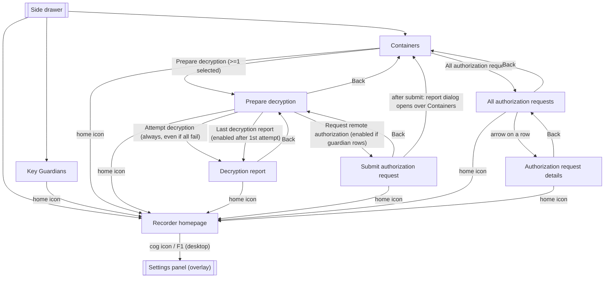

# 02 — UX and Screens

This file specifies everything the user sees and does in the **Witness Angel Recorder** app (GUI process, plus the physical e-paper/LCD/button interface of the background service on a Raspberry Pi): screens, labels, dialogs, validation messages, enabled/disabled states, background-task behaviour. It is written so the app can be rebuilt from scratch in another framework (planned target: Flet, sharing a package with the Authenticator). Kivy/KivyMD code is cited as evidence, but behaviour is described as observable results.

Related specifications:
- [01](01-architecture-and-platform.md): process model, background service, OSC link, config file and the **settings semantics table**, storage paths, i18n mechanism, build. This file only describes how settings are *displayed*.
- [03](03-business-logic.md): what happens behind each action (recording toolchain, cryptoconf, purge, decryption and revelation algorithms, state machines).
- [04](04-data-and-protocols.md): cryptainer format, on-disk layout, gateway JSON-RPC, OSC message formats.
- [05](05-open-issues.md): consolidated bugs and dispositions. In this file, defects are marked inline with their `OI-nn` link; a behaviour marked *fix* there MUST NOT be copied.
- Sister spec for the other app: `AUTHSPEC/02-ux-and-screens.md` (same shared widgets and screen families; the Recorder reuses the *claimant* side of the revelation flow, the Authenticator the *guardian* side).

Normative tags (**MUST / SHOULD / MAY / INFO**) and citation prefixes (`REC/`, `COMP/`, `CRYPTO/`, `SERVER/`, `AUTHSPEC/`) are defined once in the [README](README.md#normative-language) ([source baseline](README.md#source-baseline-and-citation-prefixes)). Untagged text describes the 1.0 behaviour; bugs are never requirements. `.kv` line numbers are the file's own.

**Vocabulary (UI vs code).** The UI says *container* where code and the other specs say *cryptainer*; the UI says *key guardian* (FR *gardien de clés*) for *trustee*/*authenticator*; it says *authorization request* (FR *demande d'autorisation*) for the protocol's *revelation request* and also, inconsistently, *decryption request* ([OI-86](05-open-issues.md#oi-86)). A reimplementation SHOULD keep the UI words and use the protocol words only in code.

**Translations.** Source strings are English. Two French catalogs are chained, the recorder's first, then the components': `tr.add_locale_dirs(LOCALE_DIR, GUILIB_LOCALE_DIR)` (`REC/warecorder/warecorder_gui.py:29-30`); both directories exist and both `.mo` files are compiled, and a check with `gettext` on the compiled catalogs shows that strings from each resolve to French. Strings are shown below as **EN / FR** where FR is what a French user sees. A string absent from both catalogs is shown in English and marked *(no FR)*. Catalog sources: `REC/warecorder/locale/fr/LC_MESSAGES/witnessangel.po` (settings, checkup strings of the app) and `COMP/locale/fr/LC_MESSAGES/witnessangel.po` (everything else).

---

## 1. Global application shell

### 1.1 Window, theme, layout

| Aspect | Behaviour | Source |
|---|---|---|
| Window title | `Witness Angel - Recorder` / `Witness Angel - Enregistreur` | `REC/warecorder/warecorder_gui.py:42` |
| Settings panel title | `Recorder settings` / `Paramètres d'enregistrement` | `REC/warecorder/warecorder_gui.py:43` |
| App icon | `icons/witness_angel_logo_blue_32x32.png` (components assets) | `REC/warecorder/warecorder_gui.py:46` |
| Logo in side menu | `warecorder_desktop_icon_512x512.png`, drawn 150×150 dp, centred | `REC/warecorder/warecorder_gui.py:48`, `COMP/widgets/navigation_drawer.kv:12-19` |
| Theme | Material Design (KivyMD), light, primary palette **Blue**, hue **900** | `COMP/application/generic_gui.py:52-55` |
| Root layout | A box padded by `application_margins` (OS safe-area insets, `[0,0,0,0]` unless Android, [01](01-architecture-and-platform.md)) holding: a screen stack (8 screens), the navigation drawer, and a **global wait spinner** overlaid on top. | `REC/warecorder/warecorder_gui.kv:13-58`, `REC/warecorder/warecorder_gui.py:53,130-137` |
| Screen transitions | Toolkit default slide transition between screens. | `REC/warecorder/warecorder_gui.kv:20` |
| Mobile pause | App pauses/resumes without restarting. | `COMP/application/generic_gui.py:57-60` |
| Closing the window | The background **service keeps running** (and recording continues): `should_daemonize_service()` is `True`. The GUI reconnects to it at next launch. | `REC/warecorder/warecorder_gui.py:123-125` |
| ESC / Back key | **No handler is registered** (the Authenticator registers one, the Recorder does not). The toolkit default applies: ESC closes the app (Kivy `exit_on_escape`; on Android the Back key is mapped to ESC, so it closes the app too; [01 §4.6](01-architecture-and-platform.md#46-pause-resume-and-back-key), [OI-91](05-open-issues.md#oi-91)). INFO. A reimplementation MAY add a Back-key rule; if it does, it SHOULD follow the on-screen Back arrows of §2. | `COMP/application/*` (no key binding found) |
| Platforms actually built by this repo | Desktop (PyInstaller spec; Windows/macOS/Linux) and Raspberry Pi (Ansible). Android-specific code paths exist (insets, notification, permission helpers) but the repo has **no Android build file**. INFO. | `REC/pyinstaller.spec`, `REC/ansible/`, `REC/warecorder/warecorder_gui.py:130-137` |

**Global wait spinner.** A 46×46 dp circular indeterminate spinner, centred, hidden by default (`COMP/widgets/popups.py:129-139`, placed at `REC/warecorder/warecorder_gui.kv:57`). Shown while an offloaded task runs (`_offload_task_with_spinner`, `COMP/application/generic_gui.py:121-136`). **It is not modal**: buttons underneath stay clickable. In the Recorder it is used by: decryption (§7.2), authorization-request submission (§8.1), authorization-request listing (§8.2). Everything else (key import, container listing, deletion, gateway import) runs **on the UI thread without spinner** and freezes the window while it works ([OI-13](05-open-issues.md#oi-13) lists the worst case). A reimplementation SHOULD offload all of them and SHOULD make the spinner block input.

### 1.2 Screens (8 registered)

Registered in `REC/warecorder/warecorder_gui.kv:24-52`; names from `COMP/screens/base.py:17-26`.

| Screen id | Title EN / FR | Reachable from | In side menu |
|---|---|---|---|
| `recorder_homepage` | Recorder / Enregistreur | startup; Home icon of every screen; menu | yes |
| `foreign_keystore_management` | Key Guardians / Gardiens des Clés | menu | yes |
| `cryptainer_storage_management` | Containers / Conteneurs | menu; Back from §7 and §8.2 | yes |
| `cryptainer_decryption_process` | Prepare decryption / Préparer le déchiffrement | "Prepare decryption" button of Containers | no |
| `cryptainer_decryption_result` | Decryption report / Rapport de déchiffrement | after "Attempt decryption"; "Last decryption report" button | no |
| `claimant_revelation_request_creation_form` | Submit authorization request / Envoyer la demande d'autorisation | "Request remote authorization" button of §7.1 | no |
| `claimant_revelation_request_management` | All authorization requests / Toutes les demandes d'autorisation | "All authorization requests" button of Containers | no |
| `claimant_revelation_request_detail` | Authorization request details / Détails des demandes d'autorisation | arrow icon on a row of the list | no |

The authenticator-only screens of `WAScreenName` (`authenticator_*`) are **not** registered by the Recorder and are out of scope.

### 1.3 Side navigation drawer

A slide-in drawer (`WaNavigationDrawer`) opened by the **menu** (hamburger) icon at the left of the top bar of the three top-level screens (and by a horizontal swipe, toolkit default). Content: the logo, then a list of exactly **3 entries in this order** (`REC/warecorder/warecorder_gui.py:190-201`):

| # | Icon | Label EN / FR | Target |
|---|---|---|---|
| 1 | `home` | Recorder / Enregistreur | `recorder_homepage` |
| 2 | `key` | Key Guardians / Gardiens des Clés | `foreign_keystore_management` |
| 3 | `lock` | Containers / Conteneurs | `cryptainer_storage_management` |

Selecting an entry switches screen and closes the drawer (`REC/warecorder/warecorder_gui.py:110-112`; the code passes the literal state `"screen_name"`, which the toolkit treats as "close" — works by accident, [OI-93](05-open-issues.md#oi-93)). The drawer is rebuilt (labels re-translated) on every language change (`:209-211`). There is no "Settings", "Help", "About" or "Logs" entry; there is **no help and no about screen** at all (the dev TODO lists "add help pages"; `REC/TODO.txt`). The log console widget exists in the components but is unused: `log_output()` returns immediately (`REC/warecorder/warecorder_gui.py:55-62`). Logs go to `<INTERNAL_APP_ROOT>/logs/log.txt` only ([01](01-architecture-and-platform.md)).

### 1.4 Top bars

Every screen starts with a top app bar (elevation 8, `WAToolbar`; `COMP/widgets/layout_components.kv:26-30`): left action = **menu** icon (top-level screens) or **arrow-left** Back (sub-screens); title; right-side icons, each with a tooltip.

| Icon | Tooltip EN / FR |
|---|---|
| `arrow-left` | Back / Retour |
| `refresh` | Refresh / Rafraîchir |
| `home` | Back to home / Retour *(same FR word as Back, [OI-85](05-open-issues.md#oi-85))* |
| `select-all` | Select all / Sélectionner tout |
| `select-off` | Select none / Sélectionner rien |
| `alert-rhombus-outline` | Reset background service / Réinitialiser le service en fond |
| `earth` | Language / Langue |
| `cog` | Settings / Paramètres |

The **Back arrow** goes to the fixed previous screen of §2 (not a history stack). The **home** icon goes to `recorder_homepage` (`REC/warecorder/warecorder_gui.py:114-115`).

Below each top bar there is a **banner**: an elevated 40 dp strip with one line of explanatory text (`WAElevatedBoxLayout`, `COMP/widgets/layout_components.kv:32-39`).

### 1.5 Feedback primitives (framework-neutral definitions)

| Primitive | Look and behaviour | Source |
|---|---|---|
| **Toast** | Small temporary message, 1.5 s (desktop), not dismissable. Used for confirmations and "please select…" hints. | `COMP/widgets/popups.py:26-33` |
| **Snackbar** | Full-width bar at the bottom, 3.5 s. Used for errors and the "Configuration errors prevent recording" message. | `COMP/widgets/popups.py:36-44` |
| **Dialog** | Modal; title; text or custom content; optional action buttons; **always** a last "close" button (default label Close / Fermer, often overridden to Cancel / Annuler). Tapping outside does not close it. A single "current dialog" is tracked; opening a second one while one is registered does not register the second. | `COMP/widgets/popups.py:61-87,95-126` |
| **Unexpected-error guard** | Most user-triggered handlers (all those named "safe_catch…" below) catch any exception, log it with traceback, and show a **snackbar** `Abnormal error caught: <ExceptionClassName>` / `Erreur anormale détectée : <ExceptionClassName>`. The operation stops; the screen is not reset. Handlers that are *not* guarded (e.g. "Select all", the recorder-screen toolbar actions) let the exception reach the toolkit, which most likely terminates the GUI ([OI-79](05-open-issues.md#oi-79)). | `COMP/widgets/popups.py:46-58` |
| **Settings popups** | Provided by the toolkit and **not translated**: buttons `Ok` / `Cancel`, panel `Close`. INFO. | toolkit |

**Background-task model** (spinner, one worker thread, callback on the UI thread, spinner always hidden afterwards): owned by [01](01-architecture-and-platform.md). If the worker raises, the result callback is not called and the error snackbar is shown.

### 1.6 Language switch

- Two languages, English (`en`) and French (`fr`); default detected at startup ([01](01-architecture-and-platform.md)).
- The switcher is the **earth** icon, and exists **only on the Recorder homepage** (`COMP/screens/recorder_homepage.kv:16`; mixin `COMP/widgets/layout_components.py:71-97`). It opens a dropdown with two items, `English` and `Français` (not translated), opening downward, 110 dp max height.
- Choosing a language: dismisses the menu, switches the catalog, updates every declaratively bound label (titles, buttons, banners), rebuilds the side menu, destroys the settings panel (so it is rebuilt translated next time), and refreshes the checkup text (`COMP/screens/recorder_homepage.py:17-20`, `COMP/application/generic_gui.py:108-110`, `REC/warecorder/warecorder_gui.py:209-211`).
- Text built in code (list rows, dialogs already built, decryption status words) keeps the old language until the screen is re-entered; the decryption status words `SUCCESS/FAILURE` are translated only once at import ([OI-83](05-open-issues.md#oi-83)).
- The choice is **not persisted**. INFO ([OI-83](05-open-issues.md#oi-83)).

### 1.7 Startup sequence (what the user sees)

1. The window opens on the **Recorder homepage**; the big record button is **disabled** (service state unknown) and the checkup text is shown at once (`COMP/application/recorder_gui.py:68-86`, `REC/warecorder/warecorder_gui.py:127-169`).
2. The GUI immediately asks the service for its recording state; if no answer after 3 consecutive 2-second polls it **launches the service** itself; if the new service still does not answer, it retries on the 11th consecutive unanswered poll (§3.2).
3. When the service answers, the record button becomes enabled (text *Start Recording*, or *Stop Recording* pressed if the service was already recording, e.g. after a GUI restart).
4. The saved selection of key guardians is loaded from the config file and **silently filtered** to guardians still present on disk (`REC/warecorder/warecorder_common_runtime.py:49-67`; the TODO about warning on dropped IDs is still open).
5. The preview image is loaded, then re-read every 15 s (§3.5).

---

## 2. Navigation map



What runs each time a screen is entered (`on_pre_enter`):

| Screen | On enter | Source |
|---|---|---|
| Homepage | Re-run all checks and rewrite the checkup text. | `COMP/screens/recorder_homepage.kv:6-7` |
| Key Guardians | Set the three bottom buttons to half width (layout hack), then list imported guardians; toast `Refreshed imported key guardians`. | `COMP/screens/foreign_keystore_management.kv:27-37`, `.py:189-247` |
| Containers | Same hack, then list containers; toast `Refreshed local containers` **on every entry**. | `COMP/screens/cryptainer_storage_management.kv:14-20`, `.py:73-118` |
| Prepare decryption | Rebuild the container summary (toast `Refreshed concerned containers`) and the guardian status list. | `COMP/screens/cryptainer_decryption_process.kv:24-33` |
| Decryption report | Rebuild the report **and write report files to disk** ([OI-71](05-open-issues.md#oi-71)). | `COMP/screens/cryptainer_decryption_result.kv:12-14` |
| Authorization request form | Rebuild summary and guardian checklist. | `COMP/screens/claimant_revelation_request_creation_form.kv:20-22` |
| Authorization requests list | Fetch from the gateway **only the first time in the session** ([OI-76](05-open-issues.md#oi-76)). | `COMP/screens/claimant_revelation_request_management.py:66-69` |
| Request details | Nothing (content is injected by the list screen before navigating). | `COMP/screens/claimant_revelation_request_detail.kv:7` |

---

## 3. Recorder homepage (`recorder_homepage`)

Sources: `COMP/screens/recorder_homepage.kv`, `.py`; `COMP/application/recorder_gui.py`; `REC/warecorder/warecorder_gui.py`; `REC/warecorder/warecorder_common_runtime.py`.

### 3.1 Layout (top to bottom)

```
+--------------------------------------------------------------+
| [=]  Recorder                      [⟳] [⚠] [🌐] [⚙]         |  top bar (menu | title | refresh, reset service, language, settings)
+--------------------------------------------------------------+
|                                                              |
|          +-------------------------------------+             |
|          |         Start Recording             |             |  ToggleButton, 70% width x 20% height, 30sp, centred
|          +-------------------------------------+             |
|                                                              |
| +----------------------------------------------------------+ |
| | [OK] Sensors: IP camera rtsp://rtsp.stream/pattern       | |  read-only selectable text, scrollable, 40% height
| | [KO] 0 key guardian(s) selected, 1 of which necessary... | |
| | [OK] Container storage: /home/pi/.witnessangel/crypta... | |  absolute path, not shortened
| | [OK] Each container stores 15.0 mn(s) of video           | |
| | [OK] Containers are kept for 30 day(s)                   | |
| | [OK] Ffmpeg module is installed with a compatible 6.1... | |
| +----------------------------------------------------------+ |
| +----------------------------------------------------------+ |
| |                  latest preview image                    | |  Image, keep ratio, 40% height (logo if none)
| +----------------------------------------------------------+ |
+--------------------------------------------------------------+
```
(`COMP/screens/recorder_homepage.kv:11-43`.) The emoji-like glyphs above are only wireframe notation; the real toolbar uses icons `refresh`, `alert-rhombus-outline`, `earth`, `cog`.

Toolbar right actions, in order (`COMP/screens/recorder_homepage.kv:16`):

| Icon | Tooltip | Action |
|---|---|---|
| refresh | Refresh | Re-run the checks and rewrite the checkup text (no toast). Not guarded. |
| alert-rhombus-outline | Reset background service | **Stop the service now** (no confirmation, no toast), disable the record button; the GUI's polling relaunches the service after 3 unanswered polls (about 6 s; about 24 s on Raspberry Pi). Blocks the UI thread while waiting for the service to exit (up to 10 s; 40 s on Raspberry Pi) before killing it. [OI-13](05-open-issues.md#oi-13). |
| earth | Language | Opens the language dropdown (§1.6). |
| cog | Settings | Opens the settings panel (§4). |

### 3.2 The record button: state machine

The button is a toggle with three observable states. The text depends on the state: **Start Recording** / **Lancer Enregistrement** when *normal*, **Stop Recording** / **Arrêter Enregistrement** when *pressed* (`COMP/screens/recorder_homepage.kv:19-25`).

| State | Enabled | Pressed | Text | Meaning |
|---|---|---|---|---|
| OFFLINE/UNKNOWN | no | no | Start Recording | At launch and after "Reset background service", until the service answers |
| IDLE | yes | no | Start Recording | Service alive, not recording |
| RECORDING | yes | yes | Stop Recording | Service recording |
| BUSY | no | (as set) | (as set) | A start/stop is in progress |

Transitions (GUI side; protocol in [04](04-data-and-protocols.md), service side in [03](03-business-logic.md)):

| Event | Effect |
|---|---|
| User presses the button when IDLE | Button goes disabled. The GUI runs all checks ([§3.3](#33-the-checkup-panel)). If any check is KO: snackbar **`Configuration errors prevent recording`** / `Des erreurs de configuration empêchent l'enregistrement`, nothing is sent. Else the GUI sends *start* to the service. (`COMP/application/recorder_gui.py:102-117`) |
| User presses the button when RECORDING | Button goes disabled, GUI sends *stop*. No checks. |
| Service broadcasts its state (after every start/stop completion, and in reply to polls) | `true` → enabled + pressed; `false` → enabled + normal; the special third value "in progress" (empty string over OSC) → disabled. (`:133-145`) |
| Poll timer (every 2 s; **8 s on Raspberry Pi**) | GUI asks the service to broadcast. If **more than 2** polls in a row got no answer, the GUI **launches the service** and resets the counter to `-8`, so the next launch attempt comes on the 11th consecutive unanswered poll (22 s; 88 s on Raspberry Pi). (`:119-131`, `COMP/default_settings.py:65`) |
| Reset-service icon | Service stopped; button disabled until the next answer. |

Facts a reimplementation MUST preserve: (a) the button is never enabled before the service has answered; (b) it is disabled during a transition so that a double-click cannot send two commands; (c) start is refused in the GUI when any check is KO. INFO: the toggle's own `on_state` handler also fires when the state is changed programmatically from a broadcast, so the GUI re-sends a redundant start/stop (ignored by the service) and re-runs the checks each time ([OI-22](05-open-issues.md#oi-22)); a reimplementation SHOULD NOT reproduce this loop.

**Failure feedback gap.** If the service refuses to start (its own check run fails) or the toolchain cannot be built, the user gets **no message**: only the log has it, and the button simply returns to *Start Recording* at the next broadcast ([OI-15](05-open-issues.md#oi-15)). A reimplementation SHOULD surface the reason (snackbar with the failing check message).

**Proposed status display (fix, not 1.0).** With the status message proposed in [04 §11.1](04-data-and-protocols.md#111-proposed-service-status-message-fix-not-10): a new `refusal` shows a snackbar with its first KO line (or its `error`), and the checkup panel (§3.3) shows the service's `checkup` lines instead of the GUI's own run, since the GUI's config may differ from the service's ([OI-15](05-open-issues.md#oi-15)); while recording, any sensor in `restarting` or `failed` state adds a line under the record button, for example `Recording (degraded): rtsp_camera restarting` ([OI-16](05-open-issues.md#oi-16), [OI-17](05-open-issues.md#oi-17), [OI-18](05-open-issues.md#oi-18)); `storage.full` adds a `[KO]` storage line to the checkup panel and one snackbar per transition ([OI-44](05-open-issues.md#oi-44)). Exact EN/FR texts are to be written with the implementation.

### 3.3 The checkup panel

A read-only, selectable, copyable, scrollable multi-line text (40% of the height) under the record button. It is rewritten: on entering the screen, on the Refresh icon, on every config change, after a language change, and on every start attempt. One line per checker, in this fixed order, each prefixed **`[OK] `** or **`[KO] `** (ASCII, literal) (`COMP/application/_common_runtime_support.py:88-100`, checker list `REC/warecorder/warecorder_common_runtime.py:212-222`). The global status is the AND of all lines; it gates the record button (§3.2) and is re-evaluated by the service at start ([03](03-business-logic.md)).

| # | Checker | OK message EN / FR | KO message EN / FR | OK when |
|---|---|---|---|---|
| 1 | Sensors (`check_all_sensors`, `:181-210`) | `Sensors: <list>` / `Capteurs : <list>`. `<list>` is comma-joined: `local camera` / `caméra locale`, `local microphone` / `microphone local` (Raspberry Pi only), `IP camera <url>` / `Caméra IP <url>` | `Local microphone not found` / `Microphone local non trouvé` (Pi, mic enabled, no PulseAudio input source) · `Wrong IP camera url: "<url>"` / `Mauvaise url de caméra IP : "<url>"` · `No sensors are enabled` / `Aucun capteur n'est activé` | At least one sensor enabled **and** every enabled one valid. IP camera URL valid = non-empty with a URL scheme (`rtsp://…`). **Only the first failure is reported**, and the OK form replaces the "IP camera url: …" text. Off Raspberry Pi the local camera/microphone are not considered at all: desktop = IP camera only. |
| 2 | Key guardians (`check_keyguardian_counts`, `_common_runtime_support.py:112-121`) | `{n} key guardian(s) selected, {t} of which necessary for decryption` / `{n} gardien(s) de clés configuré(s), dont {t} nécessaire(s) pour le déchiffrement` | same text | `0 < threshold <= n`, where `n` counts the selected guardians **as saved in the config file, filtered to those still imported**. The text is the same for OK and KO. |
| 3 | Container storage (`:105-110`) | `Container storage: {dir}` / `Stockage des conteneurs : {dir}` | `Invalid container storage: "{dir}"` / `Stockage des conteneurs invalide : {dir}` *(FR drops the quotes)* | The configured folder (or the default internal one when the setting is empty) **exists as a directory**. It is never created automatically for a custom path. |
| 4 | Recording duration (`:146-151`) | `Each container stores {d} mn(s) of video` / `Chaque conteneur stocke {d} mn(s) de vidéo` | same text | `d > 0`. `{d}` is a float, so the default shows `15.0` ([OI-42](05-open-issues.md#oi-42)). |
| 5 | Retention (`:153-158`) | `Containers are kept for {n} day(s)` / `Les conteneurs sont gardés {n} jour(s)` | same text | `n > 0` |
| 6 | Ffmpeg (`:160-…`) | `Ffmpeg module is installed with a compatible {v:.1f} version` / `Module ffmpeg installé avec une version {v:.1f} compatible` | `Ffmpeg module not found, please ensure it is in your PATH` / `Module ffmpeg non trouvé, veuillez vérifier qu'il est dans votre PATH` · `Ffmpeg module is installed, but beware its version couldn't be determined` / `Module ffmpeg installé, mais attention sa version n'a pas pu être déterminée` · `Ffmpeg module is installed but this {v:.1f} version is below required {min}` / `Module ffmpeg installé mais sa version {v:.1f} est inférieure à {min} requise` | `ffmpeg -version` runs and reports a version `>= 4.3` (`REC/warecorder/warecorder_common_runtime.py:178-179`) |

Notes:
- The gateway URL is **not checked** on this screen although a checker for it exists ([OI-41](05-open-issues.md#oi-41)).
- Check 1 on Raspberry Pi queries PulseAudio on every refresh; check 6 spawns `ffmpeg` on every refresh. Both run on the UI thread.
- Hand-edited config files with a non-UUID in `selected_keyguardians` make check 2 raise ([OI-36](05-open-issues.md#oi-36)).

### 3.4 Config changes while on this screen

Every setting change (§4) immediately re-runs the checks (`REC/warecorder/warecorder_gui.py:119-121`, `:176-188`), so the user sees `[KO]`→`[OK]` live behind the settings panel. When the panel is closed a toast says **`Some configuration changes might only apply at next recording restart`** / `Certains changements de configuration pourraient ne s'appliquer qu'au redémarrage de l'enregistrement` (`COMP/application/recorder_gui.py:50-52`). MUST: changes apply to the *next* recording only, never to a running one ([03](03-business-logic.md)).

### 3.5 Preview image

- An image box under the checkup text. Source: the preview JPEG written by the recording sensors (`<INTERNAL_CACHE_DIR>/video_preview_image.jpg`, [01](01-architecture-and-platform.md)/[03](03-business-logic.md)); if it does not exist, the app logo (`warecorder_desktop_icon_512x512.png`) is shown (`REC/warecorder/warecorder_gui.py:64-76`).
- Refreshed at startup and **every 15 s** by a timer (marked "FIXME repair" in the code), regardless of whether recording is on. There is **no freshness check**: an hours-old image is shown as if current (the code carries a TODO "only display image if recent enough") ([OI-31](05-open-issues.md#oi-31)). A reimplementation SHOULD hide or dim the image when the file is older than about twice the recording duration, or when not recording.
- Image options: aspect ratio kept, stretchable, mipmapped, not cached.

### 3.6 Raspberry Pi extras on the homepage

None: on a Raspberry Pi the homepage is identical; the Pi-only differences are in the settings panel (§4.2) and in the physical interface (§9).

---

## 4. Settings panel

Opened by the **cog** icon (and F1 on desktop, toolkit default). It is the toolkit's `SettingsWithSpinner`: a full-window panel with a header (a one-entry section spinner showing the panel title **`Recorder settings` / `Paramètres d'enregistrement`**, and a **Close** button — toolkit text, not translated) and a vertical list of items (`COMP/application/generic_gui.py:28-45,88-91`). The toolkit's own technical panel is hidden. The panel is built from a list of items (title rows, switches, option lists, numbers, texts); the **meaning, defaults and validation of every key are specified in [01 (settings table)](01-architecture-and-platform.md)**; this section specifies only how each is presented. The item list depends on the platform: *Pi-only* items appear when the machine is a Raspberry Pi (`IS_RASPBERRY_PI`, detection in [01 §8.2](01-architecture-and-platform.md#82-raspberry-pi)); all others always.

### 4.1 Widgets and interaction rules

| Item type | Presentation | Interaction | Persistence |
|---|---|---|---|
| title | Bold section heading, not interactive | – | – |
| `bool` | Title, description, a switch at the right | Tap toggles; stored as `1`/`0` | Immediate |
| `options` | Title, description, current value as text | Tap opens a popup (titled with the item title) with one toggle button per option (current one pressed) and a `Cancel` button; picking an option applies it and closes | Immediate |
| `numeric` | Title, description, value | Tap opens a popup with a one-line text field and `Ok` / `Cancel`. **Integer-only unless the current value already contains a `.`**: input that does not parse is **silently discarded** (popup closes, value unchanged, no message). No min/max. | Immediate on Ok |
| `string_truncated` | Title, description, value shown on **one line shortened with an ellipsis** (15 sp) | Tap opens the same text popup as `numeric` (any text accepted, trimmed) | Immediate on Ok |

Consequences ([OI-35](05-open-issues.md#oi-35)): `recording_duration_mn` (default `15`) and `live_preview_interval_s` (default `1`) cannot be given a fractional value from the UI; `0` and negative integers are accepted and turn the corresponding checkup line `[KO]` (duration, retention, threshold) — the UI itself never rejects a value. A reimplementation SHOULD validate numbers (positive; decimals allowed for the duration and preview interval) and SHOULD show an inline error instead of dropping input silently.

Every change is written to the INI file at once (no "Save" button) and triggers a checkup refresh (§3.4). Changing the language destroys and rebuilds the panel.

### 4.2 Item list (in display order)

Legend: P = Raspberry Pi only; "—" = always. FR is shown in parentheses after the EN. Defaults are those of `REC/warecorder/config_defaults.ini` (semantics: [01](01-architecture-and-platform.md)).

**Section "Sensors" / "Capteurs"** (title row)

| Key | P | Type | Title EN / FR | Description EN / FR | Default |
|---|---|---|---|---|---|
| `enable_local_camera` | P | bool | Local camera / Caméra locale | Enable attached camera / Activer la caméra attachée | on |
| `local_camera_rotation` | P | options `0, 90, 180, 270` | Local camera rotation / Rotation de caméra locale | Rotation angle of camera (Picamera only) / Angle de rotation de caméra (Picamera uniquement) | 0 |
| `enable_local_microphone` | P | bool | Local microphone / Microphone local | Enable attached microphone / Activer le microphone attaché | on |
| `compress_local_microphone_recording` | P | bool | Compress audio / Compresser l'audio | Encode audio recording / Encoder l'enregistrement audio | off |
| `enable_local_camera_microphone_muxing` | P | bool | Mux recordings / Muxer l'enregistrement | Merge local video and audio (requires libcamera) / Fusionner vidéo et audio locaux (requiert libcamera) | off |
| `enable_ip_camera` | — | bool | IP camera / Caméra IP | Enable network camera / Activer la caméra réseau | on |
| `ip_camera_url` | — | string | IP Camera URL / URL Caméra IP | RTSP stream address / Adresse de flux RTSP | `rtsp://rtsp.stream/pattern` (a public demo stream; INFO) |
| `recording_duration_mn` | — | numeric | Media recording duration (mn) / Durée des enregistrements média (mn) | How long each audio/video clip must last / Combien de temps chaque clip audio/vidéo doit durer | 15 |

**Section "Key guardians" / "Gardiens de Clés"**

| Key | P | Type | Title | Description | Default |
|---|---|---|---|---|---|
| `keyguardian_threshold` | — | numeric | Key guardian threshold / Seuil de gardiens de clés | Count of key guardians required to decrypt data / Nombre de gardiens de clés requis pour déchiffrer les données | 1 |

(The *selection* of guardians is not here; it is the checkboxes of §5.)

**Section "Storage" / "Stockage"**

| Key | P | Type | Title | Description | Default |
|---|---|---|---|---|---|
| `cryptainer_dir` | — | string | Container folder / Dossier des conteneurs | Folder to store containers (defaults to user profile) / Dossier de stockage des conteneurs (par défaut, le profil utilisateur) | empty (= internal folder) |
| `max_cryptainer_age_day` | — | numeric | Max retention period (days) / Période de rétention max (jours) | For how long to keep a container before deletion / Combien de temps garder les conteneurs avant suppression | 30 |

The container folder is free text; **there is no folder browser**, and no check at entry time (only the checkup line, §3.3).

**Section "Peripherals" / "Périphériques"** (whole section P)

| Key | Type | Title | Description | Default |
|---|---|---|---|---|
| `epaper_type` | options: *(blank)*, `waveshare_2.7_epaper`, `waveshare_2.13_epaper_v3`, `waveshare_2.13_epaperb_v3`, `dfrobot_2.13_epaper_v2` | E-paper type / Type d'E-paper | Optional E-ink display / Affichage E-ink optionnel | blank |
| `lcd_type` | options: *(blank)*, `waveshare_1.3_lcd` | LCD type / Type de LCD | Optional LCD display / Affichage LCD optionnel | blank |
| `enable_screen_buttons` | bool | Screen buttons / Boutons d'écran | Enable epaper/lcd screen buttons / Activer boutonsd'écran epaper/lcd *(sic, missing space)* | on |
| `enable_button_shim` | bool | 5 buttons shim / Carte à 5 boutons | Enable Pimoroni buttonshim device (requires e-paper too) / Activer le buttonshim de Pimoroni (nécessite E-paper aussi) | off |

**Section "Network" / "Réseau"**

| Key | Type | Title | Description | Default |
|---|---|---|---|---|
| `wagateway_url` | string | Witness Angel Gateway URL / URL de la Passerelle Witness Angel | Registry of key guardians / Registre des gardiens de clés | `https://api.witnessangel.com/gateway/jsonrpc/` |

**Section "Advanced" / "Avancé"** (title row; items below are all stored in the `sensor` section)

| Key | P | Type | Title EN / FR | Description EN / FR |
|---|---|---|---|---|
| `live_preview_interval_s` | P | numeric | Live preview interval / Interval de preview live *(sic)* | How many seconds between live previews of Picamera (0 to disable) / Combien de secondes entre les aperçus de Picamera (0 pour désactiver) |
| `libcameravid_video_parameters` | P | string | Libcameravid video params / Params vidéo libcameravid | Replace libcameravid video parameters / Remplacer les paramètres vidéo de libcameravid |
| `libcameravid_audio_parameters` | P | string | Libcameravid audio params / Params audio libcameravid | Replace libcameravid audio parameters / Remplacer les paramètres audio de libcameravid |
| `raspivid_parameters` | P | string | Raspivid params / Params raspivid | Replace raspivid parameters / Remplacer les paramètres raspivid |
| `picamera_parameters` | P | string | Picamera params / Paramètres picamera | Json object to replace picamera parameters / Objet Json pour remplacer les paramètres picamera |
| `arecord_parameters` | P | string | Arecord params / Params arecord | Replace arecord parameters / Remplacer les paramètres arecord |
| `arecord_output_format` | P | string | Arecord format / Format arecord | Replace arecord output format (default: wav) / Remplace le format de sortie arecord (defaut : wav) |
| `ffmpeg_alsa_parameters` | P | string | Ffmpeg alsa params / Params ffmpeg alsa | Replace ffmpeg alsa parameters / Remplacer les paramètres ffmpeg alsa |
| `ffmpeg_alsa_output_format` | P | string | Ffmpeg alsa format / Format ffmpeg alsa | Replace ffmpeg alsa output format (default: mp3) / Remplacer le format de sortie ffmpeg alsa (defaut : mp3) |
| `ffmpeg_rtsp_parameters` | — | string | FFmpeg rtsp params / Params ffmpeg rtsp | Replace ffmpeg rtsp audio/video parameters / Remplacer les paramètres ffmpeg rtsp audio/video |
| `ffmpeg_rtsp_output_format` | — | string | Ffmpeg rtsp format / Format ffmpeg rtsp | Replace ffmpeg rtsp output format (default: mp4) / Remplacer le format de sortie ffmpeg rtsp (defaut : mp4) |

Source of the whole list: `REC/warecorder/warecorder_gui.py:213-459`. On a non-Pi desktop the visible panel is therefore: *Sensors* (IP camera, URL, duration), *Key guardians*, *Storage*, *Network*, *Advanced* (two ffmpeg RTSP items).

Not exposed in the panel (config-file only, [01](01-architecture-and-platform.md)): `selected_keyguardians` (written by §5), and the app-level `daemonize_service` flag read by the service.

---

## 5. Key Guardians (`foreign_keystore_management`)

Purpose: manage the **imported key guardians** (foreign keystores = authenticators of other people whose public keys protect the recordings) and **choose which of them secure the recordings**. Sources: `COMP/screens/foreign_keystore_management.py/.kv`.

### 5.1 Layout

```
+--------------------------------------------------------------+
| [=]  Key Guardians                                   [⟳] [⌂] |
+--------------------------------------------------------------+
| Please select the key guardians used to secure recordings    |  banner
+--------------------------------------------------------------+
| [x] User Paul Dupont (ID …1abfb5411)                    (i)  |  one row per imported guardian, sorted by UID
| [ ] User Marie Curie (ID …77c0de002)                    (i)  |  (empty: centred "Empty" / "Vide")
+--------------------------------------------------------------+
| [Import from USB] [Import from Web] [Delete]                 |  3 buttons, half width each
+--------------------------------------------------------------+
```
Banner EN/FR: `Please select the key guardians used to secure recordings` / `Veuillez sélectionner les gardiens de clés utilisés pour sécuriser les enregistrements`. Top-right icons: Refresh, Home.

### 5.2 List rows

- One row per foreign keystore found in the keystore pool, **sorted by keystore UID** (`.py:204-209`), rebuilt from scratch on entry, on Refresh, and after import/delete.
- Row text: `User ` / `Utilisateur ` + `<owner> (ID …<last UUID group>)`, e.g. `User Paul Dupont (ID …1abfb5411)`. The ID is shortened to U+2026 followed by the last hyphen-group of the UUID (`COMP/utilities/__init__.py:102-103,154-167`). Owner falls back to `Unknown` / `Inconnu(e)`.
- Left: a **checkbox** = "this guardian secures the recordings". Ticking/unticking updates the in-GUI selection and **immediately saves** it to the config key `keyguardian.selected_keyguardians` (comma-joined UUIDs), so the service sees it; the homepage checkup reflects it on next entry (`REC/warecorder/warecorder_gui.py:204-207`).
- Right: an **information** icon; opens the details dialog (§5.3).
- Only *authenticator*-type keystores are listed (the screen comment says "we're only dealing with AUTHENTICATORS here").
- Empty list → centred message `Empty` / `Vide`. Refresh toast (shown only if the list is non-empty; also on entry): **`Refreshed imported key guardians`** / `Les gardiens de clé importés ont été rafraîchis`.

The same checkbox is the target of **Delete** (§5.6): the selection is overloaded, "use for recording" and "delete" are the same ticks ([OI-50](05-open-issues.md#oi-50)). A reimplementation SHOULD separate them or at least make the dialog name the guardians to delete.

### 5.3 Details dialog (ⓘ)

Title `Key Guardian <owner>` / `Gardien de Clés <owner>`; body:

```
Type: AUTHENTICATOR

Key n°1: RSA-OAEP …a1b2c3d4 (private key not present)
Key n°2: …
```
`Type: {t}` / `Type : {t}` (upper-cased keystore type); one line per keypair: `Key n°` / `Clé n°`, index from 1, `: `, key algo with `_` replaced by `-`, shortened keychain UID, and the suffix **`(private key present)` / `(clé privée présente)`** or **`(private key not present)` / `(clé privée non présente)`**. One close button `Close` / `Fermer`. Errors are caught by the guard.

### 5.4 Import from USB

Button **Import from USB** / **Importer depuis USB** (icon `database-import-outline`).

1. Detect connected authentication devices (USB drives with an authenticator folder; [01](01-architecture-and-platform.md) for detection). Any open dialog is closed.
2. No device at all → toast **`No connected authentication devices found`** / `Aucun périphérique d'authentification trouvé`; stop. Devices but none holding an initialized authenticator → toast **`No initialized authentication devices found`** / `Aucun périphérique d'authentification initialisé trouvé`; stop. (On Android/iOS the detection returns nothing, so this import is desktop-only; see `AUTHSPEC/02 §3.2`.)
3. Otherwise a dialog **`Import keys from USB drives`** / `Import de clés depuis les stockages USB` asks: **`Do you want to import the private keys (passphrase-protected) as well?`** / `Voulez-vous aussi importer les clés privées (protégées par phrase secrète) ?` with buttons **Yes / Oui**, **No / Non**, and **Cancel / Annuler**. *Yes* keeps the (passphrase-encrypted) private keys so the recorder machine can later decrypt locally (§7); *No* imports public keys only.
4. The import (UI thread, guarded) reads each initialized device: the secret fields `keystore_secret` and `keystore_passphrase_hint` are **stripped** before saving. A device whose metadata fails validation, or whose UID mismatches, is counted as corrupted and skipped.
5. Result toast: **`{n} new authenticators imported, {u} updated, {c} skipped because corrupted`** / `{n} nouveaux authentifieurs importés avec succès, {u} mis à jour, {c} ignoré(s) car corrompu(s)`.
6. **Newly imported** guardians are **auto-selected** (ticked and saved); *updated* ones keep their previous tick state. The list is refreshed (no extra toast).

MUST: strip the guardian's secret and hint; MUST import private keys only after the explicit Yes. SHOULD: show a progress indicator (the work freezes the UI).

### 5.5 Import from Web (gateway)

Button **Import from Web** / **Importer depuis Web** (same icon). A dialog **`Import keys from web gateway`** / `Import de clés depuis la passerelle web` with the label **`Enter the ID of the authenticator:`** / `Entrez l'ID de l'authentifieur :`, a text field with hint **`Authenticator ID`** / `ID d'authentifieur`, buttons **Import / Importer** and **Cancel / Annuler**.

On Import: the text is trimmed and lower-cased; then (guarded, UI thread, gateway call `get_public_authenticator`, [04](04-data-and-protocols.md)):

| Outcome | Dialog shown (title `Import result: <result>` / `Résultat de l'import : <result>`, single close button) |
|---|---|
| Not a valid UUID | `Failure` / `Échec` — `Badly formed hexadecimal UUID string` / `Chaîne UUID hexadécimale mal formée` |
| Gateway says unknown ID | `Failure` — `Authenticator does not exist` / `Authentifieur non existant` |
| Success | toast `Authentication device(s) updated` *(no FR, [OI-82](05-open-issues.md#oi-82))*; the guardian is imported (public keys only, `private_key` empty), **auto-selected**, list refreshed; dialog `Success` / `Succès` — `Authenticator has been imported successfully` / `L'authentifieur a été importé avec succès` |
| Network or other error | the guard's snackbar `Abnormal error caught: <Class>` (e.g. `JSONRPCError`, `ConnectionError`); no dialog |

An empty field is reported as the bad-UUID failure. The gateway URL comes from the settings (§4) and is read at click time.

### 5.6 Delete

Button **Delete** / **Supprimer** (icon `delete-alert-outline`) acts on the **ticked** guardians.
- Nothing ticked → toast **`Please select key guardians to remove`** / `Veuillez sélectionner les gardiens de clé à supprimer`.
- Else a confirmation dialog **`Key guardian removal confirmation`** / `Confirmation de suppression de gardiens de clé` with text **`Are you sure you want to remove %s key guardian(s)?`** / `Êtes-vous sûr de vouloir supprimer %s gardien(s) de clé` (*sic*, no question mark in FR) and buttons **Confirm removal / Confirmer suppression**, **Cancel / Annuler**.
- On confirm (guarded): each guardian's folder in the pool is removed (a failure to remove one is only logged), the guardians are un-ticked and the selection saved, toast **`Selected imported authentication devices were deleted`** *(no FR, [OI-82](05-open-issues.md#oi-82))*, list refreshed.
- Defect: the un-tick loop iterates the same list it removes from, so **every other guardian stays ticked** in the saved selection after a multi-delete ([OI-49](05-open-issues.md#oi-49)); they are dropped only at next start by the integrity filter (§1.7). MUST NOT be copied. Deleting a guardian that secured past recordings does **not** affect existing containers (they can no longer be locally decrypted without it, §7).

---

## 6. Containers (`cryptainer_storage_management`)

Purpose: list the encrypted recordings (containers) in the configured folder, select, delete, and start decryption. Sources: `COMP/screens/cryptainer_storage_management.py/.kv`.

### 6.1 Layout

```
+--------------------------------------------------------------+
| [=]  Containers                    [▦] [▢] [⟳] [⌂]           |  select all, select none, refresh, home
+--------------------------------------------------------------+
| View and manage encrypted containers (selected: 2)           |  banner with live counter
+--------------------------------------------------------------+
| [x] N° 0: 20250307_221530_rtsp_camera_cryptainer.mp4.crypt (6MB)    (i)  |  newest first
| [x] N° 1: 20250307_220030_rtsp_camera_cryptainer.mp4.crypt (6MB)    (i)  |
| [ ] N° 2: 20250307_214530_rtsp_camera_cryptainer.mp4.crypt (missing)(i)  |
+--------------------------------------------------------------+
| [Delete] [Prepare decryption] [All authorization requests]   |
+--------------------------------------------------------------+
```
Banner EN/FR: `View and manage encrypted containers (selected: N)` / `Voir et gérer les conteneurs chiffrés (Sélectionné: N)` (`:38`, live counter).

### 6.2 List

- Source: the container storage at the configured folder (finished containers only, sorted by name; the names embed a UTC timestamp so name order is chronological; [03](03-business-logic.md)/[04](04-data-and-protocols.md)). Shown **newest first**.
- Row: checkbox, `N° <i>: <name> (<size>)`, info icon. `<i>` starts at **0** for the newest (the decryption screen numbers from 1, [OI-89](05-open-issues.md#oi-89)). `<size>` = integer part with unit, no space (`bytes`, `KB`, `MB`, `GB`, `TB` with 1024 steps, e.g. `6MB`); a container deleted during listing shows `(missing)` / `(manquant)`.
- Empty folder → centred `Empty` / `Vide`. Invalid or missing storage folder → **no message and no change**: the refresh returns early without touching the list, so the rows of the previous valid folder stay (stale), or `Empty` shows if the list was never filled; only the homepage checkup reports the problem (`COMP/screens/cryptainer_storage_management.py:80-83`, [OI-80](05-open-issues.md#oi-80)).
- Toast **`Refreshed local containers`** / `Conteneurs locaux rafraichis` on every entry and every Refresh.
- Refresh drops from the selection any container that no longer exists.
- Toolbar **Select all** / **Select none** act on the whole list (the banner counter follows). Select all with no valid storage raises an unguarded error ([OI-79](05-open-issues.md#oi-79)).

### 6.3 Details dialog (ⓘ)

Title: the container file name. Body:

```
Container ID: <full cryptainer_uid>

Key Guardians used:

N° 1: Paul Dupont (ID …1abfb5411, type authenticator)
N° 2: Marie Curie (ID …77c0de002, type authenticator)
```
`Container ID` / `ID de conteneur`, `Key Guardians used` / `Gardiens de Clés utilisés`, guardians sorted by owner (case-insensitive), index from 1, label format `<owner> (ID …<uid>, type <trustee_type>)` (`format_authenticator_label`; `Unknown` / `Inconnu(e)` if the owner or UID is missing). If the container cannot be loaded, the body is the first 800 characters of `repr(exception)` and **the title is empty** ([OI-88](05-open-issues.md#oi-88)).

### 6.4 Buttons

| Button (EN / FR) | Icon | Condition | Action |
|---|---|---|---|
| **Delete** / Supprimer | `delete-alert-outline` | ≥1 selected, else toast `Please select containers to delete` / `Veuillez sélectionner les conteneurs à supprimer` | Dialog **`Container deletion confirmation`** / `Confirmation de suppression de conteneur`, text `Are you sure you want to delete %s container(s)?` / `Êtes-vous sûr de vouloir supprimer %s conteneur(s) ?`, buttons **Confirm deletion / Confirmer suppression**, **Cancel / Annuler**. On confirm each selected container is deleted (already-vanished ones ignored), the list refreshes (so the toast `Refreshed local containers` follows). Irreversible, no recycle bin. This deletion is not guarded. |
| **Prepare decryption** / Préparer le déchiffrement | `eye-circle-outline` | ≥1 selected, else toast `Please select containers to decrypt` / `Veuillez sélectionner les conteneurs à déchiffrer` | Hands the selection to §7 and navigates there. |
| **All authorization requests** / Toutes les demandes d'autorisation | `format-list-text` | always | Navigates to §8.2. |

Note: the selection is **kept by reference** and shared with §7 and §8.1 (they show the same list).

---

## 7. Decryption

### 7.1 Prepare decryption (`cryptainer_decryption_process`)

Purpose: show which key guardians the selected containers depend on, whether their keys are present locally, let the user type passphrases, then try to decrypt, or ask the guardians remotely. Sources: `COMP/screens/cryptainer_decryption_process.py/.kv`. Algorithms: [03](03-business-logic.md).

```
+--------------------------------------------------------------+
| [<-]  Prepare decryption                          [⟳] [⌂]    |
+--------------------------------------------------------------+
| Containers selected for decryption                           |
|  N° 1: 20250307_221530_rtsp_camera_cryptainer.mp4.crypt                  |  (scrollable, 50% height)
|  N° 2: 20250307_220030_rtsp_camera_cryptainer.mp4.crypt                  |
+--------------------------------------------------------------+
| Summary of related key guardians                             |
|  [key] Key guardian: Paul Dupont (ID …1abfb5411, type auth…) |  3-line rows
|        Status: FOUND, passphrase: NOT SET             (i)    |
|        Private keys needed for decryption are present        |
+--------------------------------------------------------------+
| [Add a passphrase]        [Attempt decryption]               |
| [Request remote authorization] [Last decryption report]      |
+--------------------------------------------------------------+
```

**Container summary** (upper list). One line per selected container, in **reverse order of the selection list**, numbered from 1: `N° <i>: <name>` (FR `N°` is identical). Toast `Refreshed concerned containers` / `Liste des conteneurs concernés rafraichie`. The toolbar Refresh icon rebuilds **only this list**, not the guardian list.

**Guardian status list** (lower list), one **3-line row** per distinct guardian required by the selected containers, sorted by owner. Rows only for guardians of type *authenticator* (other trustee types are silently ignored):

| Line | Text EN / FR |
|---|---|
| 1 | `Key guardian: <owner> (ID …<uid>, type authenticator)` / `Gardien de clés : …` |
| 2 | `Status: FOUND|NOT FOUND, passphrase: SET|NOT SET` / `Statut : TROUVÉ|NON TROUVÉ, phrase secrète : RENSEIGNÉ(E)|NON RENSEIGNÉ(E)`. The words are upper-cased translations of `found`/`not found`/`set`/`not set`; the label word `passphrase` is **lower-case** in the line (`passphrase: SET`). "Found" = the guardian is imported locally; "set" = a passphrase for it has been accepted this session. The owner is unknown (`Unknown`) when not found. |
| 3 | one of: `Private keys needed for decryption are present` / `Les clés privées nécessaires au déchiffrement sont présentes` · `Private key(s) missing locally: <list of keys>` / `Clé(s) privée(s) manquant localement : <liste>` · `Private keys needed were not found` / `Les clés privées nécessaires sont introuvables` (guardian not imported) |

The row's information icon opens a dialog **`Keypairs used`** / `Paires de clés utilisées` listing `Keypair n°<i>: <algo> …<uid> (private key present|not present)` / `Paire n°<i> : … (clé privée présente|non présente)` for the keypairs of that guardian that the selected containers use.

**Buttons**

| Button EN / FR | Icon | Enabled | Action |
|---|---|---|---|
| **Add a passphrase** / Ajouter une phrase secrète | `key-arrow-right` | always | §7.1.1 |
| **Attempt decryption** / Tenter le déchiffrement | `eye-circle-outline` | always | §7.2 |
| **Request remote authorization** / Demander l'autorisation à distance | `remote` | only when the guardian list is non-empty | Navigate to §8.1 with the current selection and guardian data. |
| **Last decryption report** / Dernier rapport de déchiffrement | `format-list-text` | only after the first decryption attempt **in this app session** | Navigate to §7.2 report (re-displays the previous result). |

Back arrow → Containers.

#### 7.1.1 Add a passphrase

Dialog **`Add passphrase`** / `Ajouter une phrase secrète` with the label **`Enter the passphrase for one of the key guardians`** / `Entrez la phrase secrète pour l'un des gardiens de clés`, a text field with hint **`Passphrase`** / `Phrase secrète` (**not masked**, [OI-67](05-open-issues.md#oi-67)), buttons **Check / Vérifier** and **Cancel / Annuler**.

On Check (guarded): the app tests the typed passphrase against the **first private key** of every *imported* guardian that the selected containers need (not only the ones lacking a passphrase). Result dialog titled `Validation result: <result>` / `Résultat de validation : <result>`:

| Outcome | Dialog text |
|---|---|
| Matches at least one guardian | `Success` / `Succès` — `Passphrase recognized` / `Phrase secrète reconnue`. The passphrase is stored **in memory** for each matching guardian (`passphrase: SET`) and the guardian list is refreshed. |
| Matches none | `Failure` / `Échec` — `Passphrase doesn't match any relevant private key` / `La phrase secrète ne correspond à aucune clé privée pertinente` |
| Same passphrase already stored | **Crashes** with `Abnormal error caught: TypeError` instead of the intended `Already existing passphrase: <passphrase>` message ([OI-66](05-open-issues.md#oi-66)). A reimplementation MUST show a neutral "already entered" message and MUST NOT echo the passphrase. |

Limits (INFO): guardians imported **without** private keys can never match; only the first keypair of each guardian is tested; a guardian can hold one stored passphrase; stored passphrases are **never cleared** until the app exits and are shared by all later decryptions ([OI-68](05-open-issues.md#oi-68)). A reimplementation SHOULD clear them after use or on leaving the flow.

### 7.2 Attempt decryption and the decryption report

**Attempt decryption** (guarded; offloaded with the global spinner): for every selected container, in order, the app asks the storage to decrypt it with the stored passphrases and with the gateway (to fetch answers to previously submitted authorization requests; the gateway URL and the requestor ID are captured when the screen is created, [OI-72](05-open-issues.md#oi-72)). A container that yields content is written to the **export folder** under its name without the final `.crypt` extension (e.g. `20250307_221530_rtsp_camera_cryptainer.mp4`), **overwriting any existing file**. Nothing is written for a failed container. A container for which decryption raises an unexpected exception is logged and **omitted from the report** ([OI-69](05-open-issues.md#oi-69)). Algorithm and partial-success rules: [03](03-business-logic.md).

When the task ends the app navigates to the **Decryption report** screen, and if **no** container was decrypted shows snackbar **`All decryptions failed, see reports`** / `Tous les déchiffrements ont échoué, voir les rapports`.

**Decryption report** (`cryptainer_decryption_result`, `COMP/screens/cryptainer_decryption_result.py/.kv`):

```
+--------------------------------------------------------------+
| [<-]  Decryption report                                [⌂]   |
+--------------------------------------------------------------+
| Export folder: ~/.witnessangel/external/exports              |  banner (path shortened: <sdcard>/… or ~/…)
+--------------------------------------------------------------+
|         1 out of 2 container(s) have been decrypted         |  centred, heading
| [ Decryption status for 2025…221530….crypt: SUCCESS       ]  |  grey strip, centred
|   No errors/warnings when decrypting the container           |  selectable text
| [ Decryption status for 2025…220030….crypt: FAILURE       ]  |
|   ASYMMETRIC DECRYPTION ERROR (KeyDoesNotExist)              |
|   Message: ...                                               |
+--------------------------------------------------------------+
```
- Heading: `{n} out of {m} container(s) have been decrypted` / `{n} sur {m} conteneur(s) ont été déchiffrés`; `m` counts the **reported** containers.
- Per container: a strip `Decryption status for {name}: SUCCESS|FAILURE` / `Statut du déchiffrement de {name} : SUCCÈS|ÉCHEC`, then either `No errors/warnings when decrypting the container` / `Aucune erreur/avertissement lors du déchiffrement du conteneur`, or the **operation report** as selectable text: one block per entry, separated by a blank line; an INFO entry reads `Info: <message>` / `Info : <message>`; any other entry reads `<CRITICITY>: <Entry Type Title Cased> (<ExceptionClass>)` newline `Message: <message>` / `Message : <message>`, indented with `> ` once per nesting level (`COMP/utilities/__init__.py:228-258`).
- **Side effect:** entering this screen **writes one text file per container having report entries** into the export folder, named `<cryptainer name>_revelation_report_<YYYYMMDD_HHMMSS>.txt`, containing the same text; no message tells the user; a second visit writes new files ([OI-71](05-open-issues.md#oi-71)). The export folder is `<EXTERNAL_APP_ROOT>/exports` (desktop `~/.witnessangel/external/exports`; [01](01-architecture-and-platform.md)); where no external folder exists the value is `None` and the screen/decryption fails ([OI-70](05-open-issues.md#oi-70)).

---

## 8. Remote authorization (claimant side of the revelation flow)

The Recorder acts as a *claimant*: when the guardians' private keys are not on this machine, it asks them, through the gateway, to authorize ("reveal") the keys needed by the selected containers; once they accept (in their Authenticator app, `AUTHSPEC/02 §6`), a later **Attempt decryption** (§7.2) fetches the answers. Protocol: [04](04-data-and-protocols.md); algorithm: [03](03-business-logic.md). All wording below is UI-side ("authorization request").

### 8.1 Submit authorization request (`claimant_revelation_request_creation_form`)

Sources: `COMP/screens/claimant_revelation_request_creation_form.py/.kv`. Reached from §7.1 only.

```
+--------------------------------------------------------------+
| [<-]  Submit authorization request                 [⟳] [⌂]   |
+--------------------------------------------------------------+
| Send an authorization request to remote key guardian         |
+--------------------------------------------------------------+
| Summary:                                                     |
| +----------------------------------------------------------+ |
| | Container(s) selected:                                   | |  read-only text box
| |     20250307_221530_rtsp_camera_cryptainer.mp4.crypt                 | |
| |                                                          | |
| | Gateway url: https://api.witnessangel.com/gateway/...    | |
| +----------------------------------------------------------+ |
| Select key guardian(s) to query                              |
|  [key] Authenticator Paul Dupont (ID …1abfb5411)      [ ]    |
|  [key] Authenticator Marie Curie (ID …77c0de002)      [ ]    |
| Justify the authorization request                            |
|  +------------------------------------------------------+    |
|  | Enter a description (minimum 10 characters):         |    |  multiline, outlined
|  +------------------------------------------------------+    |
|                 [ Send my decryption request ]               |
+--------------------------------------------------------------+
```
EN / FR of the fixed texts: banner `Send an authorization request to remote key guardian` / `Envoyer une demande d'autorisation au gardien de clés distant`; `Summary: ` / `Résumé :`; `Container(s) selected` / `Conteneur(s) sélectionné(s)`; `Gateway url` / `Url de la passerelle`; `Select key guardian(s) to query` / `Sélectionnez les gardiens de clé à solliciter`; `Justify the authorization request` / `Entrez le motif de la demande de déchiffrement` *(FR says "decryption", [OI-86](05-open-issues.md#oi-86))*; hint `Enter a description (minimum 10 characters):` / `Entrez une description (minimum 10 caractères) :`; button **`Send my decryption request` / `Envoyer la requête de déchiffrement`** (icon `send-outline`, centred, 200×80). Fallback summary text before first fill: `No information available` / `Aucune information disponible`.

- Summary: the selected container names one per line (indented 4 spaces), a blank line, then the gateway URL.
- Checklist: one row per guardian of type *authenticator* required by the selection, label `Authenticator ` / `Authentifieur ` + `<owner> (ID …<uid>)`; **all unticked** initially. A guardian already holding its private key locally is still listed.
- The Refresh icon rebuilds summary and checklist (unticks everything; the description text is kept).
- **Validation** on the send button (guarded), in this order, each failure being a toast and a stop:
  1. no guardian ticked → **`Please select authenticators`** / `Veuillez sélectionner un authentifieur`;
  2. description (trimmed) shorter than **10** characters → **`Description must be at least 10 characters long.`** / `La description doit faire au moins 10 caractères de long.` (no maximum).
- **Submission** (offloaded with spinner; algorithm [03](03-business-logic.md)): the app generates **one** RSA-OAEP *response keypair* in the local key factory (shared by all the requests of this click), then for each ticked guardian sends one gateway request carrying the description, the response public key, and the decryption requests for the selected containers' keys. Per-guardian business errors are collected: `Authenticator %s does not exist in sql storage` (*no FR in practice*, [OI-84](05-open-issues.md#oi-84)) and `Public key needed does not exist in key storage in %s authenticator` / `La clé publique requise n'existe pas dans le stockage des clés de l'authentificateur %s.` (`%s` = shortened UID). Any other error (network, gateway refusal) aborts the whole submission with the error snackbar, possibly after some guardians were already contacted ([OI-74](05-open-issues.md#oi-74)).
- **Report dialog** titled **`Operation Report`** / `Rapport d'Opération`: `Successful requests: {ok} out of {n}` / `Demandes réussies: {ok} sur {n}`, plus, only if `ok != n`, a blank line, **`Error Report`** / `Rapport d'erreurs` `:` and the indented error lines. Close button `Close` / `Fermer`. Because of a call-time bug the app **navigates to Containers when the dialog opens**, not when it closes ([OI-75](05-open-issues.md#oi-75)); the dialog therefore appears over the Containers screen. Pressing send again re-submits (new response key each time); there is no duplicate protection.

### 8.2 All authorization requests (`claimant_revelation_request_management`)

Sources: `COMP/screens/claimant_revelation_request_management.py/.kv`. Reached from the Containers screen. Shows what this machine has asked guardians, **grouped by container**.

- Top bar: Back arrow (→ Containers), title `All authorization requests`, icons Refresh, Home. Banner: `View authorization requests submitted for each container` / `Voir les demandes d'autorisation soumises pour chaque conteneur`.
- On **first entry of the session** (and on each Refresh) the app asks the gateway for the requests of this machine (identified by its persistent *device UID*, a UUID stored in `<INTERNAL_APP_ROOT>/.wa_device_uid.json`, which 1.0 creates at GUI start if missing; [01](01-architecture-and-platform.md)/[04](04-data-and-protocols.md)) — offloaded with spinner. Later entries show the old list without refreshing, so a request just submitted does not appear until the user taps Refresh ([OI-76](05-open-issues.md#oi-76)).
- Gateway unreachable or JSON-RPC error → snackbar **`Network error, please check the gateway url`** / `Erreur de réseau, veuillez vérifier l'url de la passerelle`; the previous list is kept. Success → toast **`Refreshed authorization requests`** / `Demandes d'autorisation rafraichies`.
- List: one two-line row per **container** (newest container first, by UID), left icon `file-arrow-left-right`, right arrow icon `arrow-right-bold-hexagon-outline`:
  - line 1: `<cryptainer name> (ID …<uid>)`;
  - line 2: `Authorization requests: N` / `Demandes d'autorisation: N`, where N counts (request × key) entries for that container.
  Tapping the **arrow icon** (not the row) opens §8.3. Empty → centred `Empty` / `Vide`.

### 8.3 Authorization request details (`claimant_revelation_request_detail`)

Sources: `COMP/screens/claimant_revelation_request_detail.py/.kv`. Banner `Container: <name (ID …uid)>` / `Conteneurs: <…>` *(FR is plural, [OI-85](05-open-issues.md#oi-85))*; title `Authorization request details` / `Détails des demandes d'autorisation`; Back → list; Home.

One two-line row per (request × key), left icon `key`, right ⓘ icon:
- line 1: `Request "<description truncated to 40 chars + …>" (<YYYY-MM-DD>) for <guardian owner>` / `Demande "…" (…) pour <owner>`; date is the creation date in UTC;
- line 2: `Status: <status>` / `Statut : <status>`; the status is the **raw gateway value** (not translated, [OI-87](05-open-issues.md#oi-87)); its values: [04](04-data-and-protocols.md).
- ⓘ opens a dialog **`Authorization request summary`** / `Résumé de la demande d'autorisation` with:

```
Description: <full description>

Authenticator: <owner> (ID …<uid>)
Authenticator key: <algo> …<keychain uid>
Local key for response: <algo> …<keychain uid>

Symkey decryption status: <status>
```
FR labels: `Description`, `Authentifieur`, `Clé de l'authentifieur`, `Clé locale pour la réponse`, `Statut de déchiffrement de la Symkey`. There is no action on this screen (read-only); acceptance by the guardian is picked up by §7.2.

---

## 9. Raspberry Pi physical interface (headless operation)

Specified here because it is the only UI of a Pi that runs without the GUI. It is implemented in the **service** (`REC/warecorder/warecorder_service.py`), active only when the machine is a Raspberry Pi. Peripherals are chosen in the settings (§4.2) and the service must be restarted to apply a change ([01](01-architecture-and-platform.md)).

### 9.1 Devices and buttons

| Peripheral | Settings value | Button 1 (GPIO, BCM) | Button 2 | Others |
|---|---|---|---|---|
| Waveshare 2.7" e-paper (264×176 landscape) | `waveshare_2.7_epaper` | **5** | **6** | pins 13, 19 declared, unused |
| Waveshare 2.13" e-paper V3 (250×122) | `waveshare_2.13_epaper_v3` | none | none | – |
| Waveshare 2.13" e-paper B V3 (tri-colour, red plane left blank) | `waveshare_2.13_epaperb_v3` | none | none | – |
| DFRobot 2.13" e-paper V2 (250×122) | `dfrobot_2.13_epaper_v2` | **21** | **20** | – |
| Waveshare 1.3" LCD (ST7789, joystick board) | `waveshare_1.3_lcd` | **KEY1 = 21** | KEY2 = 20 (unused) | KEY3 = 16, joystick 5/6/19/26/13 unused |
| Pimoroni Button SHIM (I²C) | switch `enable_button_shim` (needs an e-paper too for button B) | **A** | **B** | RGB LED |

Mapping (when `enable_screen_buttons` is on, GPIO pull-up, **falling edge**, 1000 ms debounce, `COMP/devices/gpio_buttons.py:28-31`):
- **Button 1 (or shim A) = toggle recording** (start when idle, stop when recording; the service runs its own checks and, if they fail, only logs, [OI-15](05-open-issues.md#oi-15)). If both an e-paper and an LCD are configured, the **LCD's** KEY1 pin replaces the e-paper's (`:80-91`). INFO: the 1000 ms debounce means a second press within one second is ignored ([OI-25](05-open-issues.md#oi-25)).
- **Button 2 (or shim B) = refresh the e-paper status screen** (only if an e-paper is configured).
- Shim brightness is 0.2.
- The e-paper is redrawn **only when button 2/B is pressed**: it never refreshes by itself, so a 2.13" e-paper without shim shows nothing useful ([OI-24](05-open-issues.md#oi-24)). INFO: after each redraw the display is put to sleep to avoid damaging it.
- If the LCD cannot be initialized the service raises (the e-paper case only logs a warning) ([OI-23](05-open-issues.md#oi-23)).

### 9.2 E-paper status screen

Drawn as a monochrome image in **landscape**, text in the components' bundled font (size 14 px, line height 15 px), **never translated** (English only, [OI-92](05-open-issues.md#oi-92)):

```
2.13" / 250x122  (x offset 122, text row at y=70)         2.7" / 264x176  (x offset 141, text row at y=80)
+--------------------+-------------------------+
|  grey thumbnail    | Recording   ON          |  y=0
|  of the latest     | [wifi] ON  [eth] OFF    |  y=20  (icon 20x15 + ON/OFF each)
|  preview image     | 2025/03/07              |  y=40
|  (120 / 140 px     | 14:05:31                |  y=55  (local date/time)
|   wide, 16:9)      |                         |
+--------------------+-------------------------+
| Last Thumbnail      12s                      |  y=70  label at x=2, value at x=122
| Last Container      35s (6MB)                |  y=85
| Container Count     42                       |  y=100
| Disk Left           41GB  (63%)              |  y=115  (not on the 2.13" displays)
| Ram Left            210MB  (41%)             |  y=130  (not on the 2.13" displays)
+--------------------------------------------------------------+
```
Fields (`REC/warecorder/warecorder_service.py:146-190`, `COMP/devices/epaper/_epaper_base.py:77-149`): *Recording* `ON`/`OFF` from the service; Wi-Fi `ON` if any interface named `wlan*` is up, Ethernet `ON` if any `eth*` is up, else `OFF`; date `%Y/%m/%d`, time `%H:%M:%S`; *Last Thumbnail* = age in seconds of the preview image file, `N/A` if none; *Last Container* = age in seconds of the newest container (from its name) and its size, `N/A` if none; *Container Count* = number of finished containers in the storage; *Disk Left* and *Ram Left* = free amount and percentage. The thumbnail is `PREVIEW_IMAGE_WIDTH` wide: 140 px on the 2.7" model, 120 px on the 2.13" models; its height is `int(width × 9/16)` (78 / 67 px), and it is centred in that column at y = 0 (`COMP/devices/epaper/_waveshare_epaper.py:43, 70`, `COMP/devices/epaper/_dfrobot_epaper.py:28`). The small (2.13") displays show only the first three bottom rows. Labels are the field names with `_` replaced by a space and capitalised.

### 9.3 LCD and LED

- **LCD (1.3", 240×240):** shows only the live **preview image** pushed by the legacy Picamera sensor every `live_preview_interval_s` seconds while recording (letter-boxed on black). There is no status text ("No status display with LCD for now").
- **Button SHIM LED:** blinks (0.1 s) in the colour of the active sensor each time about **100 KiB** of encrypted data has been written by that sensor, then turns off: RTSP/IP camera **green** (0,150,0); microphone (ALSA) **purple** (150,30,130); legacy Picamera **blue** (0,0,180); legacy raspivid **blue** (0,0,150). The libcamera sensor sends no blink. This is the only "heartbeat" a headless user has.

---

## 10. Reusable widgets and the Flet shared package

Observations for the planned Flet port (the shared package is `witness-angel-authenticator/flet_reimplementation/waflet_components/`, `FLET/` below).

| Recorder need | Kivy implementation | Exists in `FLET/` | Gap / note |
|---|---|---|---|
| Top bar with title, back arrow, icon actions + tooltips | `WAToolbar` | `widgets.top_bar`, `widgets.icon_action` (`FLET/widgets.py:12-22`) | Reuse. Add the `menu` leading action for top-level screens. |
| Language dropdown (English / Français) | `LanguageSwitcherScreenMixin` | `widgets.language_menu`, `app.switch_language` (`FLET/widgets.py:25-30`, `app_base.py:301-305`) | Reuse. SHOULD persist the choice ([OI-83](05-open-issues.md#oi-83)). |
| Modal dialog with action buttons and always-present close | `dialog_with_close_button` | `app.show_dialog`, `action_button`, `run_dialog_action` | Reuse. |
| Toast / snackbar / unexpected-error guard | `popups.py` | `app.toast`, `app.snackbar`, `app.guarded`, `app.report_unexpected_error` | Reuse; same `Abnormal error caught: …` wording. |
| Background task + blocking spinner | `_offload_task_with_spinner` | `app.run_in_background`, `set_busy` (modal overlay) | Reuse; use it for **all** slow operations here (§1.1). |
| Passphrase input | plain text field | `widgets.passphrase_field` (masked + reveal) | Reuse (fixes [OI-67](05-open-issues.md#oi-67)). |
| Read-only selectable multi-line text (checkup, summaries, reports) | `WASelectableLabel` | `widgets.readonly_text_box` | Reuse. |
| Folder picker | – (free text) | `widgets.pick_path` | MAY use for the container folder setting. |
| Path shortening (`<sdcard>`, `~/`), UID shortening, size formatting, label formatters | `utilities` | `FLET/formatting.py` (`format_path_for_display`, `shorten_uid`, `convert_bytes_to_human_representation`, `format_authenticator_label`, …) | Reuse; **add** `format_cryptainer_label`, `format_revelation_request_error`, `format_keypair_label` private-key suffix variants (`COMP/utilities/__init__.py:128-258`). |
| Settings panel | Kivy `SettingsWithSpinner` with bool / options / numeric / text items, instant save | `app.open_settings`: **strings only**, Save-on-OK dialog, `validate_setting` hook (`FLET/app_base.py:266-299`) | **Gap:** needs `bool` (switch), `options` (dropdown) and `numeric` types, section titles and per-platform visibility. SHOULD validate numbers (see §4.1). |
| Side navigation drawer (3 entries) | `MDNavigationDrawer` | none | **Gap:** add `NavigationDrawer` to `app_base`. |
| Big start/stop toggle with 4 states and a live checkup text | `ToggleButton` + status text | none | **Gap:** recorder-specific widget; fine to live in the recorder package. |
| Preview image refreshed by timer | `Image` + `Clock` | none | **Gap:** `ft.Image` + periodic task; add freshness rule (§3.5). |
| Checkbox list rows with ⓘ icon (guardians, containers) | `WASelectableListItemEntry` | none (authenticator uses radio-like rows) | **Gap:** add a `selectable_list_item` widget; virtualised `ListView` for containers (can be thousands: one per few minutes of recording). |
| 2- and 3-line list rows with leading icon | `WAIconListItemEntry`, `WAThreeListItemEntry`, `WAClaimantAuthorizationRequestListItemEntry` | partially (authorization-request rows) | Add 3-line variant. |
| Empty-state message | `WABigInformationBox` | none | Add small helper (`Empty` / `Vide`). |
| Translation catalogs | gettext `.po` | `locale_fr.py` (python dict) | Port the recorder's `.po` strings of §3-§9 into the shared dict; fix the FR defects of [OI-85](05-open-issues.md#oi-85). |

SHOULD: the components shared between the two apps (claimant screens vs guardian screens, list rows, dialogs, label formatters, status wording) live in the shared package; the recorder-specific screens (homepage, checkup, drawer) in the app package.

---

## 11. End-to-end user journeys

1. **First setup (desktop).** Launch → homepage shows `[OK] Sensors: IP camera rtsp://rtsp.stream/pattern`, `[KO] 0 key guardian(s) selected, 1 of which necessary for decryption`, other lines OK, record button enabled once the service answers. The user opens **Settings** (cog) and enters the real camera URL and recording duration, closes the panel (toast about next restart), then opens **Key Guardians** from the menu and imports at least one guardian (journey 3 or 4). Back on the homepage the key-guardian line is `[OK]`.
2. **Record.** Homepage → **Start Recording**: button disables, checks run; if all `[OK]` the service starts and the button comes back as **Stop Recording** (pressed). Chunks of `recording_duration_mn` minutes appear in **Containers**; the preview image changes every 15 s. Closing the window leaves the recording running. Next launch the button shows *Stop Recording*. **Stop Recording** → button disables → comes back as *Start Recording*. If a check is `[KO]` the snackbar `Configuration errors prevent recording` appears and nothing starts.
3. **Import a guardian from a USB key.** Key Guardians → **Import from USB** → (no key / not initialized → toast) → **Yes** (also import passphrase-protected private keys, needed for local decryption) or **No** → toast `1 new authenticators imported, 0 updated, 0 skipped because corrupted`; the guardian appears ticked.
4. **Import a guardian by ID.** Key Guardians → **Import from Web** → paste the ID the guardian gave (shown in their Authenticator after publishing) → **Import** → `Success` dialog; the guardian appears ticked (public keys only: this guardian can only be asked remotely).
5. **Choose and tune the threshold.** Tick the guardians that must secure recordings (saved at once); set **Key guardian threshold** in Settings; the homepage line shows `N key guardian(s) selected, T of which necessary`; `T` must be between 1 and `N`.
6. **Decrypt a container locally.** Containers → tick one or more → **Prepare decryption** → rows show `Status: FOUND` and `Private keys needed for decryption are present` → **Add a passphrase** → type it → **Check** → `Success`, row shows `passphrase: SET` (repeat per guardian until the threshold is reached) → **Attempt decryption** → spinner → report screen: `1 out of 1 container(s) have been decrypted`, files in the export folder shown in the banner.
7. **Request remote revelation.** Containers → tick → **Prepare decryption** → **Request remote authorization** → tick the guardians to query, type a justification of ≥10 characters → **Send my decryption request** → spinner → `Operation Report: Successful requests: 2 out of 2` shown over the Containers screen. Open **All authorization requests** → **Refresh** to see the new row (`Authorization requests: N`) → arrow → details with `Status: …`.
8. **Decrypt after guardians accepted.** Later: Containers → same selection → Prepare decryption → **Attempt decryption** (no passphrase needed for guardians that answered; the library fetches their responses from the gateway with this machine's device UID) → report. A guardian's rejection or silence appears as a failure entry in the report.
9. **Housekeeping.** Containers → tick → **Delete** → confirm. Key Guardians → tick → **Delete** → confirm (avoid multi-delete until [OI-49](05-open-issues.md#oi-49) is fixed).
10. **Headless Raspberry Pi.** With an e-paper selected and screen buttons enabled: press **button 1** to start/stop (LED blink = data written), **button 2** to refresh the e-paper (`Recording ON/OFF`, network state, container count, last container age).

---

## 12. Open issues

All open issues raised by this file are in [05](05-open-issues.md), with their final `OI-nn` IDs and dispositions.
