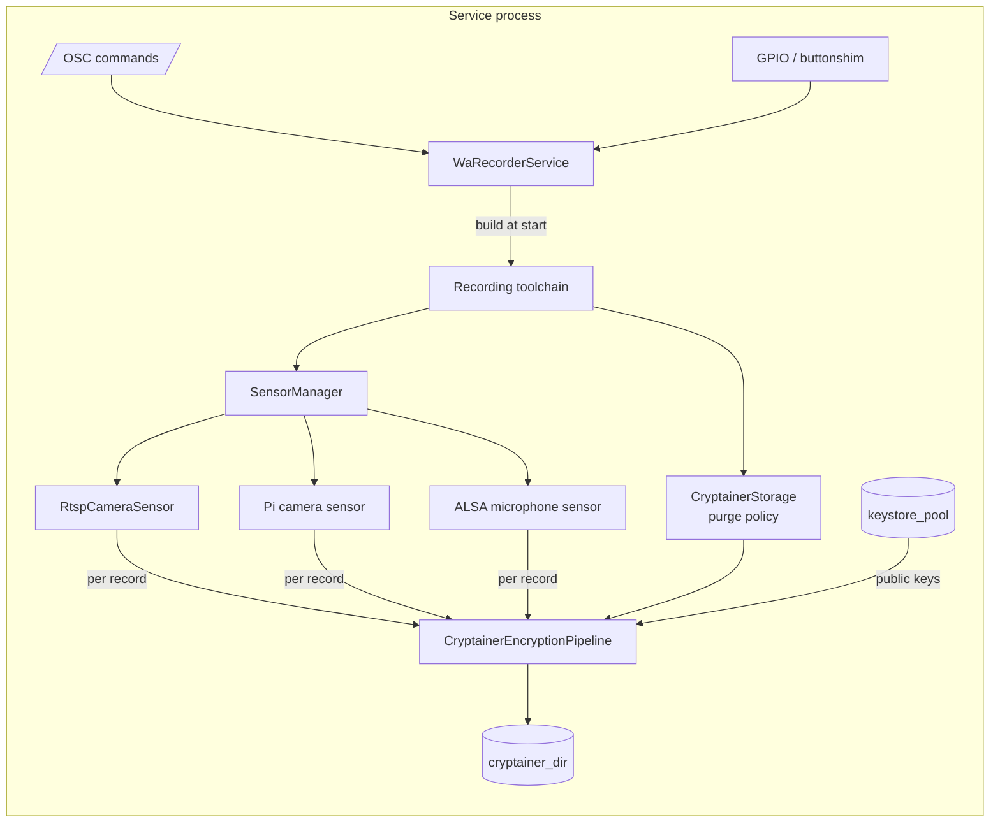
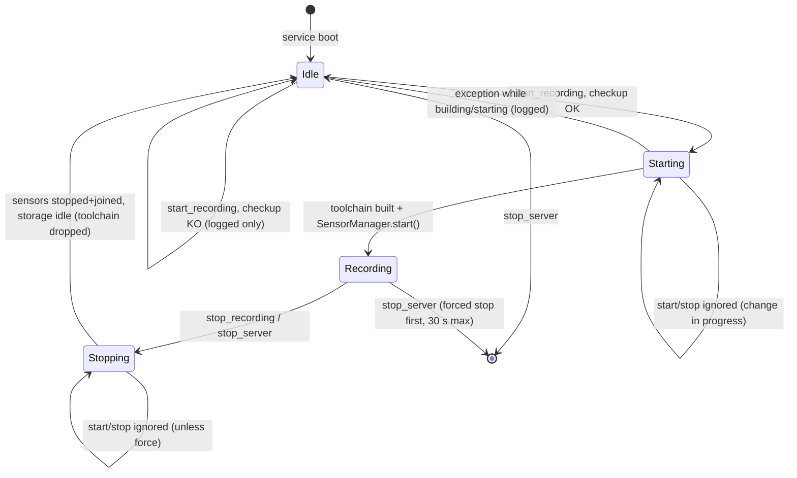
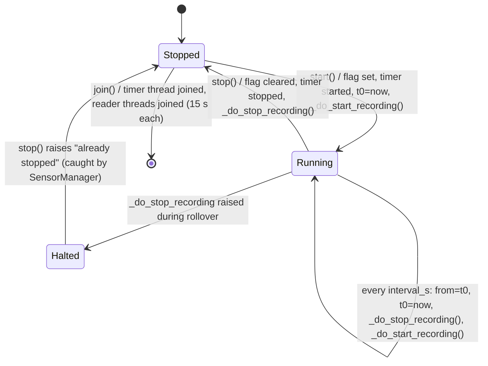
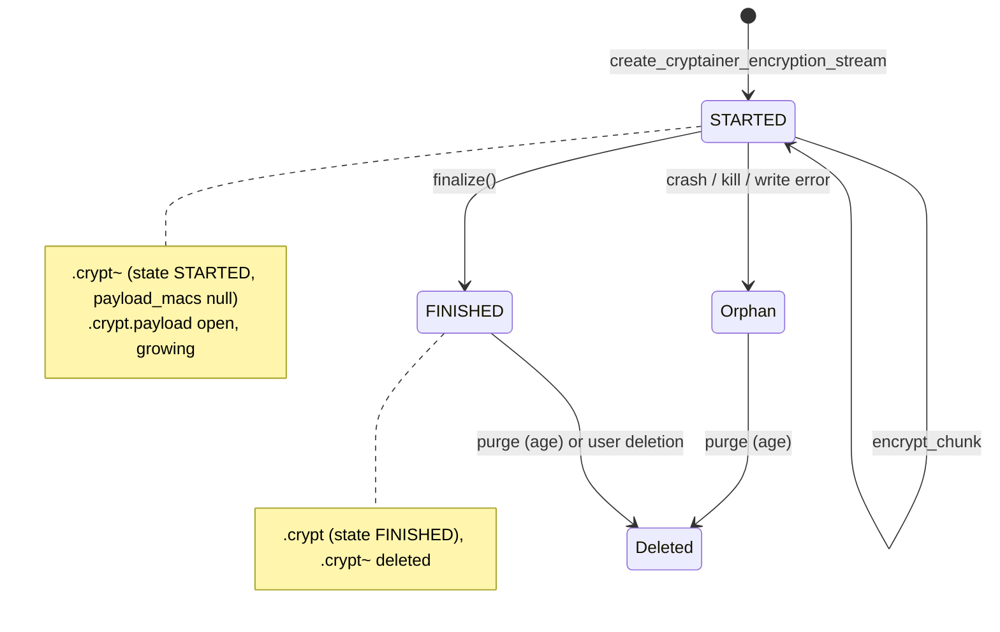

# 03 - Business logic specification

Witness Angel Recorder (repository `main` @ `bbf5d17`). This file covers the domain: what is recorded, how recordings become cryptainers, how the encryption configuration is built from the settings, how storage is kept within limits, and every GUI-side operation on key guardians, cryptainers and revelation requests. It also covers error handling, atomicity and security properties.

Sibling files:

- [01](01-architecture-and-platform.md): process model (GUI process + background service), the OSC transport between them, the settings table, storage roots per OS, permissions, build. Not repeated here; this file only states *what* each setting does to the logic.
- [02](02-ux-and-screens.md): screens, labels, dialogs, journeys. UI wording is not repeated here.
- [04](04-data-and-protocols.md): byte-level formats: cryptoconf and cryptainer JSON schema, Extended JSON, crypto parameters, on-disk layout and file names, keystore files, gateway JSON-RPC, exact ffmpeg / libcamera / arecord command lines, OSC message formats. This file says "see 04" for bytes.
- [05](05-open-issues.md): consolidated open issues. In this file, bugs link to their `OI-nn` item.

Normative tags (**MUST**, **SHOULD**, **MAY**, **INFO**) have the meaning given in the [README](README.md#normative-language); they follow the convention of the Authenticator specification (`AUTHSPEC/README.md`, "Normative language"). Untagged text describes current behaviour, which is the reference **except** where an `OI-nn` item says *fix* or *decide*. Bugs are never requirements. Behaviours that exist only as Python `assert`s are absent from optimised builds and are marked "debug builds only".

Citation prefixes and source revisions: [README](README.md#source-baseline-and-citation-prefixes). The Authenticator spec cites a *different* cryptolib branch (`poc/pure-python-crypto-utils`); `CRYPTO/` line numbers here are for `warecorder_stable` only.

---

## 1. Domain concepts

| Concept | Definition | Evidence |
|---|---|---|
| **Recorder** | A device (Raspberry Pi, desktop PC, Android phone) that continuously captures audio/video and stores it **only in encrypted form**, so that nobody, including the device owner, can view it without the agreement of a quorum of key guardians. | `REC/Readme.rst`, `CRYPTO/cryptainer.py:1712-1714` |
| **Background service** | The process that owns the sensors and writes cryptainers. It runs independently of the GUI (it may survive GUI closure). Commands arrive over OSC ([01](01-architecture-and-platform.md)). | `COMP/application/recorder_service.py:41-49` |
| **Recording toolchain** | The object graph built at each recording start: one `CryptainerStorage`, one `SensorManager` holding the enabled sensors, empty aggregator lists, no key pre-generator. Rebuilt from scratch at every start. | `REC/warecorder/warecorder_service.py:272-413`, `COMP/recording_toolchain.py:10-63` |
| **Sensor** | A periodic recorder of one media source (RTSP camera, Pi camera, microphone). Each sensor produces a continuous stream of *records*, each streamed into its own cryptainer. | `CRYPTO/sensor.py:294-545` |
| **Record / chunk** | The media captured by one sensor between two rollovers (one "recording period"). Exactly one cryptainer per record. "Chunk" also names the 2 MiB (0.2 MiB for audio) blocks read from the subprocess pipe and pushed into the encryption pipeline. | `CRYPTO/sensor.py:411`, `COMP/sensors/camera/raspberrypi_camera_microphone.py:234` |
| **Rollover** | The periodic restart of a sensor every `recording_duration_mn` minutes, which closes the current cryptainer and opens a new one. | `CRYPTO/sensor.py:357-368` |
| **Cryptainer** | The encrypted container of one record: a JSON file (`*.crypt`) holding the wrapped keys and metadata, plus an *offloaded* binary ciphertext file (`*.crypt.payload`). A cryptainer being written also has a temporary `*.crypt~` JSON file. | `CRYPTO/cryptainer.py:70-92`, `:1593-1666` |
| **Cryptoconf** | The encryption recipe (JSON-like tree) applied to every new cryptainer: payload cipher layers, key cipher layers, trustees, Shamir threshold. The recorder builds it from settings at each recording start (§5). | `REC/warecorder/warecorder_service.py:215-270` |
| **Symkey** | A random symmetric key (here AES-256-CBC key + IV) generated per cryptainer to encrypt the payload. | `CRYPTO/keygen.py:38-41`, `CRYPTO/cryptainer.py:500` |
| **Trustee** | An entity that holds a key used to wrap a symkey. Three types exist in the cryptolib: `local_keyfactory` (keys generated on the device itself), `authenticator` (keys imported from a key guardian's authenticator), `jsonrpc_api` (a remote key server). **The recorder only uses `authenticator` trustees** for encryption. | `CRYPTO/cryptainer.py:99-128`, `:312-329` |
| **Key guardian** | A person owning an *authenticator* (see `AUTHSPEC/03-business-logic.md` §1). The recorder encrypts symkey shards with the guardian's public keys. In the UI, "key guardian" = imported foreign keystore. | `REC/warecorder/warecorder_gui.py:195-196` |
| **Foreign keystore** | The local copy, on the recorder, of a key guardian's authenticator: metadata + public keys, and optionally the passphrase-protected private keys. Stored under `<keystore_pool>/foreign_keystores/keystore_<uid>/`. | `CRYPTO/keystore.py:686-771` |
| **Keystore pool** | The folder `<INTERNAL_APP_ROOT>/keystore_pool` holding one local keyfactory and N foreign keystores. | `COMP/default_settings.py:147-148`, `CRYPTO/keystore.py:686-707` |
| **Local keyfactory** | The device's own keystore (`keystore_pool/local_keyfactory`). On the recorder it only holds the *revelation response* keypairs created for claimant requests (§10.7). | `CRYPTO/keystore.py:702-707`, `COMP/screens/claimant_revelation_request_creation_form.py:92-103` |
| **Shared secret (Shamir)** | The symkey is split into *n* shards (one per selected key guardian) with a threshold *k*; any *k* shards rebuild it. | `CRYPTO/shared_secret.py:16-55`, `CRYPTO/cryptainer.py:583-614` |
| **Key guardian threshold** | Setting `keyguardian_threshold` = *k*. Must satisfy `0 < k <= n`. | `COMP/application/_common_runtime_support.py:112-121` |
| **Claimant / requestor** | The recorder itself when it asks guardians, through the gateway, to decrypt shards. Identified by the device UID `wa_device_uid`. | `COMP/application/_common_runtime_support.py:180-190` |
| **Revelation request** | A claimant's request to one guardian: description, one-time response public key, list of *symkey decryption requests* (one per shard ciphertext). Called "authorization request" in the UI. | `COMP/screens/claimant_revelation_request_creation_form.py:112-171`, `AUTHSPEC/03-business-logic.md` §3.3 |
| **Gateway** | The Witness Angel JSON-RPC registry. Used by the recorder to fetch public authenticators, submit and list revelation requests. Default URL in `REC/warecorder/config_defaults.ini:52`. | `COMP/application/_common_runtime_support.py:192-195` |
| **Checkup status** | The list of `[OK]`/`[KO]` lines produced by the status checkers; the global status gates recording start. | `COMP/application/_common_runtime_support.py:88-101` |
| **WIP recording marker** | The empty file `<INTERNAL_APP_ROOT>/recording_in_progress`. Present = "recording was wanted"; the service auto-starts recording when it finds it at boot. | `COMP/default_settings.py:133-134` |
| **Purge** | Automatic deletion of cryptainers that exceed the retention age (and, theoretically, quota/count). | `CRYPTO/cryptainer.py:2134-2183` |
| **Operation report** | The structured list of info/error entries produced by a decryption attempt. | `CRYPTO/cryptainer.py:762-866` |

---

## 2. Actors and trust model

| Actor | Role | Trusted for |
|---|---|---|
| Device owner / operator | Configures sensors, selects key guardians, starts/stops recording. | Choosing guardians. Not trusted to read recordings alone (unless he holds a quorum of guardian private keys and passphrases). |
| Key guardians | Hold authenticators (private keys + passphrase). Accept or reject revelation requests on the gateway (Authenticator app). | Not to collude below the threshold. |
| Gateway | Stores public authenticators, relays revelation requests and responses. | Availability only. It sees cryptainer names, UIDs and shard ciphertexts, but shard plaintexts only in re-encrypted form (§11). |
| Claimant (recorder GUI) | Requests decryption, receives responses, rebuilds symkeys, decrypts. | Holding the response private keys (unencrypted on disk, [OI-77](05-open-issues.md#oi-77)). |

---

## 3. Settings as seen by the logic

The settings table (keys, defaults, UI types, file location) is owned by [01](01-architecture-and-platform.md). This section only fixes the **parsing and validation** each setting gets, because both affect behaviour.

| Setting (`section/key`) | Parsed by | Rule / effect | Evidence |
|---|---|---|---|
| `sensor/enable_ip_camera` | `getboolean` | Adds the RTSP sensor (all platforms). | `REC/warecorder/warecorder_common_runtime.py:97-98` |
| `sensor/ip_camera_url` | `get().strip()` | Must parse with a non-empty URL scheme (any scheme). | `:100-101`, `COMP/application/_common_runtime_support.py:123-132` |
| `sensor/recording_duration_mn` | `getfloat` | Rollover period; `interval_s = value * 60`. Must be `> 0`. Fractions allowed. | `REC/warecorder/warecorder_common_runtime.py:103-104`, `REC/warecorder/warecorder_service.py:288` |
| `sensor/enable_local_camera`, `enable_local_microphone`, `compress_local_microphone_recording`, `enable_local_camera_microphone_muxing` | `getboolean` | Raspberry Pi only (ignored elsewhere, even if true). | `REC/warecorder/warecorder_service.py:306-401` |
| `sensor/local_camera_rotation` | `getint` | Picamera only. | `REC/warecorder/warecorder_common_runtime.py:85-86` |
| `sensor/live_preview_interval_s` | `getfloat` | Picamera only, and only if an LCD display is configured; else forced to 0. | `REC/warecorder/warecorder_service.py:341-343` |
| `sensor/*_parameters` (libcameravid video/audio, raspivid, arecord, ffmpeg_alsa, ffmpeg_rtsp) | `shlex.split` | Non-empty value **replaces** the default argument block (not appended). See 04 for defaults. | `REC/warecorder/warecorder_common_runtime.py:109-139` |
| `sensor/picamera_parameters` | `json.loads` | Must be a JSON object containing `resolution` (debug builds only). | `:118-124` |
| `sensor/*_output_format` | `get().strip()` (`ffmpeg_rtsp_output_format`: **not** stripped) | Empty = default (`mp4` RTSP, `wav` arecord, `mp3` ffmpeg-alsa). Becomes the record extension. | `:129-142` |
| `keyguardian/keyguardian_threshold` | `getint` | Raises `ValueError` on `"2.0"` or text ([OI-35](05-open-issues.md#oi-35)). | `:144-145` |
| `keyguardian/selected_keyguardians` | `split(",")`, strip, drop empties | Comma-separated keystore UID strings. Written by the GUI (§10.1). | `:147-150` |
| `storage/cryptainer_dir` | `get().strip()` | Empty → `<INTERNAL_APP_ROOT>/cryptainers`. Otherwise used as-is, never created by the app; must be an existing folder. | `:152-158` |
| `storage/max_cryptainer_age_day` | `getint` | Retention in days, must be `> 0`. | `:160-161` |
| `network/wagateway_url` | `get().strip()` | Gateway JSON-RPC endpoint. Not validated on the recorder (the checker `check_witness_angel_gateway_url` exists but is not in the recorder's checker list). | `:175-176`, `:212-222` |
| `peripheral/*` | various | Raspberry Pi displays/buttons (§6.8). | `REC/warecorder/warecorder_service.py:60-120` |

Configuration propagation:

- The GUI writes the INI file; the service **re-reads it at each `start_recording`** (`COMP/application/recorder_service.py:200`). Changes made while recording apply only at the next start. The GUI shows "Some configuration changes might only apply at next recording restart" on settings close (`COMP/application/recorder_gui.py:50-52`).
- The service reads defaults first, then the user file; a missing or corrupt user file is logged and ignored (`COMP/application/recorder_service.py:88-109`).

---

## 4. Recording service

### 4.1 Overview



The service object is a singleton per process (`WarecorderBackgroundServer`, `REC/warecorder/warecorder_service.py:42-58`). Its main thread only waits on a termination event (`COMP/application/recorder_service.py:277-283`); all work happens on:

- the OSC server thread (receives commands),
- one **single-worker executor** (`MONOTHREAD_POOL_EXECUTOR`, `COMP/utilities/__init__.py:26-28`) that runs start/stop of recording and peripheral notifications,
- per-sensor timer threads and per-subprocess reader threads (§6).

### 4.2 Service recording state machine

The service has no explicit state variable. The logical state is derived from two fields: `_status_change_in_progress` (bool) and `is_recording` = "toolchain exists **and** its `SensorManager` is running" (`COMP/application/recorder_service.py:209-211`).



| Logical state | `_status_change_in_progress` | `is_recording` | Broadcast value of `/receive_recording_state` |
|---|---|---|---|
| Idle | False | False | `False` |
| Starting / Stopping | True | any | `""` (empty string = "unknown/in progress", because OSC has no null) |
| Recording | False | True | `True` |

Evidence: `COMP/application/recorder_service.py:213-225`. The state is broadcast after every start/stop attempt, success or failure (`:186-188`, `:242-245`), and on each `/broadcast_recording_state` request.

"Recording" here means the `SensorManager` state flag is set. It does **not** mean data is flowing: a sensor whose start failed still counts as running ([OI-16](05-open-issues.md#oi-16)), and a sensor whose subprocess died stays "running" until the next rollover ([OI-17](05-open-issues.md#oi-17)).

### 4.3 Start recording

Triggers: OSC `/start_recording` from the GUI, the record button of a Pi display or buttonshim (§6.8), or service boot with the WIP marker present (§4.5).

```text
start_recording():                                   # OSC thread or GPIO thread
    if _status_change_in_progress: log; return       # no queueing
    touch WIP_RECORDING_MARKER                        # BEFORE the checks (OI-14)
    reload_config()                                   # defaults + user INI
    (ok, messages) = refresh_checkup_status()         # §4.3.1
    if not ok: log error "...configuration issues: <messages>"; return   # nothing sent to GUI (OI-15)
    _status_change_in_progress = True
    submit _offloaded_start_recording to MONOTHREAD executor

_offloaded_start_recording():                         # executor thread
    try:
        if is_recording: return
        if toolchain is None: toolchain = _build_recording_toolchain()   # §4.3.2
        start_recording_toolchain(toolchain)          # SensorManager.start()
        Android: startForeground(notification "Sensors are active")
    except Exception: log "Could not build recording toolchain"
    finally:
        _status_change_in_progress = False
        broadcast_recording_state()
```

Evidence: `COMP/application/recorder_service.py:153-207`, `COMP/recording_toolchain.py:10-23`.

On exception during build, `_recording_toolchain` stays `None` if the build failed, but stays **set** if `SensorManager.start()` raised after the build; `is_recording` then depends on whether `TaskRunnerStateMachineBase.start()` already flipped the flag (it flips first, `CRYPTO/utilities.py:283-287`). In practice `SensorManager.start()` never raises because each sensor start is wrapped (`CRYPTO/sensor.py:559-567`).

#### 4.3.1 Start preconditions (status checkers)

The same checker list runs in the GUI (to enable the button and show the checkup text) and in the service (authoritative, after reloading the config). All checkers run; the global status is the AND of all. Each produces one line prefixed `[OK] ` or `[KO] ` (`COMP/application/_common_runtime_support.py:88-101`). Order (`REC/warecorder/warecorder_common_runtime.py:212-222`):

| # | Checker | OK when | Evidence |
|---|---|---|---|
| 1 | `check_all_sensors` | See algorithm below. | `REC/warecorder/warecorder_common_runtime.py:181-210` |
| 2 | `check_keyguardian_counts(threshold, n)` with `n = len(_load_selected_keystore_uids())` | `0 < threshold <= n` | `COMP/application/_common_runtime_support.py:112-121` |
| 3 | `check_cryptainer_output_dir(get_cryptainer_dir())` | the path is an existing directory | `:105-110` |
| 4 | `check_recording_duration_mn` | `> 0` | `:145-150` |
| 5 | `check_max_cryptainer_age_day` | `> 0` | `:152-157` |
| 6 | `check_ffmpeg(4.3)` | `ffmpeg -version` runs and its version (regex `ffmpeg version .?(\d\.\d)`, first match, as float) `>= 4.3` | `:159-178`, `COMP/sensors/camera/rtsp_stream.py:21-38` |

```text
check_all_sensors():
    titles = []
    if IS_RASPBERRY_PI:
        if enable_local_camera: titles += "local camera"          # existence of the camera is NOT checked
        if enable_local_microphone:
            titles += "local microphone"
            if list_pulseaudio_microphone_names() == []: return (False, "Local microphone not found")
    if enable_ip_camera:
        titles += "IP camera <url>"
        (ok, msg) = check_camera_url(url)          # non-empty + urlparse().scheme non-empty
        if not ok: return (False, msg)
    if titles == []: return (False, "No sensors are enabled")
    return (True, "Sensors: " + ", ".join(titles))
```

`_load_selected_keystore_uids()` keeps, in config order, the UIDs of `selected_keyguardians` that exist in the keystore pool (`REC/warecorder/warecorder_common_runtime.py:49-67`). Unknown UIDs are silently dropped; a malformed UID string raises `ValueError` ([OI-36](05-open-issues.md#oi-36)).

Not checked at start (INFO): free disk space ([OI-44](05-open-issues.md#oi-44)), camera reachability ([OI-40](05-open-issues.md#oi-40)), existence of the local camera, validity of foreign keystores ([OI-51](05-open-issues.md#oi-51)), presence of keypairs in the selected keystores ([OI-54](05-open-issues.md#oi-54)), ffmpeg being actually needed ([OI-39](05-open-issues.md#oi-39)).

A reimplementation **MUST** refuse to start recording when checkers 2 or 3 fail (encrypting with no or an inconsistent guardian set would produce unusable or unencrypted data). It **SHOULD** report the refusal to the GUI ([OI-15](05-open-issues.md#oi-15)).

#### 4.3.2 Building the toolchain

```text
_build_recording_toolchain():
    dir = get_cryptainer_dir();  if not dir.is_dir(): raise RuntimeError
    storage = CryptainerStorage(dir,
                default_cryptoconf = _get_cryptoconf(),          # §5
                keystore_pool = filesystem_keystore_pool,
                max_workers = 1,
                max_cryptainer_age = timedelta(days=max_cryptainer_age_day))
                # max_cryptainer_quota / max_cryptainer_count: NOT set (OI-44)
    sensors = select_sensors(...)                                 # §6.1
    assert sensors                                                # debug builds only
    return {sensors_manager: SensorManager(sensors), data_aggregators: [], tarfile_aggregators: [],
            cryptainer_storage: storage, free_keys_generator_worker: None}
```

Evidence: `REC/warecorder/warecorder_service.py:272-413`. The cryptoconf is computed **once per recording session**, so the key chosen per guardian (§5) is the same for every cryptainer of the session.

### 4.4 Stop recording and service shutdown

```text
stop_recording(force=False):
    if _status_change_in_progress and not force: log; return
    unlink WIP_RECORDING_MARKER (ignore missing)
    _status_change_in_progress = True
    submit _offloaded_stop_recording

_offloaded_stop_recording():
    try:
        if not is_recording: return
        stop_recording_toolchain(toolchain)     # below
        Android: stopForeground(True)
    finally:
        toolchain = None                         # next start re-reads everything
        _status_change_in_progress = False
        broadcast_recording_state()

stop_recording_toolchain(t):
    t.sensors_manager.stop()     # each sensor: stop timer, terminate subprocess (§6.3)
    t.sensors_manager.join()     # each sensor: join timer thread, join reader threads (15 s each)
    (no data/tarfile aggregators in the recorder)
    t.cryptainer_storage.wait_for_idle_state()   # waits queued encryptions, then purge (§8)
```

Evidence: `COMP/application/recorder_service.py:227-260`, `COMP/recording_toolchain.py:26-63`.

`stop_server` (OSC `/stop_server`, sent by the GUI "Reset background service" action or on GUI exit when the service is not daemonized): if recording, it calls `stop_recording(force=True)` and waits for its future up to **30 s**, then stops the OSC server and releases the main thread (`COMP/application/recorder_service.py:262-275`). If the wait times out, the exception escapes before `osc.stop_all()` and the service does **not** exit ([OI-05](05-open-issues.md#oi-05)).

`force=True` bypasses the "change in progress" guard, so a stop can be queued behind a start still running in the single-worker executor; it then runs after it.

### 4.5 Autostart after restart

At service construction, if the WIP marker exists, `start_recording()` is called synchronously (`REC/warecorder/warecorder_service.py:51-57`). The marker is created at every start *request* and removed at every stop request (§4.3, §4.4), so a service killed while recording (Android activity closed, crash, power loss) resumes recording on its next launch. Because the marker is created before the checks, a start refused for configuration reasons also leaves it in place ([OI-14](05-open-issues.md#oi-14) (a)).

A reimplementation **MUST** keep this "resume recording after restart" behaviour (it is what makes the recorder robust to power cuts on a Pi), using the same marker file so that upgrades keep the state.

### 4.6 GUI side: polling and liveness of the service

```text
GUI on_start: disable record button; poll every service_querying_interval (2 s, x4 on Raspberry Pi); poll once now
poll():
    unanswered += 1
    if unanswered > 2: unanswered = -8; service_controller.start_service()     # (re)launch the service
    else: send /broadcast_recording_state
on /receive_recording_state(v):     # scheduled on UI thread
    unanswered = 0
    if v == "": button disabled                  # change in progress
    else: button enabled, pushed = v
record button toggled(want):
    disable button
    if want and not refresh_checkup_status().ok: snackbar "Configuration errors prevent recording"; return
    send /start_recording or /stop_recording
```

Evidence: `COMP/application/recorder_gui.py:32` (`service_querying_interval = 2 * WAIT_TIME_MULTIPLIER`), `:68-86`, `:102-145`; `WAIT_TIME_MULTIPLIER = 4` on Raspberry Pi (`COMP/default_settings.py:65`).

Consequences (INFO):

- The service is (re)started by the GUI on the 3rd consecutive unanswered poll (≈ 4 s after GUI start, since the first poll is immediate; ≈ 16 s on a Pi). The counter is then set to -8, so a further launch happens only on the 11th consecutive unanswered poll (22 s on desktop, 88 s on a Pi).
- The GUI never learns *why* a start failed; it only sees the state go back to `False` ([OI-15](05-open-issues.md#oi-15)).
- On GUI exit, the recorder keeps the service alive (`should_daemonize_service() → True`, `REC/warecorder/warecorder_gui.py:123-125`).

### 4.7 Error handling summary for the service

| Failure | Where caught | Visible effect |
|---|---|---|
| Config file missing/corrupt | `reload_config` | Defaults used, error logged. |
| Checkup KO | `start_recording` | Logged; state stays Idle; GUI unaware ([OI-15](05-open-issues.md#oi-15)). |
| Exception building the toolchain (invalid dir, `check_cryptoconf_sanity` failure, corrupted foreign keystore, `IndexError` in `random.choice`) | `_offloaded_start_recording` | Logged; state Idle. |
| A sensor fails to start (binary missing, camera busy) | `SensorManager.start` per sensor | Logged; recording reported ON ([OI-16](05-open-issues.md#oi-16)). |
| Subprocess exits mid-record (camera unreachable, ffmpeg crash) | none needed | Current cryptainer finalized early; nothing recorded until next rollover ([OI-17](05-open-issues.md#oi-17)). |
| New cryptainer cannot be created at rollover (disk full, keystore deleted) | `catch_and_log_exception` on the rollover task | Logged at every rollover; recording reported ON, nothing recorded ([OI-18](05-open-issues.md#oi-18)). |
| Unhandled exception in an OSC handler | `safe_catch_unhandled_exception` | Logged; OSC server keeps running. |

---

## 5. Building the cryptoconf

### 5.1 Algorithm

`_get_cryptoconf()` → `_build_cryptoconf(threshold, selected_uids, pool)` (`REC/warecorder/warecorder_service.py:215-270`):

```text
_build_cryptoconf(k, selected_uids, pool):
    all_meta = pool.get_all_foreign_keystore_metadata()        # loads EVERY foreign keystore; raises if any is invalid (OI-51)
    shards = []
    for uid_str in selected_uids:                              # config order, already filtered to existing keystores
        uid = UUID(uid_str)
        owner = all_meta[uid]["keystore_owner"]
        keys = pool.get_foreign_keystore(uid).list_keypair_identifiers()
                # all *_public_key.pem files, sorted by (keychain_uid, key_algo); private key presence irrelevant
        key = random.choice(keys)                              # IndexError if empty; non-crypto PRNG (OI-54)
        shards.append({
          "key_cipher_layers": [{
             "key_cipher_algo": key.key_algo,                  # "RSA_OAEP" for authenticators
             "keychain_uid":    key.keychain_uid,
             "key_cipher_trustee": {"trustee_type": "authenticator",
                                    "keystore_uid": uid,
                                    "keystore_owner": owner}}]})
    conf = {"payload_cipher_layers": [{
              "payload_cipher_algo": "AES_CBC",
              "key_cipher_layers": [{
                  "key_cipher_algo": "[SHARED_SECRET]",
                  "key_shared_secret_threshold": k,
                  "key_shared_secret_shards": shards}],
              "payload_signatures": []}]}
    check_cryptoconf_sanity(conf)        # schema: threshold int, 1 <= k <= len(shards), non-empty layer lists
    return conf
```

Properties:

| Property | Value | Normative |
|---|---|---|
| Payload cipher | One layer, `AES_CBC` (AES-256, random IV, PKCS#7-style padding; see 04). No MAC, no signature ([OI-55](05-open-issues.md#oi-55)). | A reimplementation **MUST** produce cryptainers decryptable by `wacryptolib` (any listed payload algo is). Keeping `AES_CBC` is **INFO**; see [OI-55](05-open-issues.md#oi-55) for the decision. |
| Symkey wrapping | One `[SHARED_SECRET]` layer, *n* shards (one per selected guardian, in selection order), threshold *k*. | **MUST** (this is the product's security promise). The shard order is **INFO** (readers take it from the cryptainer). |
| Shard wrapping | Each shard: one `RSA_OAEP` layer with one public key of that guardian's authenticator. | **MUST** use the guardian's public key, identified by `(keystore_uid, keychain_uid, key_algo)`. |
| Key choice per guardian | Uniformly random among the guardian's public keys, once per recording session. | **SHOULD** pick among encryption keys only; per-cryptainer choice is **MAY**. |
| Root `keychain_uid` | Absent from the cryptoconf, so a random uuid0 is generated per cryptainer; unused since every layer names its key. | **INFO** |
| Trustee `keystore_owner` | Copied from the foreign keystore metadata; used only for display at decryption time (it is ignored by `get_trustee_id`). | **SHOULD** keep (UI relies on it). |
| `cryptainer_metadata` | Always `None` for recorder cryptainers. | **INFO** |

With `k = 1`, Shamir degenerates: every shard equals the secret (pycryptodome `Shamir.split(1, n, s)` returns `n` copies of `s`), so any single guardian can decrypt. This is the intended meaning of "threshold 1" ([OI-56](05-open-issues.md#oi-56), info).

### 5.2 Example

The exact JSON produced for n = 2, k = 1 (real fixture, Extended JSON encoding) is in [04 §4.3](04-data-and-protocols.md#43-the-cryptoconf-built-by-the-recorder).

---

## 6. Sensors

### 6.1 Sensor selection

Executed in `_build_recording_toolchain` (`REC/warecorder/warecorder_service.py:287-401`). `interval_s = recording_duration_mn * 60` for every sensor.

```text
sensors = []
if enable_ip_camera: sensors += RtspCameraSensor(url, ffmpeg_rtsp_parameters, ffmpeg_rtsp_output_format, preview_image_path)
if IS_RASPBERRY_PI:
    legacy = ("supported=1 " in `vcgencmd get_camera`)          # False if the command fails with non-zero exit
    audio_done = False
    if enable_local_camera:
        if legacy:
            # raspivid branch is dead code ("if False")             (OI-26)
            sensors += RaspberryPicameraSensor(picamera_parameters, rotation,
                          live_preview_interval_s if LCD configured else 0)
        else:
            mic = None
            if muxing and enable_local_microphone:
                mic = list_pulseaudio_microphone_names()[0]; audio_done = True
            sensors += RaspberryLibcameraSensor(mic, libcameravid_video_parameters, libcameravid_audio_parameters)
    if enable_local_microphone and not audio_done:
        sensors += RaspberryAlsaMicrophoneSensor(compress, arecord_*, ffmpeg_alsa_*)
```

| Sensor | `sensor_name` | Platforms | Source | Record extension | LED colour (RGB) |
|---|---|---|---|---|---|
| `RtspCameraSensor` | `rtsp_camera` | all | `ffmpeg` reading RTSP, writing to stdout | `.` + output format (default `.mp4`) | (0,150,0) |
| `RaspberryLibcameraSensor` | `rpi_libcamera` | Pi, modern camera stack | `libcamera-vid` stdout | `.mpegts` with muxed audio, else `.h264` | none |
| `RaspberryPicameraSensor` | `picamera` | Pi, legacy camera stack | `picamera` Python library, in-process | `.` + `format` param (default `.h264`) | (0,0,180) |
| `RaspberryRaspividSensor` | `rpi_raspivid_camera` | never instantiated | `raspivid` | `.h264` | (0,0,150) |
| `RaspberryAlsaMicrophoneSensor` | `rpi_microphone` | Pi | `arecord` (default) or `ffmpeg -f alsa` (if compress) | `.wav` / `.mp3` (or configured) | (150,30,130) |

Evidence: `COMP/sensors/camera/rtsp_stream.py:41-63`, `COMP/sensors/camera/raspberrypi_camera_microphone.py:45-406`. Exact command lines and default parameter blocks are specified in 04.

Microphone discovery: PulseAudio sources whose name contains `input` (case-insensitive), in PulseAudio order (`COMP/sensors/camera/raspberrypi_camera_microphone.py:23-34`).

### 6.2 Periodic sensor lifecycle (rollover)

All sensors derive from `PeriodicSensorRestarter` (`CRYPTO/sensor.py:294-368`), a `PeriodicTaskHandler` with `runonstart=False` driven by a `multitimer` repeating timer.



Rules:

- `start`, `stop` and the rollover task are serialized per sensor by a lock (`@synchronized`, `CRYPTO/sensor.py:307-368`).
- The run flag is set **before** `_do_start_recording()`; if that raises, the sensor stays "running" ([OI-16](05-open-issues.md#oi-16)).
- At rollover the new record start time is taken **before** stopping the old subprocess, so the new cryptainer's name timestamp is slightly earlier than the actual start of capture. Between stop and restart there is a gap (subprocess termination: up to 10 s + 5 s, plus start-up).
- If stopping the old subprocess raises during a rollover, the sensor stops its own timer and run flag ("Unrecoverable error … aborting sensor operation") and the exception is logged (`CRYPTO/sensor.py:344-355`). Recording of that sensor ends silently.
- `_handle_post_stop_data` is never reached: stream-based sensors return `None` from `_do_stop_recording`.

### 6.3 Subprocess-based stream recorder

`PeriodicSubprocessStreamRecorder` (`CRYPTO/sensor.py:407-544`), used by RTSP, libcamera, raspivid and ALSA sensors.

```text
_do_start_recording():
    cmd = _build_subprocess_command_line()
    pipeline = storage.create_cryptainer_encryption_stream(
                  filename_base = "<t0 %Y%m%d_%H%M%S>_<sensor_name>_cryptainer<record_extension>",
                  cryptainer_metadata = None, dump_initial_cryptainer = True, (+ progress-notification class))   # §7
    [PreviewImageMixin hook: delete old preview image, then sensor-specific snapshot (no-op for RTSP)]
    try: proc = Popen(cmd, stdin=PIPE, stdout=PIPE, stderr=PIPE, bufsize = 6 * chunk_size)
    except OSError: log; pipeline.finalize(); return          # an EMPTY cryptainer is produced (OI-19)
    thread stdout_reader: loop { chunk = stdout.read(chunk_size); if empty: break; pipeline.encrypt_chunk(chunk) }
                          pipeline.finalize(); close stdout
    thread stderr_reader: log each stderr line at INFO
_do_stop_recording():
    if proc is None: warn; return
    if proc already exited: warn "Subprocess had already terminated"; return
    proc.terminate(); wait(10 s)
    on any error/timeout: proc.kill(); wait(5 s); still alive → RuntimeError
    (the stdout reader then finalizes the cryptainer asynchronously)
join(): for each reader thread still tracked: join(15 s); log CRITICAL if still alive
```

`chunk_size` = 2 MiB (`CRYPTO/sensor.py:411`), 0.2 MiB for the microphone (`COMP/sensors/camera/raspberrypi_camera_microphone.py:234`).

Finalization is owned by the **stdout reader thread** and happens when the subprocess closes its stdout (normal termination, crash, or kill). Hence:

- A record ends exactly when the subprocess ends, whatever the reason.
- Reader-thread exceptions (e.g. `OSError` on a full disk) are logged and the thread exits **without** finalizing: the cryptainer stays unfinished (`*.crypt~`) ([OI-44](05-open-issues.md#oi-44), [OI-46](05-open-issues.md#oi-46)).

### 6.4 RTSP camera

- Requires `ffmpeg >= 4.3` in `PATH` (checker 6). At each record start the version is re-read to choose the RTSP socket timeout option: `-timeout 5000000` for ffmpeg ≥ 5, `-stimeout 5000000` below (5 s, microseconds) (`COMP/sensors/camera/rtsp_stream.py:68-79`). If the version cannot be determined, no timeout option is passed.
- Default: video copied without re-encoding, **no audio** (`-an`), output fragmented ISMV/MP4 suitable for a non-seekable pipe; the preview image is written by the same ffmpeg process as a second output (first frame, 140 px wide, greyscale). Full command line: 04.
- `ffmpeg_rtsp_parameters` replaces the whole codec block (including `-an` and `-f ismv`); `ffmpeg_rtsp_output_format` replaces the `-f` of the piped output and the file extension.

Failure behaviour (INFO, current): if the camera is unreachable at start or the stream stalls for 5 s, ffmpeg exits; its cryptainer is finalized with whatever was received (possibly zero bytes of plaintext) and **nothing is recorded until the next rollover**. There is no retry, no backoff and no "camera lost" status ([OI-17](05-open-issues.md#oi-17)). A reimplementation **SHOULD** restart a dead capture subprocess with a bounded backoff (e.g. 1 s, 2 s, 4 s … capped at 60 s, reset after a successful minute), each restart opening a new cryptainer, and **SHOULD** surface "sensor not delivering data" in the status.

### 6.5 Raspberry Pi sensors

| Sensor | Behaviour |
|---|---|
| libcamera (`rpi_libcamera`) | `libcamera-vid --timeout 0 --nopreview` to stdout. With muxing: libav/mpegts container + AAC 16 kbit/s audio from the first PulseAudio microphone. Preview: separate `libcamera-jpeg` snapshot (140×104, 20 s timeout) **before** each record, failures only logged. No activity notifications. (`COMP/sensors/camera/raspberrypi_camera_microphone.py:112-223`) |
| picamera (`picamera`) | In-process. Start: create `PiCamera(resolution, framerate)`, set rotation, `start_recording(custom_output)` where the output object pushes each written buffer into the encryption pipeline and `flush()` finalizes it. Rollover uses `split_recording(new_output)` (no gap, the camera is not reopened). Preview snapshot taken from the video port at each start. Optional live preview (480×480 JPEG) pushed to the LCD every `live_preview_interval_s`. Defaults: 1280×720, 30 fps, h264, quality 25. (`:296-406`) |
| ALSA microphone (`rpi_microphone`) | `arecord -t wav -c 1 -r 22005 -f S16_LE` to stdout, or with compression `ffmpeg -f alsa -i default -ac 1 -acodec libmp3lame -ab 128k -f mp3 pipe:1`. (`:226-293`) |

Note: in the picamera output wrapper, every write/flush error is logged and swallowed (`:302-310`), so a failing encryption is invisible to the camera.

### 6.6 Preview image

- Path: `<INTERNAL_CACHE_DIR>/video_preview_image.jpg`, shared by GUI and service (`REC/warecorder/warecorder_common_runtime.py:28`).
- Deleted then regenerated at the start of each record by the sensor that owns it (RTSP: by ffmpeg itself; libcamera/raspivid: separate snapshot command; picamera: video-port capture). With several cameras, the last writer wins.
- The GUI reloads the image every 15 s, falling back to the app logo when absent (`REC/warecorder/warecorder_gui.py:64-76`, `:166-169`). The age of the image is not checked.
- The preview is **unencrypted** (a small greyscale thumbnail of the latest record). This is a deliberate privacy trade-off; a reimplementation **SHOULD** keep it small and greyscale, and **MAY** make it optional (decide in 05).

### 6.7 Activity notifications

- `RECORDING_PROGRESS`: every time more than 100 KiB of plaintext have been pushed into a sensor's pipeline since the last notification, the service is called with the sensor's LED colour (`COMP/sensors/camera/_camera_base.py:48-91`). On a Pi with buttonshim, the LED blinks 0.1 s in that colour. Otherwise ignored.
- `IMAGE_PREVIEW`: live picamera frames, displayed on an LCD if configured.
- Notifications are dispatched on the same single-worker executor as start/stop (`REC/warecorder/warecorder_service.py:122-143`), so LED blinks can delay a start/stop by a fraction of a second each ([OI-12](05-open-issues.md#oi-12), info).

### 6.8 Peripherals (Raspberry Pi only)

| Peripheral | Logic |
|---|---|
| E-paper display (`epaper_type`) | Button 1 toggles recording; button 2 refreshes a status page: recording ON/OFF, Wi-Fi/Ethernet up, local time, age of the preview image, age and size of the newest finished cryptainer (by name order), cryptainer count, free disk and RAM. Display is released after each refresh. (`REC/warecorder/warecorder_service.py:60-212`) |
| LCD display (`lcd_type`) | Button 1 toggles recording; receives live previews. Failure to initialise an LCD **aborts service start** (exception re-raised), unlike e-paper. |
| `enable_screen_buttons` | Enables the display buttons above. |
| Buttonshim (`enable_button_shim`) | Button A toggles recording; button B refreshes e-paper (if present); LED used for progress blinks. |

Toggle = `stop_recording()` if `is_recording`, else `start_recording()`, under a class-level lock.

### 6.9 Cryptolib sensor machinery present but unused by the recorder

`TarfileRecordAggregator`, `JsonDataAggregator`, `PeriodicValuePoller` and `PeriodicValueMixin` (`CRYPTO/sensor.py:27-291`) aggregate small records (JSON samples, files) into one in-memory tar per period, encrypted through `enqueue_file_for_encryption` (non-streaming, `<from>_to_<to>_cryptainer.tar` naming). The recorder toolchain passes empty aggregator lists (`REC/warecorder/warecorder_service.py:405-412`). A reimplementation **MAY** omit them; if it implements them, the stop order (sensors stop → join → flush JSON aggregators → finalize tar aggregators → wait for storage idle) **MUST** be kept (`COMP/recording_toolchain.py:26-63`).

---

## 7. Cryptainer lifecycle

### 7.1 Naming

| File | Name | Written |
|---|---|---|
| Unfinished JSON | `<base>.crypt~` | at record start |
| Payload ciphertext | `<base>.crypt.payload` | continuously during the record |
| Finished JSON | `<base>.crypt` | at finalization |

`<base>` = `<YYYYmmdd_HHMMSS>_<sensor_name>_cryptainer<record_extension>`, timestamp = record start in **UTC** (`CRYPTO/sensor.py:381-389`, `CRYPTO/cryptainer.py:72`). Example: `20240315_142000_rtsp_camera_cryptainer.mp4.crypt`. The payload of an unfinished cryptainer has the same name as for a finished one (the `~` is stripped, `CRYPTO/cryptainer.py:1835-1839`). Full layout in 04.

Two records of the same sensor starting in the same second get the same name; the second overwrites the first ([OI-20](05-open-issues.md#oi-20)).

### 7.2 State machine



### 7.3 Creation (`create_cryptainer_encryption_stream`)

Under the storage lock (`CRYPTO/cryptainer.py:2278-2310`):

1. `_purge_exceeding_cryptainers()` (§8) and drop completed executor futures.
2. Open `<base>.crypt.payload` for writing (truncating any existing file).
3. Build the cryptainer skeleton from the cryptoconf (`CRYPTO/cryptainer.py:467-530`):
   1. new `cryptainer_uid` (uuid0), `keychain_uid` (uuid0 since none in conf);
   2. for the payload layer: generate a symkey (`AES_CBC`: 32-byte key + 16-byte IV), serialise it to JSON bytes;
   3. wrap it: `[SHARED_SECRET]` → split into *n* Shamir shards (16-byte chunks, padded) → each shard `(index, bytes)` serialised → `RSA_OAEP` layer: fetch the guardian public key **from the local foreign keystore** (`ReadonlyTrusteeApi.fetch_public_key`, never generates keys) → encrypt `{"key_bytes": shard, "cryptainer_metadata": None}` → cipherdict JSON;
   4. `key_ciphertext` = JSON of `{"shard_ciphertexts": [...]}`;
   5. set `cryptainer_state = "STARTED"`, `payload_ciphertext_struct = {"ciphertext_location": "offloaded"}`, `cryptainer_metadata = None`, `payload_macs = None`.
4. Write the skeleton to `<base>.crypt~` ("savegame in case the stream is broken").
5. On any exception in 3-4, close the payload file and re-raise (the empty payload file stays on disk).

Byte formats (cipherdicts, Extended JSON, RSA-OAEP chunking): 04.

### 7.4 Streaming and finalization

- `encrypt_chunk(chunk)`: AES-CBC encrypts the block-aligned part, keeps the remainder (< 16 bytes) in memory, writes ciphertext to the payload file. No flush, no fsync (`CRYPTO/cipher.py:267-279`, `:381-386`).
- `finalize()`: pad and encrypt the remainder, write, flush, close the payload file; compute integrity tags (`payload_macs = {}` for AES_CBC, no digests since no signatures); set `cryptainer_state = "FINISHED"`; write `<base>.crypt` (full rewrite, plain `write`), then delete `<base>.crypt~` (`CRYPTO/cryptainer.py:1650-1657`).

Atomicity (INFO, current): the final JSON is written in place, not via temp+rename, and nothing is fsynced. A power loss between steps can leave: a `.crypt~` + payload (normal crash case), a truncated `.crypt`, or both `.crypt` and `.crypt~`. A reimplementation **SHOULD** write `<base>.crypt` via a temporary file + atomic rename and fsync the payload before it, and **MUST** keep the file names so that existing tools can read the results.

Orphans: unfinished cryptainers are never shown, never repaired and never decrypted by the app; they are only deleted by the age purge ([OI-46](05-open-issues.md#oi-46)). Their `.crypt~` contains the wrapped keys, so the data recorded until the crash is in principle recoverable (AES-CBC ciphertext prefix). Decide in 05 whether to offer recovery.

---

## 8. Storage policy

### 8.1 Purge algorithm

`CryptainerStorage._purge_exceeding_cryptainers()` (`CRYPTO/cryptainer.py:2134-2183`). Listing includes **finished and unfinished** cryptainers (`*.crypt` and `*.crypt~`).

```text
purge():
    deleted = 0
    if max_age is set:                                    # recorder: max_cryptainer_age_day days
        for c in list(finished=None, with_age):
            if c.age > max_age: delete(c); deleted += 1
    if max_quota is set:                                  # recorder: NOT set
        sort by (-age, name) descending  (oldest last); total = sum(size)
        while total > max_quota: pop oldest, delete, total -= size
    if max_count is set:                                  # recorder: NOT set
        delete the (count - max_count) oldest
    return deleted
age(c) = now_utc - datetime(name[:15], "%Y%m%d_%H%M%S", UTC)     # fallback: file mtime if the prefix does not parse
delete(c) = remove c (the .crypt or .crypt~ file), then remove its .crypt.payload if present
```

When the purge runs:

| Trigger | Storage instance | Effect |
|---|---|---|
| Each new cryptainer (record start and each rollover, per sensor) | recording toolchain | Age purge. |
| Recording stop (`wait_for_idle_state`) | recording toolchain | Age purge. |
| GUI operations | GUI storage, created **without** limits | Never purges. |
| Recorder idle | none | **No purge at all** ([OI-45](05-open-issues.md#oi-45)). |

Not covered: a payload file without any JSON (e.g. creation failed after opening it) is never listed and never purged (part of [OI-46](05-open-issues.md#oi-46)). Deletion errors (`os.remove`) propagate to the caller: during record start this aborts the new cryptainer ([OI-18](05-open-issues.md#oi-18)).

A reimplementation **MUST** delete cryptainers older than `max_cryptainer_age_day` (it is a legal retention promise), **SHOULD** also run the purge periodically when not recording, and **SHOULD** compute age from the name timestamp as today (so that copying files does not reset their age).

### 8.2 Disk space

No free-space check exists anywhere in the recording path; quota and count limits exist in the cryptolib but are not configured ([OI-44](05-open-issues.md#oi-44)). When the disk fills: writes fail in the reader thread, the cryptainer stays unfinished, subsequent rollovers fail to create cryptainers, and the GUI still shows "recording". A reimplementation **SHOULD**: check free space at start (refuse below a margin), configure a quota (e.g. a percentage of the partition), and report a "storage full" status. Free disk is only *displayed* on the e-paper status page (§6.8).

### 8.3 Time

- All names and ages use the system clock in UTC (`get_utc_now_date()`); there is no time synchronisation logic in the app.
- On the Raspberry Pi image, provisioning installs a DS1307 RTC and `chrony` configured as a local NTP server for the IP camera (`REC/ansible/configure-raspberrypi-system.yml:28-40`, `:70-77`). This is deployment, not app logic.
- A clock jump forward makes the age purge delete recent recordings; a jump backward keeps old ones and can produce names in the past ([OI-47](05-open-issues.md#oi-47)). A reimplementation **SHOULD** refuse to purge when the clock is obviously wrong (e.g. before the build date) and **MAY** warn when the clock is not synchronised.

---

## 9. Concurrency summary

| Thread | Work | Shared state |
|---|---|---|
| Service OSC thread | command handlers (`start_recording` runs the checkers synchronously, including `ffmpeg -version` and PulseAudio queries) | `_status_change_in_progress` (unlocked, [OI-11](05-open-issues.md#oi-11)) |
| Service executor (1 worker) | toolchain build/start/stop, LED and LCD notifications | toolchain |
| Per-sensor timer thread | rollover | sensor lock |
| Per-subprocess reader threads | encryption + finalization | the pipeline of that record only |
| `CryptainerStorage` executor (1 worker) | `enqueue_file_for_encryption` jobs (unused by the recorder's sensors) | storage lock |
| GUI UI thread | key guardian import/deletion, cryptainer listing/deletion, passphrase check (blocking, [OI-81](05-open-issues.md#oi-81)) | — |
| GUI executor (1 worker, with spinner) | decryption, revelation request submission and listing | — |

The GUI and the service touch the same folders (keystore pool, cryptainer dir, preview image, config file) without locks. Known races: deleting a guardian keystore while recording ([OI-53](05-open-issues.md#oi-53)); deleting a cryptainer while the service purges it (handled: `FileNotFoundError` ignored, `COMP/screens/cryptainer_storage_management.py:198-202`).

---

## 10. GUI-side operations

### 10.1 Key guardian selection

- The set of guardians used for encryption is the list of *checked* entries on the Key Guardians screen. It is held in memory by the screen (`selected_keystore_uids`, list of UID strings, order of checking) and saved to `keyguardian/selected_keyguardians` as a comma-separated string on **every** change (`REC/warecorder/warecorder_gui.py:204-207`).
- At GUI start the list is loaded from the config, filtered to existing keystores (`REC/warecorder/warecorder_gui.py:158-159`); the filtered list is written back only on the next change.
- The service reads the setting at the next `start_recording`. Selection changes during a recording do not affect it.
- The same checkboxes also select the keystores to delete ([OI-50](05-open-issues.md#oi-50)). Import auto-checks newly imported guardians; deletion unchecks deleted ones.

### 10.2 Import from USB authenticators

```text
choice_import_private_key_or_no_dialog():
    devices = list_available_authdevices()          # removable mounted partitions (Linux: pyudev+psutil; Windows: WMI; macOS: system_profiler; iOS: none)
    if none: toast "No connected authentication devices found"; return
    initialized = [d for d in devices if metadata file exists in d.authenticator_dir]   # <mount>/authenticator.keystore or legacy <mount>/.authenticator
    if none: toast "No initialized authentication devices found"; return
    ask "include private keys?" Yes / No / Cancel
import_keystores_from_usb(include_private_keys, initialized):     # UI thread
    new, updated, skipped = [], [], 0
    for d in initialized:
        try: tree = FilesystemKeystore(d.dir).export_to_keystore_tree(include_private_keys)   # validates schema
             drop "keystore_secret" and "keystore_passphrase_hint" from tree
        except SchemaValidationError: skipped += 1; continue
        try: was_update = pool.import_foreign_keystore_from_keystore_tree(tree)
        except ValidationError: skipped += 1; continue           # UID mismatch with existing folder
        (updated if was_update else new).append(metadata)
    auto-select the NEW ones (not the updated ones); toast "{new} new authenticators imported, {updated} updated, {skipped} skipped because corrupted"
    refresh list
```

Evidence: `COMP/screens/foreign_keystore_management.py:54-137`, `:315-344`, `CRYPTO/authdevice.py:13-47`, `CRYPTO/keystore.py:602-641`, `:765-771`.

Import semantics (`import_from_keystore_tree`):

- New keystore: create `foreign_keystores/keystore_<uid>/`, write `keystore_metadata.json` (without secret and hint), then each public key, then each private key if present.
- Existing keystore: metadata **unchanged**; missing keys added; existing key files kept as they are (assumed identical, never compared).
- `include_private_keys=True` with an authenticator lacking a private key raises `KeyDoesNotExist`, which is not caught by the loop and aborts the whole import with the generic error snackbar (`Abnormal error caught: KeyDoesNotExist`, [02 §1.5](02-ux-and-screens.md#15-feedback-primitives-framework-neutral-definitions)) (part of [OI-52](05-open-issues.md#oi-52)).
- Not atomic: a failure after the metadata write leaves a partial keystore ([OI-52](05-open-issues.md#oi-52)).

Security note: private keys copied this way stay passphrase-protected (PKCS#8, see `AUTHSPEC/04-data-and-protocols.md`), but having them on the recorder lets someone who also knows the passphrases decrypt locally, without the gateway. The choice is the operator's. A reimplementation **MUST** never import `keystore_secret` nor `keystore_passphrase_hint` (they are the guardian's gateway credential and a passphrase clue).

### 10.3 Import from the gateway

```text
import_key_storage_from_web_gateway(text):            # UI thread, blocking network call (OI-81)
    uid_str = text.strip().lower()
    try:
        uid = UUID(uid_str)
        pa = gateway.get_public_authenticator(keystore_uid=uid)
        tree = {keystore_type: "authenticator", keystore_format: "keystore_1.0",
                keystore_owner: pa.keystore_owner, keystore_uid: pa.keystore_uid,
                [keystore_creation_datetime: pa.keystore_creation_datetime if not null],
                keypairs: [{keychain_uid, key_algo, public_key: key_value, private_key: None} for pa.public_keys]}
        validate_keystore_tree(tree)
    except ValueError: "Failure" / "Badly formed hexadecimal UUID string"      # also catches other ValueErrors
    except ExistenceError: "Failure" / "Authenticator does not exist"
    else:
        pool.import_foreign_keystore_from_keystore_tree(tree)
        auto-select uid (even if it was an update); toast; refresh
        "Success" / "Authenticator has been imported successfully"
    dialog "Import result: <result>"
```

Evidence: `COMP/screens/foreign_keystore_management.py:297-415`. Other errors (network, JSON-RPC, schema) propagate to the generic error snackbar (`Abnormal error caught: <Class>`, [02 §1.5](02-ux-and-screens.md#15-feedback-primitives-framework-neutral-definitions)). Gateway call format: 04.

### 10.4 Key guardian deletion

```text
open_keystore_deletion_dialog(): if no selection: toast; else confirm "remove N key guardian(s)?"
delete_keystores(uids):
    for uid: rmtree(foreign_keystores/keystore_<uid>)   # errors logged, loop continues
    unselect all uids (saved to config), toast, refresh
```

Evidence: `COMP/screens/foreign_keystore_management.py:139-186`. Deleting a guardian makes every existing cryptainer that depends on it undecryptable *locally* with that guardian's private keys (if they were imported), but the gateway path (§10.7) still works since requests only need the ciphertexts. Deleting a guardian used by an ongoing recording breaks the next rollover ([OI-53](05-open-issues.md#oi-53)). A reimplementation **SHOULD** forbid deleting a guardian of the ongoing recording, or warn.

### 10.5 Key guardian list and details

Listing loads the metadata of **every** foreign keystore; one corrupted or partial keystore makes the whole list fail with the generic error snackbar (`Abnormal error caught: <Class>`, [02 §1.5](02-ux-and-screens.md#15-feedback-primitives-framework-neutral-definitions)) ([OI-51](05-open-issues.md#oi-51)). Entries are sorted by keystore UID. Details show the keystore type and each keypair (`keychain_uid`, `key_algo`, private key present or not) (`COMP/screens/foreign_keystore_management.py:188-295`).

### 10.6 Cryptainer listing, details, deletion

- Storage: the GUI builds a `CryptainerStorage` on the configured dir, or `None` if the dir is invalid, at start and after each settings change (`REC/warecorder/warecorder_gui.py:176-188`). With `None`, the list is empty and actions are no-ops.
- Listing: finished cryptainers only (`*.crypt`), sorted by name ascending then displayed **newest first**, numbered from 0; size = JSON + payload, or "missing" if deleted concurrently. The selection is pruned to still-existing names (`COMP/screens/cryptainer_storage_management.py:76-118`).
- Details: loads the cryptainer **including its payload** (the whole ciphertext is read just to show the header, a performance issue for large files, part of [OI-70](05-open-issues.md#oi-70)), lists the trustees of encryption layers sorted by owner name, and shows the cryptainer UID (`:129-164`). Errors are shown as the exception text.
- Deletion: confirmation dialog, then for each selected name remove `.crypt` and `.crypt.payload`; `FileNotFoundError` ignored; list refreshed (`:169-204`). No check that the cryptainer is not being written (unfinished ones are not listed, so this is safe).
- "Validation": the cryptolib offers `check_cryptainer_sanity` (schema check, `CRYPTO/cryptainer.py:2070-2074`), but no recorder screen calls it. Decryption performs format checks implicitly.

### 10.7 Decryption process

Entering the screen with N selected cryptainers runs two refreshes (`COMP/screens/cryptainer_decryption_process.kv:21-29`): the list of names, and the **trustee dependency status**.

#### 10.7.1 Trustee dependency status

```text
cryptainers = load each selected cryptainer (with payload)
deps = gather_trustee_dependencies(cryptainers)["encryption"]      # {trustee_id: (trustee_conf, [ {keychain_uid, key_algo} ... ])}
trustee_data = deps.values() sorted by keystore_owner             # kept for §10.8
for each authenticator trustee:
    found = foreign keystore exists locally
    owner = its metadata keystore_owner
    passphrase "set" if passphrase_mapper[trustee_id] non-empty
    missing = keypairs among the needed ones whose private key file is absent
    display: guardian label, FOUND/NOT FOUND, passphrase SET/NOT SET, missing private keys or "present"
```

Evidence: `COMP/screens/cryptainer_decryption_process.py:88-239`. `trustee_id` = `"authenticator@" + str(keystore_uid)` (`CRYPTO/cryptainer.py:114-128`).

#### 10.7.2 Passphrase entry

```text
check_passphrase(p):
    if [p] in passphrase_mapper.values(): "Already existing passphrase"      # this branch crashes (OI-66)
    else:
        result = Failure "Passphrase doesn't match any relevant private key"
        for each authenticator trustee of the selected cryptainers whose keystore exists locally and has keypairs:
            take the FIRST keypair (by keychain_uid order)
            if its private key exists and loads with p: passphrase_mapper[trustee_id] = [p]; result = Success "Passphrase recognized"
    refresh dependency status; dialog "Validation result: <result>"
```

Evidence: `COMP/screens/cryptainer_decryption_process.py:241-318`. The mapper is a class-level dict: passphrases stay in memory for the whole GUI session, across selections, and are never cleared ([OI-68](05-open-issues.md#oi-68)). One passphrase may be recorded for several guardians.

#### 10.7.3 Decryption algorithm

Runs on the GUI worker thread with a spinner (`:320-378`). For each selected cryptainer, sequentially:

```text
decrypt_one(name):
    c = load JSON + full payload into memory                                    (OI-70)
    report = OperationReport()
    # 1. remote pre-decrypted shards (always attempted: gateway url and device uid are always set)
    reqs = gateway.list_requestor_revelation_requests(requestor_uid = wa_device_uid)   # one call PER cryptainer (OI-72)
           on JSONRPCError/OSError: report WARNING "Unable to reach remote server <url>"; reqs = []
    pre = {}
    for r in reqs where r.revelation_request_status == "ACCEPTED":
        for s in r.symkey_decryption_requests where s.cryptainer_uid == c.cryptainer_uid and s.symkey_decryption_status == "DECRYPTED":
            priv = local_keyfactory.get_private_key(r.revelation_response_keychain_uid, r.revelation_response_key_algo)   # no passphrase
            struct = RSA_OAEP_decrypt(priv, json(s.symkey_decryption_response_data))     # errors → report ERROR, skipped
            pre.setdefault(s.symkey_decryption_request_data, struct)                     # key = the shard ciphertext bytes
    report INFO "…: <len(pre)> found"
    # 2. layers
    check c.cryptainer_format == "cryptainer_1.0" else raise ValueError
    for payload layer (reverse order; here only AES_CBC):
        key_bytes = unwrap(layer.key_ciphertext, layer.key_cipher_layers)
        if None: report ERROR "Failed symmetric decryption"; plaintext = None; break
        plaintext = AES_CBC_decrypt(json(key_bytes), ciphertext, macs = {})   # padding error → report ERROR, None
    return plaintext, report

unwrap through [SHARED_SECRET] (threshold k, n shards):
    shards = []
    for (ciphertext_i, shard_conf_i) in zip(shard_ciphertexts, shard_confs):     # order of the cryptoconf
        b = unwrap(ciphertext_i, shard_conf_i.key_cipher_layers)
        if b: shards.append(json(b)) else report WARNING "A previous error prevented decrypting this shard"
        if len(shards) == k: break
    if len(shards) < k: report "Shared secret failure! <k-len> valid shard(s) missing"; return None
    return Shamir.combine(shards)

unwrap through RSA_OAEP (authenticator trustee T, key (keychain_uid, algo)):
    if ciphertext in pre: return pre[ciphertext]["key_bytes"]                  # gateway answer wins
    passphrases = passphrase_mapper.get(trustee_id(T), []) + passphrase_mapper.get(None, [])
    keystore = pool.get_foreign_keystore(T.keystore_uid)        # missing → report "Trustee key storage not found"
    pem = keystore.get_private_key(...)                          # missing → report "Private key not found"
    key = first of [None] + passphrases that loads pem           # none → report "Could not load private key (missing passphrase?)"
    struct = RSA_OAEP_decrypt(key, cipherdict)                   # failure → report ERROR
    return struct["key_bytes"]                                   # embedded cryptainer_metadata ignored
```

Evidence: `CRYPTO/cryptainer.py:925-1375`, `:1424-1506`, `CRYPTO/trustee.py:87-104`, `:191-229`.

After each cryptainer:

- Success (`plaintext is not None`, even empty): write it to `<EXTERNAL_EXPORTS_DIR>/<cryptainer name without the final .crypt suffix>`, e.g. `…_rtsp_camera_cryptainer.mp4`, **overwriting** silently ([OI-70](05-open-issues.md#oi-70)).
- Any exception (unreadable JSON, missing payload, export dir unavailable): logged as critical, the cryptainer is **left out of the results** (not even counted as failed).
- The result screen shows "X out of Y container(s) have been decrypted" (Y = number of results, so excluding exceptions) and each operation report; each time the result screen is entered, every non-empty report is also written to `<EXTERNAL_EXPORTS_DIR>/<cryptainer name>_revelation_report_<UTC %Y%m%d_%H%M%S>.txt` ([OI-71](05-open-issues.md#oi-71)). If nothing was decrypted: snackbar "All decryptions failed, see reports". (`COMP/screens/cryptainer_decryption_result.py:36-104`)

Shard sources can be mixed: some shards from gateway answers, others from local private keys + passphrases. That is a **MUST** for a reimplementation (it is how a quorum is reached with partly local, partly remote guardians).

The check `verify_integrity_tags=True` has no effect for AES_CBC (no tags); a wrong key is detected only by a padding error, with high but not certain probability ([OI-55](05-open-issues.md#oi-55)).

### 10.8 Creating a revelation request (claimant)

Reached from the decryption screen; it uses the `trustee_data` computed there (§10.7.1).

Form (`COMP/screens/claimant_revelation_request_creation_form.py:52-90`): summary of selected cryptainers and gateway URL; one checkbox per **authenticator** trustee of `trustee_data` (other trustee types skipped).

Validation (`:173-187`), in order:

1. At least one authenticator checked, else toast "Please select authenticators".
2. Description stripped length ≥ 10 (`DESCRIPTION_MIN_LENGTH`), else toast.

Submission (worker thread, `:112-171`):

```text
requestor_uid = wa_device_uid                       # <INTERNAL_APP_ROOT>/.wa_device_uid.json, created (uuid0) at GUI start if missing (01 §7)
pairs = [(name, load(name, include_payload=False)) for selected]
per_trustee = gather_decryptable_symkeys(pairs)
    # for each cryptainer, each payload layer: follow the LAST key layer recursively;
    # for [SHARED_SECRET], zip shard ciphertexts with shard confs; for an asymmetric last layer, emit
    # {cryptainer_name, cryptainer_uid, cryptainer_metadata, symkey_decryption_request_data = ciphertext, keychain_uid, key_algo}
    # grouped by trustee_id
(resp_uid, "RSA_OAEP", resp_pub) = new RSA keypair in local_keyfactory, private key NOT passphrase-protected      (OI-77)
ok = 0; errors = []
for (trustee, requests) in per_trustee where trustee.type == authenticator and trustee.keystore_uid is checked:
    try: gateway.submit_revelation_request(authenticator_keystore_uid, revelation_requestor_uid, revelation_request_description,
                                           revelation_response_public_key = resp_pub, revelation_response_keychain_uid = resp_uid,
                                           revelation_response_key_algo = "RSA_OAEP", symkey_decryption_requests = requests)
         ok += 1
    except KeystoreDoesNotExist: errors += "Authenticator <short uid> does not exist in sql storage"
    except KeyDoesNotExist:      errors += "Public key needed does not exist in key storage in <short uid> authenticator"
    # any other exception aborts the loop → generic error snackbar, earlier successes unreported (OI-74)
dialog "Successful requests: ok out of <checked count>" (+ "Error Report" if ok != checked); then go to the Containers screen
```

Rules:

- One revelation request **per guardian**, all sharing **one** response keypair per submission, covering all selected cryptainers.
- Only ciphertexts of authenticator trustees are sent. Guardians not checked receive nothing.
- The description, the cryptainer names and UIDs, and the shard ciphertexts are disclosed to the gateway (§11).
- Wire format and gateway-side validation: 04 and `AUTHSPEC/04-data-and-protocols.md`.

### 10.9 Listing revelation requests

```text
list_requestor_revelation_requests():          # worker thread
    try: reqs = gateway.list_requestor_revelation_requests(revelation_requestor_uid = wa_device_uid)
    except (JSONRPCError, OSError): reqs = None → snackbar "Network error, please check the gateway url"
group: for each request r, each symkey request s: per_cryptainer[s.cryptainer_uid] += (r without its list) + {symkey_decryption_request: s}
display: cryptainers sorted by cryptainer_uid DESC (uuid0 ≈ creation time), label = cryptainer_name of the first entry + short uid,
         sub-label "Authorization requests: <count of entries>"
detail (per cryptainer): one entry per (request, shard): description, created_at, guardian owner, request status
         (PENDING / ACCEPTED / REJECTED), guardian key, local response key, shard status (PENDING / DECRYPTED / …)
```

Evidence: `COMP/screens/claimant_revelation_request_management.py:33-239`, `COMP/screens/claimant_revelation_request_detail.py:33-137`. The list is fetched automatically only the first time the screen is shown in a session; afterwards only via Refresh ([OI-76](05-open-issues.md#oi-76)). The list includes requests for cryptainers deleted since; nothing reconciles them with local storage. Using the answers is done by the decryption process (§10.7.3), not here.

---

## 11. Security assumptions and properties

| # | Property / assumption | Status |
|---|---|---|
| S1 | Media never touches the disk in clear on the recorder: subprocess output goes through a pipe into the encryptor. Exception: the preview thumbnail (§6.6). | Holds. **MUST** keep. |
| S2 | Confidentiality: without *k* guardian shards, the symkey cannot be rebuilt. Each shard is RSA-OAEP-encrypted under a guardian public key. | Holds, assuming the imported public keys are authentic. **MUST**. |
| S3 | Authenticity of guardian public keys rests on the import channel: USB device (physical trust) or gateway lookup by UID (trust in the gateway/TLS). No fingerprint is shown to the operator. | Assumption. |
| S4 | Integrity of recordings: **none**. AES-CBC without MAC, no signatures, metadata unauthenticated (`CRYPTO/cryptainer.py:1756-1767`). A tampered payload decrypts to altered media or fails on padding. | [OI-55](05-open-issues.md#oi-55) (decide). |
| S5 | The symkey exists in clear only in the service process memory during a record (and the payload layer's key dict). It is never written to disk. | Holds. **MUST**. |
| S6 | Imported private keys (optional) are passphrase-protected; passphrases are typed in the GUI, kept in memory for the session ([OI-68](05-open-issues.md#oi-68)), never written to disk or logs. | Holds except retention. |
| S7 | Response private keys for revelation requests are stored **unencrypted** in `local_keyfactory`; anyone with file access to the recorder can decrypt gateway answers addressed to it. | [OI-77](05-open-issues.md#oi-77). |
| S8 | Decrypted output is written in clear to the external exports folder, which may be readable by other apps (Android external storage). | [OI-70](05-open-issues.md#oi-70). |
| S9 | Metadata leaks to the gateway: cryptainer names (contain timestamp, sensor, format), UIDs, request description. | INFO ([OI-57](05-open-issues.md#oi-57)). |
| S10 | `keystore_secret` and `keystore_passphrase_hint` of authenticators are never copied to the recorder. | Holds. **MUST**. |
| S11 | Retention: data older than `max_cryptainer_age_day` is deleted only while recording ([OI-45](05-open-issues.md#oi-45)) and depends on the clock ([OI-47](05-open-issues.md#oi-47)). | Partial. |
| S12 | Key choice per guardian uses Python's non-cryptographic `random`. Not a confidentiality issue (the key is public) but predictable. | [OI-54](05-open-issues.md#oi-54), info. |

---

## 12. Reuse with the shared Flet package

The Authenticator reimplementation already provides, in `waflet_components` (`AUTHSPEC/../flet_reimplementation/waflet_components/`), pieces the Recorder reimplementation **SHOULD** reuse rather than rewrite:

| Need here | Existing piece |
|---|---|
| Storage roots per OS, writable-folder checks | `storage.py`: `compute_storage_roots`, `bootstrap_storage`, `is_folder_writable` |
| USB authdevice discovery (§10.2) | `storage.py`: `list_usb_authdevices` |
| Atomic key file writes (fixes part of [OI-52](05-open-issues.md#oi-52)) | `authenticator_services.py`: `AtomicFilesystemKeystore` |
| Gateway proxy with status-slug error mapping (§10.3, §10.8, §10.9) | `authenticator_services.py`: `get_gateway_proxy` |
| Worker-thread + spinner pattern, error-to-message mapping | `app_base.py`, `ServiceError` hierarchy in `authenticator_services.py` |
| Formatting of authenticator / keypair labels, i18n | `formatting.py`, `i18n.py`, `locale_fr.py` |

Recorder-specific logic (sensors, cryptoconf builder, purge scheduling, claimant flows) has no counterpart yet; it **SHOULD** be added as GUI-free modules (e.g. `recorder_services.py`) in the same style: plain functions raising typed errors, callable from the Flet GUI or from the background service. The cryptographic operations **MUST** keep going through `wacryptolib` so that cryptainers stay interoperable. The branch is `warecorder_stable` ([OI-100](05-open-issues.md#oi-100), decided), **not** the Authenticator's `poc/pure-python-crypto-utils` as is, because it cannot decrypt 1.0 cryptainers and writes cryptainers that `warecorder_stable` cannot decrypt ([04 §4.5](04-data-and-protocols.md#45-naming-history-payload_signatures-vs-payload_ciphertext_signatures)); the acceptance test of [04 §14.1](04-data-and-protocols.md#141-cryptolib-acceptance-test) **MUST** pass. The reimplementation stays in Python ([OI-101](05-open-issues.md#oi-101), decided).

---

## 13. Open issues

All open issues raised by this file are in [05](05-open-issues.md), with their final `OI-nn` IDs and dispositions.
